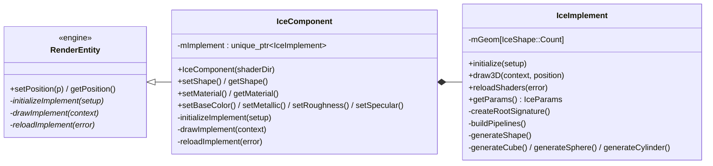
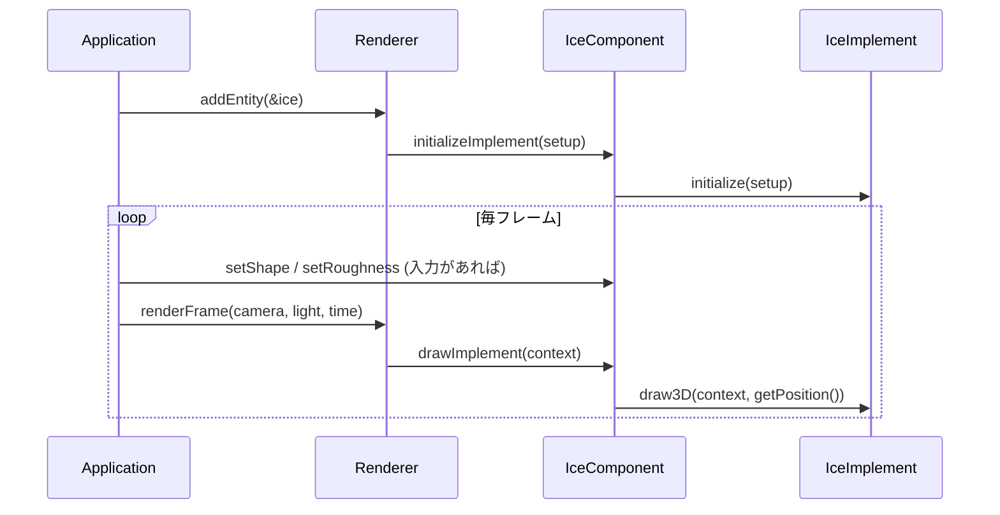

# 03. 氷の部品とプリミティブ (IceComponent / IceImplement / IceGenerate)

氷の部品を `src/ice/` に作る。 この段では **プリミティブ (キューブ・球・円柱)** を作って `mGeom` に入れ、 切り替えて描く。
面の質感は、 金属・粗さの流儀の **PBR** (物理ベースのシェーディング) で、 セッターから値を変えられる。

この段の絵: 床の上に淡い水色のキューブ (1 / 2 / 3 / Tab で球・円柱に切り替え)。 M で金属、 `[` `]` で粗さが変わる。

---

## 1. 3 つのファイルの分け方



| ファイル | 中身 | なぜ分けるか |
| --- | --- | --- |
| `IceComponent.h / .cpp` | 外から使う窓口。 エンジンの `RenderEntity` を継承。 公開するのは **形とマテリアルのセッター・ゲッターだけ** (位置は `RenderEntity` から) | 使う側が読むのはこのヘッダーだけ。 DirectX 12 の細かい物を見せない |
| `IceImplement.h / .cpp` | `initialize` / `draw3D` / `reloadShaders`、 ルートシグネチャ・PSO | 描く仕組みの全部 |
| `IceGenerate.cpp` | `generateShape` と各形 | 形づくりは長くなるので、 `IceImplement` のメンバー関数のうち形の分だけを別のファイルに書く |

### RenderEntity を継承する

`RenderEntity` はエンジンの 「画面に描く物」 の基底クラス。 継承すると:

- **位置** (`setPosition` / `getPosition`) を自動で持つ。 だから `IceComponent` には位置のセッター・ゲッターを書かない。
- `Renderer::addEntity` で登録でき、 Renderer が次の 3 つの仮想関数を呼ぶ。

| 仮想関数 | いつ | IceComponent での中身 |
| --- | --- | --- |
| `initializeImplement(setup)` | 登録のとき 1 回 | `mImplement->initialize(setup)` |
| `drawImplement(context)` | 毎フレーム、 背景の後 | `mImplement->draw3D(context, getPosition())` |
| `reloadImplement(error)` | R キー | `mImplement->reloadShaders(error)` |

```cpp
class RenderEntity {
public:
    void setPosition(const Float3& position);
    const Float3& getPosition() const;
private:
    friend class Renderer;  // 下の仮想関数を呼べるのは Renderer だけ
    virtual void initializeImplement(const RenderSetup& setup) = 0;
    virtual void drawImplement(const DrawContext& context) = 0;
    virtual bool reloadImplement(std::string& error) = 0;
    Float3 mPosition;
};
```

**仮想関数を private にする理由**: ゲームの側が `ice.drawImplement(...)` のように勝手に呼べないようにするため。
C++ では、 private の仮想関数でも派生クラスで override でき、 基底クラスの `friend` (ここでは `Renderer`) から呼べる。
`IceComponent` も private のまま override するので、 `IceComponent` を使う側から見えるのはセッター・ゲッターだけになる。

### 実装を private に隠す (pImpl)

```cpp
class IceComponent : public RenderEntity {
public:
    explicit IceComponent(const std::wstring& shaderDir);
    ~IceComponent() override;
    // 形とマテリアルのセッター・ゲッターだけ
    ...
private:
    void initializeImplement(const RenderSetup& setup) override;
    void drawImplement(const DrawContext& context) override;
    bool reloadImplement(std::string& error) override;

    std::unique_ptr<IceImplement> mImplement;
};
```

- `IceComponent.h` は `IceImplement` を **前方宣言** (`class IceImplement;`) するだけで、 中身を `#include` しない。
  使う側が `IceComponent.h` を読んでも、 `d3d12.h` の細かい型 (バッファ・PSO) は見えない。
- `std::unique_ptr` で持つと、 `IceComponent` が壊れるときに `IceImplement` も自動で壊れる。
- デストラクターを `.cpp` に書く (`IceComponent::~IceComponent() = default;`) のは、
  `unique_ptr` が `IceImplement` を壊すには `IceImplement` の中身 (完全な型) が要るため。 ヘッダーで書くとコンパイルできない。

### 登録と 1 フレームの流れ

```cpp
// Application のコンストラクター
mIce.setPosition({ 0.0f, 0.0f, 0.0f });  // RenderEntity のセッター
mRenderer.addEntity(&mIce);              // ここで initializeImplement → IceImplement::initialize

// Application のデストラクター (mIce が壊れる前に外す)
mRenderer.removeEntity(&mIce);
```



- Renderer から見えるのは `RenderEntity` だけなので、 Renderer は氷のことを知らない。
- 壊すときは、 `mIce` が壊れる **前に** 一覧から外す。 外さないと、 Renderer が壊れた物を描こうとする。
- 自分のエンジンでは、 `RenderEntity` と `addEntity` が、 エンジンの 「描く物」 の基底クラスと登録の仕組みに当たる。

### セッター・ゲッター

形とマテリアルは `IceImplement` の `IceParams` に置き、 `IceComponent` のセッター・ゲッターが読み書きする。
マテリアルは `Material` 構造体 (エンジンの `Material.h`) にまとめてある。

```cpp
struct Material {
    Float4 baseColor = { 1.0f, 1.0f, 1.0f, 1.0f };  // 下地の色 (RGBA)
    float metallic = 0.0f;
    float roughness = 0.5f;
    float specular = 0.5f;
};
```

まとめて変える `setMaterial` と、 1 つずつ変える `setBaseColor` / `setMetallic` / `setRoughness` / `setSpecular` がある。
どれも最後は `setMaterial` を通り、 **範囲に収めてから** 入れる。

```cpp
void IceComponent::setRoughness(float roughness)
{
    Material m = getMaterial();
    m.roughness = roughness;
    setMaterial(m);  // ここで clampMaterial を通す
}
```

**セッターで範囲に収める** のは、 シェーダーで困る値 (割り算の 0 や、 配列の外) を入口で止めるため。

| セッター | 範囲 | 理由 |
| --- | --- | --- |
| `setShape` | `Count` より小さい | `mGeom` の添え字になる |
| `setMetallic` / `setSpecular` | 0〜1 | 割合 |
| `setRoughness` | 0.04〜1 | 0 だと GGX の分布が 1 点に集まり、 ハイライトが消える (後述) |
| `setBaseColor` | 各 0〜1 | 反射率は 1 を超えない |

---

## 2. draw3D と generateShape

```cpp
void IceImplement::draw3D(const DrawContext& context, const Float3& position)
{
    // 1. 最初の 1 回だけ、 全部の形を作って mGeom に入れる (IceGenerate.cpp)
    if (!mGenerated) {
        generateShape();
        mGenerated = true;
    }
    // 2. 今の形を選ぶ。 形の種類がそのまま mGeom の添え字になる
    const IceGeometry& geom = mGeom[static_cast<int>(mParams.shape)];
    ...
}
```

```cpp
void IceImplement::generateShape()
{
    for (int i = 0; i < static_cast<int>(IceShape::Count); ++i) {
        switch (static_cast<IceShape>(i)) {
        case IceShape::Cube: mGeom[i] = generateCube(); break;
        case IceShape::Sphere: mGeom[i] = generateSphere(); break;
        case IceShape::Cylinder: mGeom[i] = generateCylinder(); break;
        default: break;
        }
    }
}
```

- `IceShape` の最後の `Count` は 「形の数」。 `for` で 0 から `Count - 1` まで回すと、 全部の形を 1 回ずつ作れる。
- 形の種類 = `mGeom` の添え字 なので、 描くときは `mGeom[今の形]` を選ぶだけ。 **切り替えのときに作り直さない** ので一瞬で済む。
- 形を足す手順: ① `IceShape` に種類を足す (`Count` の前) ② `generateXxx` を書く ③ `switch` に `case` を足す。

---

## 3. 形づくりの約束

| 約束 | 内容 | 理由 |
| --- | --- | --- |
| 原点 | 物体の底の真ん中 | `setPosition` の y を 0 にすると床に載る |
| 三角形の向き | **外から見て反時計回り** | パイプラインで反時計回りを表とし、 裏 (内側を向く面) を描かない (カリング) |
| UV | 左上 (0, 0)、 右下 (1, 1) | DirectX のテクスチャの座標と同じ |
| 頂点 | 位置・法線・UV (32 バイト) | `IceVertex` と入力レイアウトと HLSL の `VSInput` を同じ並びにする |

### 反時計回りの確かめ方 (外積)

三角形 $(p_0, p_1, p_2)$ の向きは、 2 辺の外積で分かる。

$$
\mathbf{n}_{tri} = (p_1 - p_0) \times (p_2 - p_0)
$$

右手の法則で、 $\mathbf{n}_{tri}$ が **外を向けば、 外から見て反時計回り**。 下の 3 つの形は、 どれもこれを満たすように並べてある。

---

## 4. 立方体 (generateCube)

面ごとに頂点を 4 つ作る。 **角の頂点を面どうしで共有しない** のは、 1 つの角でも面によって法線と UV が違うため (共有すると角で法線が平均されて丸く見える)。

各面を 3 本の向きで決める: 外向きの法線 $\mathbf{n}$、 面の右 $\mathbf{u}$、 面の上 $\mathbf{v}$。 **$\mathbf{u} \times \mathbf{v} = \mathbf{n}$ になるように選ぶ** のがこつ。

```cpp
const Face faces[6] = {
    { { 1, 0, 0 }, { 0, 0, -1 }, { 0, 1, 0 } },   // +x (右)
    { { -1, 0, 0 }, { 0, 0, 1 }, { 0, 1, 0 } },   // -x (左)
    { { 0, 1, 0 }, { 1, 0, 0 }, { 0, 0, -1 } },   // +y (上)
    ...
};
```

例: +x の面は $\mathbf{u} = (0, 0, -1)$, $\mathbf{v} = (0, 1, 0)$。
$\mathbf{u} \times \mathbf{v} = (0 \cdot 0 - (-1) \cdot 1,\ (-1) \cdot 0 - 0 \cdot 0,\ 0 \cdot 1 - 0 \cdot 0) = (1, 0, 0) = \mathbf{n}$。

面の中心 $c = \text{center} + \mathbf{n} h$ から、 4 つの角を作る ($h$ は半分の大きさ)。

```
  3 ---- 2      頂点 0 = c − u·h − v·h   UV (0, 1)
  |      |      頂点 1 = c + u·h − v·h   UV (1, 1)
  0 ---- 1      頂点 2 = c + u·h + v·h   UV (1, 0)
                頂点 3 = c − u·h + v·h   UV (0, 0)
```

三角形は `0-1-2` と `0-2-3`。 `0-1-2` の外積は
$(p_1 - p_0) \times (p_2 - p_0) = (2h\mathbf{u}) \times (2h\mathbf{u} + 2h\mathbf{v}) = 4h^2 (\mathbf{u} \times \mathbf{v}) = 4h^2 \mathbf{n}$
で外を向くので、 反時計回り。

---

## 5. 球 (generateSphere)

地球儀のように、 緯度と経度の格子で作る。

| 角度 | 範囲 | 意味 |
| --- | --- | --- |
| $\phi$ | 0 〜 π | 真上からの角度 (緯度の代わり)。 `kSphereStacks` 等分 |
| $\theta$ | 0 〜 2π | 水平にぐるりと 1 周 (経度)。 `kSphereSlices` 等分 |

球の上の向き (長さ 1) は

$$
\mathbf{n}(\phi, \theta) = (\sin\phi \sin\theta,\ \cos\phi,\ \sin\phi \cos\theta)
$$

- $\phi = 0$ で真上 $(0, 1, 0)$、 $\phi = \pi$ で真下。
- $\theta = 0$ で +z、 $\theta$ が増えると +x の側へ回る。
- **球の法線はこの向きそのもの**。 位置は $\text{center} + r\,\mathbf{n}$。
- UV は $(\theta / 2\pi,\ \phi / \pi)$。

経度 0 と 2π の点は同じ位置だが、 UV の u が 0 と 1 で違うので **別の頂点にする**。 共有すると、 継ぎ目の三角形で u が 1 → 0 に戻り、 模様が 1 周分つぶれる。

格子の四角形を三角形 2 枚に:

```
  a ---- b     a = (i, j)        b = (i, j + 1)      ← 上 (φ が小さい)
  |      |
  c ---- d     c = (i + 1, j)    d = (i + 1, j + 1)  ← 下
```

外から見ると、 $\theta$ が増える向き (a → b) は右、 $\phi$ が増える向き (a → c) は下。
`c-d-b` は 「左下 → 右下 → 右上」 なので反時計回り。 `c-b-a` も同じ。

極 (i = 0 と i = stacks) では a と b が同じ位置になり、 片方の三角形の面積が 0 になる。 面積 0 の三角形は画素を塗らないので害は無い。

---

## 6. 円柱 (generateCylinder)

側面・上のふた・下のふたの 3 つに分ける。 **縁の頂点は側面用とふた用で別にする** (縁で法線が真横から真上へ急に変わるため。 共有すると縁が丸く見える)。

### 側面

上の輪 (y = h) と下の輪 (y = 0) を、 球と同じ並べ方の四角形でつなぐ。 法線は真横 $(\sin\theta, 0, \cos\theta)$。

### ふた

真ん中の頂点 1 つと縁の輪を、 扇のように三角形でつなぐ。 上のふた (法線 +y) の三角形 (真ん中, 縁 $j$, 縁 $j+1$) の外積の y 成分は

$$
\cos\theta_j \sin\theta_{j+1} - \sin\theta_j \cos\theta_{j+1} = \sin(\theta_{j+1} - \theta_j) > 0
$$

なので +y を向き、 上から見て反時計回り。 下のふたは法線が -y なので、 縁の順を逆にする。

---

## 7. GPU のバッファ (createGeometry)

```cpp
geom.vertexBuffer = createUploadBuffer(mDevice, vertices.data(), vertexBytes);
geom.indexBuffer = createUploadBuffer(mDevice, indices.data(), indexBytes);
```

| 手順 | 内容 |
| --- | --- |
| ヒープ | **アップロードヒープ** (CPU から書けて GPU から読めるメモリ) に置く |
| 作る | `CreateCommittedResource` (状態は `GENERIC_READ` で作る決まり) |
| 写す | `Map` → `memcpy` → `Unmap` |
| ビュー | 頂点: GPU のアドレス・全体の大きさ・1 頂点の大きさ (32)。 インデックス: アドレス・大きさ・形式 (`R32_UINT`) |

本来、 よく読むバッファは GPU 専用のメモリ (既定ヒープ) へ写した方が速い。 ここでは **小さく、 作った後に変えない** ので、 手順の少ないアップロードヒープに置いたまま使う。
(後の段の SDF の 3D テクスチャは、 テクスチャがアップロードヒープに置けないので、 既定ヒープへ写す)

---

## 8. シェーダーへ値を渡す (ルートシグネチャ)

| 番号 | 種類 | 中身 |
| --- | --- | --- |
| 0 | 定数バッファビュー (`b0`) | エンジンのシーンの定数 (カメラとライト)。 `docs/04-camera-light.md` |
| 1 | 32 bit 定数 12 個 (`b1`) | `Material` (`BaseColor`, `Metallic`, `Roughness`, `Specular`) と `Position` |

**ルート定数** は、 定数バッファのリソースを作らずに、 コマンドリストへ値を直接積む仕組み (`SetGraphicsRoot32BitConstants`)。 小さな値を毎回変えるのに向く。

### 16 バイトの区切り (パッキング)

HLSL の定数は **16 バイト (float 4 個) ずつの区切り** に並ぶ。 `float3` が区切りをまたぐと、 次の区切りへ送られて CPU 側とずれる。
そこで `float3` の後に `float` を 1 つ置いて、 区切りを埋める。

```hlsl
cbuffer IceObject : register(b1)
{
    float4 BaseColor;    // [0] x y z w   (Material.baseColor)
    float  Metallic;     // [1] x
    float  Roughness;    // [1] y
    float  Specular;     // [1] z
    float  ObjectPad0;   // [1] w         (Material は 28 バイトなので、 ここで 32 バイトにそろえる)
    float3 Position;     // [2] x y z     (RenderEntity の位置)
    float  ObjectPad1;   // [2] w
};
```

CPU 側 (`IceObjectConstants`) も同じ順 (`Material`、 詰め物、 位置、 詰め物) に並べ、 `static_assert` で大きさを確かめる。

### パイプライン (PSO) の設定

| 設定 | 値 | 理由 |
| --- | --- | --- |
| 入力レイアウト | POSITION (0), NORMAL (12), TEXCOORD (24) | `IceVertex` のバイト位置 |
| カリング | `BACK`、 `FrontCounterClockwise = TRUE` | 反時計回りを表とし、 裏面を描かない |
| 深度 | テストあり (`LESS`)、 書き込みあり | 手前の面だけを残す |
| ブレンド | なし | 不透明 |

---

## 9. 面の色 (PBR): IceMesh.hlsl

### 9.1 考え方: マイクロファセット

表面を、 **向きがばらばらな小さな鏡の集まり** と考える (Cook–Torrance)。
光の向き $\mathbf{L}$ から来て目の向き $\mathbf{V}$ へ跳ね返るのは、 向きがちょうど **ハーフベクトル** $\mathbf{H} = \text{normalize}(\mathbf{L} + \mathbf{V})$ の鏡だけ。

鏡面反射の BRDF (光の跳ね返り方):

$$
f_{spec} = \frac{D(\mathbf{H})\, G(\mathbf{L}, \mathbf{V})\, F(\mathbf{V}, \mathbf{H})}{4\, (\mathbf{N} \cdot \mathbf{L})\, (\mathbf{N} \cdot \mathbf{V})}
$$

| 項 | 意味 | 粗さとの関係 |
| --- | --- | --- |
| $D$ | 向きが $\mathbf{H}$ の鏡がどれだけあるか (分布) | 粗いほど広く散らばる → ハイライトが大きく暗く |
| $G$ | 鏡どうしで隠し合い、 光が届かない・出られない分 | 粗く、 浅い角度ほど効く |
| $F$ | 鏡 1 枚がどれだけ反射するか (Fresnel) | 浅い角度ほど強い |
| 分母の 4 | 鏡の向き ($\mathbf{H}$) の空間から、 光の向きの空間へ直すときに出る係数 | |

### 9.2 D: GGX (Trowbridge–Reitz)

$$
D = \frac{\alpha^2}{\pi \left( (\mathbf{N} \cdot \mathbf{H})^2 (\alpha^2 - 1) + 1 \right)^2},\qquad \alpha = \text{roughness}^2
$$

```hlsl
float DistributionGGX(float NdotH, float a)
{
    float a2 = a * a;
    float d = NdotH * NdotH * (a2 - 1.0) + 1.0;
    return a2 / (PI * d * d);
}
```

- **粗さを 2 乗して $\alpha$ にする** と、 粗さのつまみを 0 → 1 に動かしたときの見た目の変わり方が均等になる (UE4 の流儀)。
- 粗さ 0 だと $\alpha = 0$ で、 $\mathbf{N} \cdot \mathbf{H} = 1$ の 1 点以外で $D = 0$ になり、 太陽のハイライトが消える。 だから `setRoughness` で 0.04 以上にしている。

### 9.3 G: Smith の遮蔽 (Schlick の近似)

$$
G_1(x) = \frac{x}{x (1 - k) + k},\qquad G = G_1(\mathbf{N} \cdot \mathbf{V})\; G_1(\mathbf{N} \cdot \mathbf{L}),\qquad k = \frac{(\text{roughness} + 1)^2}{8}
$$

光の側 (届くか) と目の側 (出られるか) の 2 回分を掛ける。 $k$ の式は直接の光 (太陽) 用の値。

### 9.4 F: Schlick の Fresnel

$$
F = F_0 + (1 - F_0)(1 - \cos\theta)^5
$$

- $F_0$: 正面 ($\cos\theta = 1$) から見たときの反射率。
- 浅い角度 ($\cos\theta \to 0$) で 1 に近づく。 水面を遠くまで見渡すと空が映るのと同じ。
- 本当の Fresnel の式 (偏光ごとの式) を、 5 乗の多項式で近似したもの。 誤差は小さく、 ずっと軽い。

### 9.5 金属・粗さの流儀 (metallic / roughness)

```hlsl
float3 F0 = lerp(float3(0.08, 0.08, 0.08) * Specular, BaseColor, Metallic);
float3 diffuseColor = BaseColor * (1.0 - Metallic);
```

| | 金属でない (Metallic = 0) | 金属 (Metallic = 1) |
| --- | --- | --- |
| 拡散反射 | `BaseColor` | なし (光は中に入らない) |
| 鏡面反射の $F_0$ | $0.08 \times \text{Specular}$ (色なし) | `BaseColor` (色付きの映り込み: 金・銅) |

- 金属でない物の $F_0$ はだいたい 2〜5%。 `Specular = 0.5` で 4% になる。
- 氷 (屈折率 1.31) は $F_0 = \left(\frac{1.31 - 1}{1.31 + 1}\right)^2 \approx 0.018$ → `Specular ≈ 0.225`。

### 9.6 直接光 (太陽)

```hlsl
float3 direct = ((1.0 - F) * diffuseColor + PI * specular) * SUN_COLOR * NdotL;
```

- 拡散反射 (Lambert) の BRDF は $\text{色} / \pi$。
- **$(1 - F)$**: 表面で鏡のように跳ね返った分は中へ入らないので、 拡散反射から引く。
- **$\pi$ を掛ける理由**: `SUN_COLOR` を 「白い面を真上から照らしたときの明るさ」 として決めたので、 BRDF × π × 光の強さ × $\cos$ とすると、 白い Lambert の面がちょうど `SUN_COLOR` になる。
- $\mathbf{N} \cdot \mathbf{L}$: 斜めから当たる光は、 面積あたりに薄く広がる (ランベルトの余弦則)。

### 9.7 間接光 (空と床)

```hlsl
float3 ambientDiffuse = float3(0.22, 0.30, 0.42) * (0.6 + 0.4 * N.y) * diffuseColor;
float3 R = reflect(-V, N);
float3 envF = FresnelSchlick(NdotV, F0);
float3 ambientSpecular = Environment(worldPos, R) * envF * (1.0 - Roughness) * (1.0 - Roughness);
```

- **拡散**: 空のあらゆる向きからの光を、 一定の少し青い色にまとめた。 上を向く面ほど空が広く見えるので多く受ける。
- **鏡面**: 反射の向き $\mathbf{R}$ の景色 (`Environment`) を 1 本だけ読む。
  本当は粗いほどぼやける (多くの向きの平均になる) が、 ここでは **粗いほど弱める** だけの近似。
  正しくするには、 粗さごとにぼかした空のキューブマップ (プリフィルター) と、 BRDF を前もって積分した表を使う (参考文献の Karis 2013)。

---

## 10. 確かめ方

| 項目 | どうなればよいか |
| --- | --- |
| 形 | 1 / 2 / 3 でキューブ・球・円柱。 Tab で順に回る |
| 向き | どの形も穴が空かない (裏面カリングで、 向きを間違えた三角形は消える) |
| 法線 | 太陽の側が明るく、 反対が暗い。 キューブの面ごとに明るさがはっきり変わり、 球はなめらか |
| 金属 | M で金属にすると、 床と空が色付きで映り込む |
| 粗さ | `[` で下げるとハイライトが小さく鋭く、 `]` で上げると大きくぼやける |
| 題名 | 形とマテリアルの値が出る |
