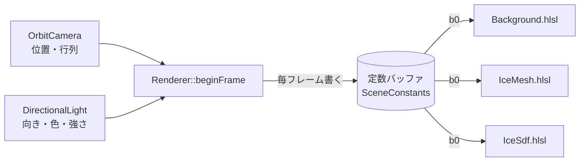

# 04. カメラとライトをシェーダーへ渡す (シーンの定数)

カメラ (行列と位置) と平行光源 (太陽) の値を、 **シェーダーにハードコードせず**、 C++ から毎フレーム渡す。
多くのエンジンと同じく、 **1 つの定数バッファ (シーンの定数) に書き、 どのシェーダーも同じレジスター (`b0`) で読む** 形にする。

後半 (「自分のエンジンで探す」) は、 自分のプロジェクトでカメラとライトの値の取り方が分からないときの調べ方。

この段の絵: 見た目は前と同じ。 J / L で太陽の方角を回すと、 背景 (空の明るい所) とプリミティブの照らされ方がそろって変わる。

---

## 1. なぜハードコードしないか

シェーダーに `float3 sunDir = normalize(float3(-0.5, 0.45, -0.6));` と書くと:

- ライトを動かしても、 そのシェーダーだけ変わらない (背景と物の照らされ方がずれる)
- 同じ数字を何か所にも書くことになり、 1 か所直し忘れると合わなくなる
- カメラの行列は毎フレーム変わるので、 そもそも数字では書けない

そこで **値の持ち主は C++ (カメラのクラス・ライトのクラス)** とし、 シェーダーは受け取るだけにする。

## 2. 全体の流れ



| 段 | どこ | すること |
| --- | --- | --- |
| 1 | `Application` | `OrbitCamera` と `DirectionalLight` を持ち、 入力で変える |
| 2 | `Renderer::beginFrame` | 2 つから `SceneConstants` を作り、 定数バッファに書く |
| 3 | `Renderer::beginFrame` | 定数バッファの GPU のアドレスを `DrawContext::sceneConstants` に入れる |
| 4 | 背景・氷 | 自分のルートシグネチャの 0 番 (`b0`) に、 そのアドレスを結び付ける |
| 5 | シェーダー | `SceneConstants.hlsli` を `#include` して、 `ViewProj` や `LightDirection` を読む |

## 3. C++ 側

### 3.1 平行光源 (DirectionalLight.h)

```cpp
struct DirectionalLight {
    Float3 direction = normalize(Float3{ -0.5f, 0.45f, -0.6f });
    Float3 color = { 1.0f, 0.95f, 0.88f };
    float intensity = 1.8f;
};
```

- **平行光源** = とても遠い光源。 どの点から見ても同じ向き・同じ強さで光が来る (太陽)。 位置を持たない。
- `direction` は **面から光源へ向かう向き**。 光が進む向きの逆。 エンジンによってどちらの約束かが違うので、 必ず確かめる (後述)。
- 色と強さを分けて持ち、 シェーダーへは `color × intensity` を渡す。

### 3.2 シーンの定数 (SceneConstants.h)

```cpp
struct SceneConstants {
    Float4x4 viewProj;     // ワールド → クリップ空間 (転置済み)
    Float4x4 invViewProj;  // クリップ空間 → ワールド (転置済み)
    Float3 cameraPos;
    float time;
    Float3 lightDirection;
    float pad0;
    Float3 lightColor;
    float pad1;
};
static_assert(sizeof(SceneConstants) == 44 * 4, "...");
```

**16 バイトの区切り**: HLSL の定数は float 4 個 (16 バイト) ずつの区切りに並ぶ。 `float3` が区切りをまたぐと次の区切りへ送られ、 CPU 側とずれる。
`float3` の後に `float` を 1 つ置いて区切りを埋めると、 CPU と HLSL で同じ並びになる。 `static_assert` で大きさを確かめておく。

| 区切り | 中身 |
| --- | --- |
| 0〜3 | `viewProj` (4 行) |
| 4〜7 | `invViewProj` (4 行) |
| 8 | `cameraPos.xyz`, `time` |
| 9 | `lightDirection.xyz`, `pad0` |
| 10 | `lightColor.xyz`, `pad1` |

### 3.3 定数バッファを作る (Renderer::createSceneConstantBuffer)

```cpp
const UINT64 size = (sizeof(SceneConstants) + 255) & ~UINT64(255);
...
heap.Type = D3D12_HEAP_TYPE_UPLOAD;
...
mSceneBuffer->Map(0, &noRead, reinterpret_cast<void**>(&mSceneMapped));
```

| 点 | 理由 |
| --- | --- |
| 大きさを 256 の倍数に | 定数バッファビューは 256 バイト単位の決まり。 `(x + 255) & ~255` は 「256 の倍数へ切り上げ」 |
| アップロードヒープ | CPU から毎フレーム書くため |
| Map したまま | アップロードヒープは Map したままでよい。 毎フレーム Map / Unmap する手間を省く |

> 注意: ここでは毎フレーム GPU が終わるのを待っているので、 定数バッファは 1 つで足りる。
> 待たずに次のフレームを作るエンジンでは、 GPU がまだ読んでいる間に CPU が書き換えないよう、 **フレームの数だけ定数バッファを持つ** (または毎フレーム別の場所に書く)。

### 3.4 毎フレーム書く (Renderer::beginFrame)

```cpp
SceneConstants scene = {};
scene.viewProj = transpose(viewProj);
scene.invViewProj = transpose(inverse(viewProj));
scene.cameraPos = camera.getPosition();
scene.time = time;
scene.lightDirection = normalize(light.direction);
scene.lightColor = light.color * light.intensity;
*mSceneMapped = scene;

context.sceneConstants = mSceneBuffer->GetGPUVirtualAddress();
```

**転置する理由**: HLSL の定数の行列は、 何も指定しないと列優先でメモリから読まれる。 C++ で行優先に並べた行列をそのまま送ると、 シェーダーからは転置に見える。
先に転置して送ると、 シェーダーで `mul(float4(p, 1), ViewProj)` と、 C++ (`p × M`) と同じ順で書ける (`docs/01-dx12-base.md`)。

### 3.5 部品の側で結び付ける (IceImplement)

ルートシグネチャの 0 番を **定数バッファビュー (CBV)** にする。

```cpp
params[kRootScene].ParameterType = D3D12_ROOT_PARAMETER_TYPE_CBV;
params[kRootScene].Descriptor.ShaderRegister = 0;  // b0
params[kRootScene].ShaderVisibility = D3D12_SHADER_VISIBILITY_ALL;
```

`draw3D` で、 エンジンから届いたアドレスを渡す。

```cpp
commandList->SetGraphicsRootConstantBufferView(kRootScene, context.sceneConstants);
```

ルート引数の CBV は、 デスクリプターヒープを使わずに **GPU のアドレスを直接** 渡せる。 シーンの定数のような 「毎フレーム 1 つ」 の物に向く。

## 4. シェーダー側

```hlsl
cbuffer SceneConstants : register(b0)
{
    float4x4 ViewProj;
    float4x4 InvViewProj;
    float3   CameraPos;
    float    Time;
    float3   LightDirection;
    float    ScenePad0;
    float3   LightColor;
    float    ScenePad1;
};
```

- この宣言は `src/engine/shaders/SceneConstants.hlsli` の 1 か所だけに書き、 どのシェーダーも `#include` する。
- `#ifndef SCENE_CONSTANTS_HLSLI` で囲み、 2 回読まれても 1 回分になるようにする (インクルードガード)。
- 環境の関数は、 数字の代わりにこれを返す:

```hlsl
float3 SunColor()     { return LightColor; }
float3 SunDirection() { return LightDirection; }
```

---

## 5. 自分のエンジンで探す

自分のプロジェクトで 「カメラやライトの値がどこにあるか分からない」 ときは、 次の順に探す。
多くのエンジンは、 上と同じ **シーン (フレーム・ビュー) の定数バッファ** を持っていて、 既存のシェーダーがもう使っている。

### 5.1 すでに動いているシェーダーを読む

カメラが動くと見え方が変わる物 (プリミティブの PBR のシェーダーなど) は、 必ずどこかからカメラの行列を受け取っている。 そのシェーダーで:

1. `cbuffer` / `ConstantBuffer<...>` の宣言を探す。 `register(b0)` などの番号と、 中の変数の名前を見る。
2. `#include` を見る。 共通の `.hlsli` (例: `Scene.hlsli`, `Common.hlsli`, `Camera.hlsli`, `Frame.hlsli`) に宣言があることが多い。
3. 行列やカメラの位置の名前が分かったら、 **同じ `#include` と同じ番号** を自分のシェーダーでも使う。

探す言葉 (シェーダー):

```
cbuffer   ConstantBuffer   register(b   ViewProj   ViewProjection   WorldViewProj
InvView   CameraPos   EyePos   CameraPosition   LightDir   LightDirection   SunDir
DirectionalLight   LightColor   Scene   Frame   PerFrame   PerView   PerObject
```

### 5.2 C++ でその番号に何を結び付けているかを探す

探す言葉 (C++):

```
SetGraphicsRootConstantBufferView   SetGraphicsRootDescriptorTable   SetGraphicsRoot32BitConstants
D3D12_ROOT_PARAMETER   CreateRootSignature   Map(   memcpy   GetGPUVirtualAddress
Camera   GetViewMatrix   GetProjectionMatrix   LookAt   Perspective
DirectionalLight   Light   SunLight   LightManager   SceneData   FrameData
```

- ルートシグネチャを作っている所 (`D3D12_ROOT_PARAMETER`) で、 何番が `b0` か、 CBV か定数かテーブルかを見る。
- その番号に値を結び付けている所 (`SetGraphicsRoot…`) を探し、 そこへ渡しているバッファを、 誰が・いつ書いているか (`Map` / `memcpy`) をたどる。
- 書いている所に、 カメラのクラスやライトのクラスから値を取る処理がある。 **それがカメラとライトの持ち主**。

### 5.3 RenderDoc や PIX で確かめる (いちばん確実)

フレームを 1 枚取り込み、 既存の物を描いている命令 (`DrawIndexedInstanced` など) を選ぶと、
**その時に結び付いている定数バッファの名前と中身 (数値)** が見られる。

| ツール | 入手先 | 費用 |
| --- | --- | --- |
| RenderDoc | https://renderdoc.org/ | 無料 (オープンソース) |
| PIX on Windows | https://devblogs.microsoft.com/pix/ | 無料 (Microsoft) |

1. アプリを RenderDoc (または PIX) から起動し、 フレームを取り込む。
2. 既存のプリミティブを描く命令を選ぶ。
3. パイプラインの状態 (Pipeline State) のピクセルシェーダー (または頂点シェーダー) の定数バッファを開く。
4. `ViewProj` やライトの向きらしい値を探す。 カメラを動かして取り込み直し、 変わる値がカメラ、 変わらない値がライトなど、 と見分けられる。

### 5.4 見つからない・無いとき

エンジンにシーンの定数が無い (または部品から使えない) ときは、 **部品が自分で持つ**:

1. 部品の C++ で、 毎フレーム カメラのクラスとライトのクラスから値を取る (エンジンの 「今のカメラ」「シーンのライト」 を取る関数を探す)。
2. 自分の定数バッファ (またはルート定数) に書き、 自分のルートシグネチャの番号に結び付ける。
3. シェーダーの数字を、 その定数に置き換える。

こうしておけば、 後でエンジンのシーンの定数が見つかったときに、 結び付ける先を替えるだけで済む。

### 5.5 つまずきやすい所

| 項目 | 確かめること |
| --- | --- |
| 行列の転置 | C++ が行優先か列優先か、 HLSL が `row_major` を付けているか。 絵がおかしいときは `mul` の順か転置を疑う |
| 掛ける順 | `mul(v, M)` (行ベクトル) か `mul(M, v)` (列ベクトル) か。 エンジンの既存のシェーダーに合わせる |
| 16 バイトの区切り | `float3` の後に詰め物があるか。 C++ と HLSL の並びが 1 つずれると、 後ろが全部ずれる |
| ライトの向き | 「面から光源へ」 か 「光が進む向き」 か。 逆だと、 光が当たる面と影が入れ替わる (`dot(N, L)` の符号が逆) |
| 座標系 | 右手系か左手系か、 y が上か z が上か。 向きの数字を移すときに符号が変わる |
| 単位と強さ | ライトの強さの単位 (そのまま掛けるだけか、 π などの係数があるか)。 明るすぎ・暗すぎのときに見る |
| 更新の時機 | 定数バッファを書く前に描いていないか (1 フレーム遅れて動く)。 GPU が読んでいる間に書き換えていないか |

---

## 6. 確かめ方

| 項目 | どうなればよいか |
| --- | --- |
| ハードコード | シェーダーに太陽の向き・色の数字が残っていない |
| ライト | J / L で太陽を回すと、 空の明るい所とプリミティブの照らされ方がそろって変わる |
| カメラ | ドラッグで回しても、 背景とプリミティブがずれない (同じ `ViewProj` を使っている) |
