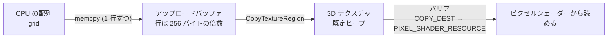
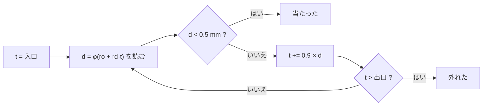

# 05. generateSDF — SDF を 3D テクスチャに焼いて描く

`generateShape` の for と switch に SDF の形を足す。 CPU で SDF を **3D テクスチャに焼き**、 格子を覆う **箱のメッシュ** と一緒に `mGeom` に入れる。
描くときは箱を描き、 箱が映る画素ごとに **光線で箱の中を追って (レイマーチ)** 氷の表面を探す。

この段の絵: 4 で切り替えると、 角が丸く、 1 つの角が欠け、 表面が少し波打った氷の塊が出る (この段は不透明)。

---

## 1. SDF とは

**SDF (Signed Distance Field、 符号付き距離場)** は、 空間のあらゆる点 $p$ に、 **形の表面までのいちばん近い距離** を持たせたもの。

$$
\phi(p) = \begin{cases} +\,(\text{表面までの距離}) & p \text{ が形の外} \\ 0 & p \text{ が表面の上} \\ -\,(\text{表面までの距離}) & p \text{ が形の中} \end{cases}
$$

| 性質 | 使い道 |
| --- | --- |
| 表面は $\phi = 0$ の所 | 光線が表面に当たる所を探せる (球追跡) |
| 符号で中と外が分かる | 光線が氷の中にいるか分かる (屈折して中を進むとき) |
| $\phi$ の勾配が表面の法線 | 当たった点の向きが分かる (光の計算) |
| 距離の式を組み合わせて形を作れる | 足す・削る・丸めるが式 1 つでできる (CSG) |

メッシュは表面しか持たないが、 SDF は **中身 (どこが中で、 表面からどれだけ深いか)** も持つ。 これが、 後の段で厚さに応じた吸収や、 芯の白い濁りを出すのに効く。

---

## 2. 氷の形を式で書く (iceShapeSdf)

```cpp
float iceShapeSdf(Float3 p)
{
    // 1. 角を丸めた箱
    float d = sdRoundBox(p - center, { kIceHalfSize, kIceHalfSize, kIceHalfSize }, kIceCornerRadius);
    // 2. 角の欠け
    d = smoothMax(d, -sdSphere(p, chipCenter, kIceChipRadius), 0.05f);
    // 3. 表面のゆらぎ
    const float n = valueNoise(p * 9.0f) * 0.7f + valueNoise(p * 23.0f) * 0.3f;
    return d + n * kIceRipple;
}
```

### 2.1 角を丸めた箱 (sdRoundBox)

まず普通の箱 (半分の大きさ $\mathbf{b}$) の SDF を考える。 箱は 3 つの軸について対称なので、 $|p|$ (成分ごとの絶対値) で **+x+y+z の 1/8 だけ** 考えればよい。

$$
\mathbf{q} = |p| - \mathbf{b}
$$

$\mathbf{q}$ は 「各軸で、 箱の面からどれだけ外へ出ているか」 (負なら中)。

- **外の点**: 出ている成分だけの長さ $\lVert \max(\mathbf{q}, 0) \rVert$ が、 箱までの距離。
  (例: x だけ出ていれば面までの距離、 x と y が出ていれば辺までの距離、 全部出ていれば角までの距離)
- **中の点**: いちばん近い面までの距離は、 $\mathbf{q}$ のいちばん大きい成分 (0 に最も近い負の数)。 $\min(\max(q_x, q_y, q_z), 0)$。

$$
\phi_{box}(p) = \lVert \max(\mathbf{q}, 0) \rVert + \min(\max(q_x, q_y, q_z), 0)
$$

**角を丸める**: 箱を半径 $r$ だけ小さく ($\mathbf{b} - r$) してから、 距離から $r$ を引く (= 表面を $r$ だけ外へふくらませる)。
ふくらませると、 角は半径 $r$ の球の一部になり、 丸くなる。

$$
\phi_{round}(p) = \phi_{box}(p;\ \mathbf{b} - r) - r
$$

```cpp
const Float3 q = { std::fabs(p.x) - (half.x - r), std::fabs(p.y) - (half.y - r), std::fabs(p.z) - (half.z - r) };
const Float3 outside = { std::max(q.x, 0.0f), std::max(q.y, 0.0f), std::max(q.z, 0.0f) };
const float inside = std::min(std::max(q.x, std::max(q.y, q.z)), 0.0f);
return std::sqrt(dot(outside, outside)) + inside - r;
```

### 2.2 球 (sdSphere)

中心 $c$、 半径 $r$ の球の表面までの距離は、 中心までの距離から $r$ を引くだけ。

$$
\phi_{sphere}(p) = \lVert p - c \rVert - r
$$

### 2.3 形を削る (CSG) となめらかな最大

SDF どうしは、 簡単な式で組み合わせられる (CSG: Constructive Solid Geometry)。

| 操作 | 式 | 理由 |
| --- | --- | --- |
| 足す (A または B) | $\min(\phi_A, \phi_B)$ | 近い方の表面が、 合わせた形の表面 |
| 共通部分 (A かつ B) | $\max(\phi_A, \phi_B)$ | 両方の中 = 両方負 = 大きい方も負 |
| 削る (A から B を除く) | $\max(\phi_A, -\phi_B)$ | 「A の中」 かつ 「B の外」 (B の符号を反転すると、 B の外が中になる) |

`max` のままだと、 削った縁が鋭い角になる。 **なめらかな最大** で縁を丸める。

$$
h = \frac{\max(k - |a - b|,\ 0)}{k},\qquad \text{smax}(a, b) = \max(a, b) + \frac{k}{4} h^2
$$

- $a$ と $b$ が $k$ 以上離れていれば $h = 0$ で、 普通の `max` と同じ。
- 近いとき ($|a - b| < k$) だけ少し大きくなり、 2 つの形の境目が幅 $k$ ほどでなめらかにつながる。
- $a = b$ のとき足す量が最大 ($k / 4$)。 足す量は $|a - b|$ について 2 次式なので、 つなぎ目で傾きが連続する (折れ目が出ない)。

### 2.4 表面のゆらぎ (値ノイズ)

本物の氷は、 溶けたり凍ったりで表面が少し波打っている。 距離に **ゆっくり変わる乱数 (ノイズ)** を足して表す。

**値ノイズ** の作り方:

1. 整数の格子点 $(i, j, k)$ ごとに、 決まった乱数を 1 つ置く (`hash3`: 座標を大きな素数と掛けてビットを混ぜる)。
2. 点 $p$ が入っている格子の箱の 8 つの角の乱数を、 3 方向に順に補間する (3 重の線形補間)。
3. 補間の重みは、 直線の $t$ ではなく **$t^2(3 - 2t)$** (smoothstep) にする。 直線だと格子の境目で傾きが折れて、 筋が見えるため。

大きさの違う 2 つ (周波数 9 と 23) を重ねる (`0.7 : 0.3`)。 大きな波の上に細かい波が乗る。

> ノイズを足すと、 値はもう厳密な距離ではない (距離の傾きが 1 からずれる)。 ゆらぎが小さい (6 mm) ので、 球追跡では 1 歩を少し控えめ (0.9 倍) にすれば足りる (後述)。

---

## 3. 格子に焼く

```cpp
const float half = kIceHalfSize + kSdfMargin;   // 氷 + 余白
const float voxel = (2.0f * half) / n;          // 格子 1 つ分 (n = 64)
...
const Float3 p = { boundsMin.x + (x + 0.5f) * voxel, ... };
grid[(z * n + y) * n + x] = iceShapeSdf(p);
```

| 決めたこと | 理由 |
| --- | --- |
| 格子は氷より **余白 (6 cm)** だけ広く取る | 表面の外側にも距離の値が要る (光線が表面に近づく途中で読む)。 格子の外周の 1 層がすべて正 (外) になるようにする |
| 格子の点は **マス目の真ん中** ($x + 0.5$) | 3D テクスチャを線形補間で読むとき、 テクセル $i$ の中心は $uvw = (i + 0.5) / n$。 そこに値の点を合わせると、 読んだ値と式の値がずれない |
| 64³ (約 26 万点、 1 MB) | 格子 1 つ 1.4 cm。 角の丸み (8 cm) やゆらぎの大きな波が表せる細かさ。 細かくすると、 メモリと焼く時間が 3 乗で増える |
| x → y → z の順に並べる | 3D テクスチャのメモリの並び (行 → 面) と同じにすると、 写すときに 1 行ずつ写せる |
| 重い式でもよい | 焼くのは最初の 1 回だけ。 描くときは 3D テクスチャを読むだけなので、 形が複雑でも描く速さは変わらない |

---

## 4. 3D テクスチャへ送る

GPU が速く読めるメモリ (**既定ヒープ**) は CPU から直接書けない。 そこで **アップロードヒープ** のバッファ (CPU から書ける) に書いてから、 GPU に写させる。



### 4.1 テクスチャを作る

```cpp
texDesc.Dimension = D3D12_RESOURCE_DIMENSION_TEXTURE3D;
texDesc.Width = n; texDesc.Height = n; texDesc.DepthOrArraySize = n;
texDesc.Format = DXGI_FORMAT_R32_FLOAT;
...
CreateCommittedResource(&defaultHeap, ..., D3D12_RESOURCE_STATE_COPY_DEST, ...);
```

- `R32_FLOAT`: 1 点に距離を 1 つ (32 bit の浮動小数)。 `R16_FLOAT` にすると半分のメモリで済むが、 ここでは分かりやすさを優先。
- 最初の状態は **COPY_DEST** (写される先)。

### 4.2 写すときの並び (GetCopyableFootprints)

バッファからテクスチャへ写すとき、 バッファ側の **1 行の大きさ (RowPitch) は 256 バイトの倍数** でなければならない (`D3D12_TEXTURE_DATA_PITCH_ALIGNMENT`)。
`GetCopyableFootprints` に作ったテクスチャの記述を渡すと、 この決まりに合う並び (行の大きさ・行の数・全体の大きさ) を返してくれる。

```cpp
mDevice->GetCopyableFootprints(&texDesc, 0, 1, 0, &footprint, &rowCount, &rowBytes, &totalBytes);
...
uint8_t* dst = staging.data() + footprint.Offset + z * slicePitch + y * rowPitch;
std::memcpy(dst, src, rowBytes);
```

- `rowBytes`: 1 行の中身の大きさ (64 × 4 = 256 バイト)
- `rowPitch`: バッファの 1 行の間隔 (256 の倍数に切り上げた物。 今回はちょうど 256)
- `slicePitch = rowPitch × rowCount`: 1 枚 (z が同じ面) の間隔
- 行ごとに写すのは、 `rowPitch` と `rowBytes` が違うとき (横幅が 256 バイトの倍数でないとき) も正しく並べるため。

### 4.3 写す命令とバリア

```cpp
commandList->CopyTextureRegion(&dst, 0, 0, 0, &src, nullptr);
// COPY_DEST → PIXEL_SHADER_RESOURCE
commandList->ResourceBarrier(1, &barrier);
```

- 命令は `draw3D` に渡された **このフレームのコマンドリスト** に記録する。 写す命令は描く命令より前に並ぶので、 GPU は写し終えてから描く。
- **アップロードバッファは、 GPU が写し終えるまで壊してはいけない**。 だから `IceGeometry::sdfUpload` に持っておく (このサンプルでは最後まで持つ。 写し終えた後に解放してもよい)。
- **リソースバリア**: テクスチャの使い方が 「写される先」 から 「ピクセルシェーダーで読む」 に変わることを GPU に伝える。 GPU は書き込みを終えてから、 読むための準備 (キャッシュの扱いなど) をする。

### 4.4 シェーダーから読めるようにする (SRV とテーブル)

| 物 | 役目 |
| --- | --- |
| **SRV** (シェーダーリソースビュー) | 「このリソースを、 この形式・この次元のテクスチャとして読む」 という記述子 |
| **デスクリプターヒープ** (SHADER_VISIBLE) | SRV を置く場所。 シェーダーから見えるヒープでないと、 描くときに使えない |
| **デスクリプターテーブル** (ルート引数 2) | 「ヒープのここから SRV を読め」 という指し先。 描く前に `SetGraphicsRootDescriptorTable` で指す |
| **静的サンプラー** (`s0`) | 読み方: 線形補間 (格子の点の間をなめらかにつなぐ)、 端で止める (箱の外を読んでも端の値) |

```cpp
ID3D12DescriptorHeap* heaps[] = { mSrvHeap.Get() };
commandList->SetDescriptorHeaps(1, heaps);
commandList->SetGraphicsRootDescriptorTable(kRootSdf, mSrvHeap->GetGPUDescriptorHandleForHeapStart());
```

---

## 5. 箱を描いて、 その画素で光線を追う

SDF そのものには三角形が無い。 そこで **格子を覆う箱のメッシュ** を描き、 箱が画面に映る画素でだけピクセルシェーダーを動かす。 各画素で:

1. カメラからその画素への光線を作る
2. 光線が箱を通る区間を求める
3. その区間で SDF を球追跡し、 表面 ($\phi = 0$) を探す
4. 当たれば、 その点の法線で色を決める。 当たらなければ **捨てる (`discard`)** → 背景がそのまま見える

### 5.1 なぜ箱の裏面を描くか

SDF 用の PSO は **表面をカリングして、 裏面だけを描く** (`D3D12_CULL_MODE_FRONT`)。

- 表面を描くと、 カメラが箱の中に入ったとき、 表面がカメラの後ろになって何も描かれない。
- 裏面ならカメラが箱の中でも見えるので、 どの位置からでも画素が出る。
- 光線の入口は、 描いた面ではなく、 次の 「光線と箱の交差」 で求める (カメラが箱の中なら入口は $t = 0$)。

深度には書かない (`DepthWriteMask = ZERO`)。 箱の面の深さは氷の表面の深さではないため。

### 5.2 光線を作る

```hlsl
float3 ro = CameraPos - Position;              // 物体の空間でのカメラ
float3 rd = normalize(worldPos - CameraPos);   // カメラ → 箱の面の点
```

氷は回さないので、 ワールドから位置を引くだけで物体の空間になる。 向き `rd` は空間をずらしても変わらない。

### 5.3 光線と箱の交差 (スラブ法)

箱を **3 枚の板 (x の板・y の板・z の板) の重なり** と考える。 光線 $ro + rd \cdot t$ が、 x の板 ($b_{min,x} \le x \le b_{max,x}$) の中にいる $t$ の区間は

$$
t = \frac{b_{min,x} - ro_x}{rd_x},\quad t = \frac{b_{max,x} - ro_x}{rd_x}
$$

の 2 つの間 (小さい方が入口、 大きい方が出口。 `rd` の向きで入れ替わる)。 y と z も同じ。

**箱の中 = 3 枚の板の全部の中** なので、

$$
t_{near} = \max(\text{各板の入口}),\qquad t_{far} = \min(\text{各板の出口})
$$

$t_{far} > \max(t_{near}, 0)$ なら、 光線はカメラより前で箱を通る。

```hlsl
float3 t0 = (BoundsMin - ro) * invRd;
float3 t1 = (BoundsMax - ro) * invRd;
tNear = max(max(min(t0, t1).x, ...), ...);
tFar  = min(min(max(t0, t1).x, ...), ...);
```

`rd` の成分が 0 (軸に平行な光線) だと 0 で割るので、 符号を保ったまま、 ごく小さい値 ($10^{-8}$) で止めてから割る。

### 5.4 球追跡 (sphere tracing)

$\phi(p)$ は 「$p$ からいちばん近い表面までの距離」。 だから **$p$ を中心に半径 $\phi(p)$ の球の中には、 表面が 1 つも無い**。
光線をその分だけ進めても、 表面を通り越すことはない。 これを繰り返す。



| 決めたこと | 値 | 理由 |
| --- | --- | --- |
| 当たったとみなす距離 | 0.5 mm | 0 には決してならない (近づくほど 1 歩が小さくなる) ので、 十分近ければ止める |
| 1 歩 | $0.9 \times d$ | ノイズで距離が少し不正確な分の安全。 1.0 だと、 わずかに表面を通り越すことがある |
| 回数の上限 | 128 回 | 表面すれすれを通る光線は、 1 歩が小さいまま進まない。 上限で打ち切る (外れた扱い) |

**なぜ速いか**: 表面から遠い所では 1 歩が大きく、 近づくほど小さくなる。 何も無い所を細かく刻む必要が無い。

### 5.5 SDF を読む (SampleSdf)

```hlsl
float3 uvw = (p - BoundsMin) / (BoundsMax - BoundsMin);
float d = SdfTexture.SampleLevel(LinearClamp, uvw, 0);
float3 q = max(BoundsMin - p, p - BoundsMax);
return d + length(max(q, 0.0));
```

- 物体の空間の点を、 箱の中の 0〜1 の位置 `uvw` に直して読む。
- `SampleLevel(…, 0)`: ミップマップの 0 段目を読む。 ピクセルシェーダーのループの中では、 自動でミップを選ぶ `Sample` は使えない (画素の間の差分が取れないため) ので、 段を指定する。
- **箱の外の補正**: サンプラーは端で止めるので、 箱の外の点では端の値を返す。 そのままだと、 遠い点でも表面が近く見える。 箱からはみ出た距離を足して、 遠い点は遠く見えるようにする。

### 5.6 法線 (勾配)

$\phi$ が最も速く増える向き (勾配 $\nabla\phi$) は、 表面に垂直で外を向く。 各軸で前後に $h$ ずらして読んだ差 (**中心差分**) で近似する。

$$
\nabla\phi \approx \frac{1}{2h}\begin{pmatrix} \phi(p + h\mathbf{x}) - \phi(p - h\mathbf{x}) \\ \phi(p + h\mathbf{y}) - \phi(p - h\mathbf{y}) \\ \phi(p + h\mathbf{z}) - \phi(p - h\mathbf{z}) \end{pmatrix}
$$

最後に長さ 1 に直すので、 $1/(2h)$ は省ける。 $h$ は格子 1 つ分 (`VoxelSize`)。
小さすぎると、 線形補間の折れ目 (格子の境目) を拾って、 ざらついた法線になる。 大きすぎると、 細かい凸凹がならされる。

---

## 6. 確かめ方

| 項目 | どうなればよいか |
| --- | --- |
| 切り替え | 4 (または Tab) で SDF の形になる |
| 形 | 角が丸く、 上の角の 1 つが丸く欠け、 表面がわずかに波打つ |
| 裏面 | 寄っても (カメラが箱に近づいても) 消えない |
| 背景 | 氷の周りの、 箱の中で氷に当たらない画素では背景が見える (箱の形が見えない) |
| 壊れない | 黒や白の点 (NaN) が無い。 箱の面に沿った筋が無い |

## 7. つまずきやすい所

| 症状 | 原因と直し方 |
| --- | --- |
| 何も出ない | SRV のヒープを `SetDescriptorHeaps` していない / テーブルを指していない / 写す命令が描く命令より後 |
| 箱が見える (氷の外が塗られる) | 当たらない画素で `discard` していない |
| 形がずれる・半分になる | `uvw` の計算 (箱の最小と最大) と、 焼いたときの箱が違う。 格子の点をマス目の真ん中に置いていない |
| 縞模様・層状の筋 | 写すときの行の並び (`RowPitch`) を無視して、 まとめて 1 回で写した |
| 表面に穴・点 | 1 歩が大きすぎる (0.9 を下げる) / 回数の上限が少ない |
| 法線がざらざら | 中心差分の幅が小さすぎる (格子 1 つ分くらいにする) |
