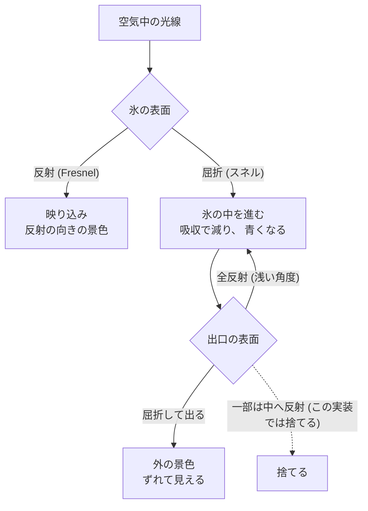
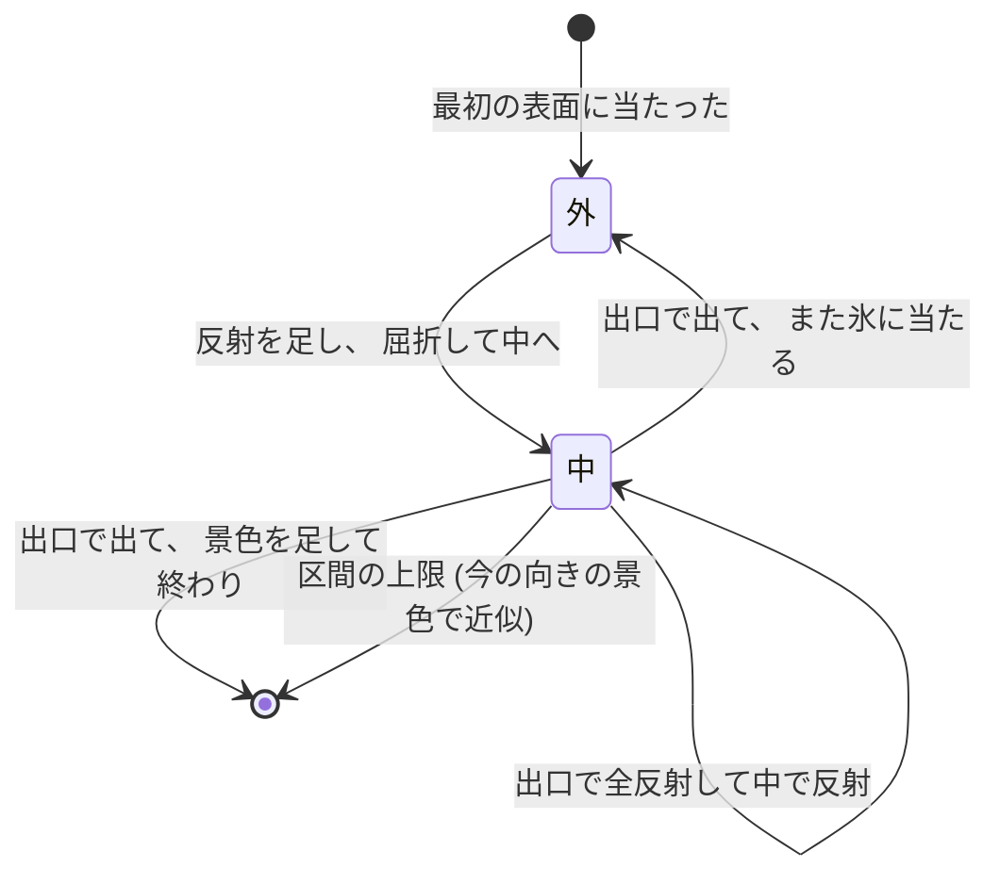

# 06. 氷の光学 (反射・屈折・吸収・全反射)

SDF の氷を透明にする。 1 本の光線を、 **外 → 表面で反射と屈折 → 中 → 出口で屈折か全反射 → 外** と区間ごとに追う。

この段の絵: 4 の SDF の氷が透明になる。 氷越しの床の市松模様がゆがんでずれ、 厚い所ほど青く、 表面に空と太陽が映り込む。

参考文献 (利用条件つき) は `docs/guide/references.md`。 ここに書いた式は教科書と論文の式を自分の言葉で書き直したもので、 コードはすべて独自に書いた。

---

## 1. 光が氷に当たると何が起きるか



| 現象 | 見え方 | 式 |
| --- | --- | --- |
| 反射 | 表面に空や太陽が映る。 浅い角度ほど強い | Fresnel (Schlick の近似) |
| 屈折 | 向こうの物がずれて・ゆがんで見える | スネルの法則 |
| 吸収 | 厚い所ほど青い | Beer–Lambert の法則 |
| 全反射 | 中から浅い角度で当たると出られない。 側面を斜めに見ると向こうが見えない所がある | スネルの法則に解が無い |

---

## 2. 反射: Fresnel

### 2.1 どれだけ反射するか

光が屈折率 $n_1$ の物から $n_2$ の物へ当たると、 一部が反射し、 残りが中へ入る。 反射する割合 $F$ は入る角度で変わる (**Fresnel の式**)。
正確な式は偏光ごとに 2 つあるが、 リアルタイムでは **Schlick の近似** を使う。

$$
F(\theta) = F_0 + (1 - F_0)(1 - \cos\theta)^5,\qquad F_0 = \left(\frac{n_1 - n_2}{n_1 + n_2}\right)^2
$$

- $\theta$: 光線と法線の角度。 正面 ($\theta = 0$) で $F = F_0$、 表面すれすれ ($\theta \to 90°$) で $F \to 1$。
- 氷 ($n = 1.31$) と空気 ($n = 1$): $F_0 = (0.31 / 2.31)^2 \approx 0.018$。 正面からはたった 1.8% しか映らない。
- だから氷は 「正面は透けて、 縁 (浅い角度) ほど空が映る」。

```hlsl
float FresnelDielectric(float cosTheta, float F0)
{
    return F0 + (1.0 - F0) * pow(1.0 - saturate(cosTheta), 5.0);
}
...
float eta = RefractiveIndex;
float F0 = ((eta - 1.0) / (eta + 1.0)) * ((eta - 1.0) / (eta + 1.0));
```

### 2.2 反射した光

反射した光は、 **反射の向きの景色** をそのまま足す。

```hlsl
float F = FresnelDielectric(dot(-rd, n), F0);
col += thr * F * Environment(p + Position + n * SURFACE_EPS, reflect(rd, n));
thr *= 1.0 - F;
```

- `reflect(d, n) = d − 2 (d·n) n`: 入射の向きを、 法線について鏡に映した向き。
- `thr` (throughput) は 「ここまでで残っている光の割合」。 反射で $F$ が抜けた残り $(1 - F)$ が中へ入る。
- 環境 (`Environment`) には太陽の円盤 (とても明るい小さな点) があるので、 表面の向きによって鋭いきらめきが出る。

---

## 3. 屈折: スネルの法則

### 3.1 曲がり方

$$
n_1 \sin\theta_1 = n_2 \sin\theta_2
$$

空気 → 氷では $n_1 < n_2$ なので $\theta_2 < \theta_1$ (法線の側へ曲がる)。 氷 → 空気では逆に、 法線から離れる側へ曲がる。

### 3.2 向きのベクトルで計算する (refract)

HLSL の `refract(i, n, η)` は、 入射の向き $\mathbf{i}$ (長さ 1)、 法線 $\mathbf{n}$ (長さ 1、 $\mathbf{i}$ と逆向き)、 屈折率の比 $\eta = n_1 / n_2$ から、 屈折した向き $\mathbf{t}$ を返す。

$$
\cos\theta_1 = -\mathbf{i} \cdot \mathbf{n},\qquad k = 1 - \eta^2 (1 - \cos^2\theta_1)
$$

$$
\mathbf{t} = \begin{cases} \eta\, \mathbf{i} + (\eta \cos\theta_1 - \sqrt{k})\, \mathbf{n} & k \ge 0 \\ \mathbf{0} & k < 0 \ (\text{全反射}) \end{cases}
$$

- $k = \cos^2\theta_2$ (屈折後の角度の cos の 2 乗)。 負なら、 その角度で曲がる向きが無い → **全反射**。
- **入るとき** ($\eta = 1/1.31 < 1$): $k = 1 - \eta^2 \sin^2\theta_1 > 0$ が必ず成り立つ。 だから入るときに全反射は起きない。
- **出るとき** は法線を中へ向けて (`-n`)、 $\eta = 1.31$ で呼ぶ。

```hlsl
rd = refract(rd, n, 1.0 / eta);       // 入る (空気 → 氷)
...
float3 outDir = refract(rd, -n, eta); // 出る (氷 → 空気)。 0 なら全反射
```

### 3.3 全反射

氷 → 空気で $k < 0$ になるのは $\sin\theta_1 > 1 / 1.31$、 つまり

$$
\theta_1 > \theta_c = \arcsin\frac{1}{1.31} \approx 49.8°
$$

法線から 49.8° より浅い角度で中から当たった光は、 外へ出られず、 表面で鏡のように全部跳ね返る。

```hlsl
if (dot(outDir, outDir) < 1e-6) {
    rd = reflect(rd, n);      // 中で跳ね返って、 また中を進む
    p -= n * SURFACE_EPS;
}
```

氷の塊の中で光が何度も跳ね返り、 思いがけない所から出てくるのが、 氷のきらめきの元になる。

---

## 4. 吸収: Beer–Lambert の法則

### 4.1 式

一様な物の中を距離 $d$ 進んだ光は、 指数関数的に減る。

$$
T(d) = e^{-\sigma_a d}
$$

- $\sigma_a$: 吸収の係数 (1/m)。 色 (RGB) ごとに違う。
- **厚さを 2 倍にすると、 残る割合は 2 乗になる** ($T(2d) = T(d)^2$)。 厚い所ほど急に色が濃くなる。

### 4.2 「吸収の色」 から係数を決める

$\sigma_a$ を直接決めるのは分かりにくいので、 **「厚さ 1 m を通った白い光が、 この色 $C$ になる」** と決めて、 そこから計算する。

$$
e^{-\sigma_a \cdot 1\text{m}} = C \quad\Rightarrow\quad \sigma_a = -\ln C
$$

```cpp
// IceImplement::draw3D (CPU で 1 回計算して定数で渡す)
object.absorption = { -std::log(c.x), -std::log(c.y), -std::log(c.z) };
```

```hlsl
float len = MarchInside(p, rd);
thr *= exp(-Absorption * len);
```

### 4.3 本物の氷の値

氷は赤い光をいちばんよく吸うので、 厚い氷ほど青く見える。 実測の氷の消衰係数 $k$ から吸収の係数は $\alpha = 4\pi k / \lambda$ で求まる (Warren & Brandt 2008 の表から計算)。

| 色 (波長) | $\alpha$ (1/m) | 1 m を通って残る割合 |
| --- | --- | --- |
| 青 (450 nm) | 約 0.0026 | 約 0.997 |
| 緑 (550 nm) | 約 0.052 | 約 0.95 |
| 赤 (650 nm) | 約 0.28 | 約 0.76 |

本物は 1 m でもほとんど色が付かない (数 m でようやく青い)。 このサンプルの既定 `(0.45, 0.75, 0.90)` は、 **数十 cm の塊でも色が見えるよう強め** にしてある。
本物らしさを優先するなら、 `setAbsorptionColor({ 0.76f, 0.95f, 0.997f })` にする。

---

## 5. 光線を区間ごとに追う

### 5.1 状態

| 変数 | 意味 |
| --- | --- |
| `p`, `n` | 今いる表面の点と、 その外向きの法線 |
| `rd` | 光線の向き |
| `col` | 目に届く光 (足していく) |
| `thr` | ここまでで残っている光の割合 (反射・吸収で減っていく) |
| `inside` | 今、 氷の中を進んでいるか |

### 5.2 1 区間の処理



外 (表面に当たった):

1. 反射: `col += thr × F × 景色(反射の向き)`、 `thr *= 1 − F`
2. 屈折して中へ。 表面から少し中へずらす (`p -= n × ε`)

中:

1. 出口まで進む (`MarchInside`)。 進んだ長さで吸収 (`thr *= exp(−σa × len)`)
2. 出口の法線を求め、 外へ屈折する向きを計算
3. 全反射なら: 中で反射して、 また 「中」 へ
4. 出られるなら: `thr *= 1 − F` (出口の Fresnel)、 外へずらす。 外へ出た光線で **また氷に当たるか** 球追跡する
   - 当たる (へこんだ形・欠けた角): その点から 「外」 へ
   - 当たらない: `col += thr × 景色(その向き)` で終わり

### 5.3 表面からずらす理由 (ε)

当たった点はちょうど表面の上 ($\phi \approx 0$)。 そこから次の追跡を始めると、 同じ表面にすぐまた 「当たった」 ことになる。
そこで、 中へ入るときは中へ、 外へ出るときは外へ、 **2 mm (`SURFACE_EPS`) だけずらす**。 格子 1 つ (1.4 cm) より十分小さく、 φ の精度より大きい値にする。

### 5.4 中を進む (MarchInside)

```hlsl
float d = SampleSdf(ro + rd * t);
if (d > 0.0) break;                          // 外へ出た
tIn = t;
t += clamp(-d, VoxelSize * 0.5, 0.05);
...
// 2 分探索 (tIn は中、 t は外)
float m = 0.5 * (tIn + t);
if (SampleSdf(ro + rd * m) > 0.0) t = m; else tIn = m;
```

- 中では $-\phi$ が 「表面までの距離」 なので、 その分進んでも表面を越えない。 ただし出口に近づくほど 1 歩が小さくなり、 いつまでも出口に届かない。
- そこで **下限 (格子の半分)** を付けて進み、 外へ出たら、 「中だと分かっている t」 と 「外だと分かっている t」 の間を **2 分探索** で絞る (6 回で幅は 1/64)。
- 上限 5 cm は、 後の段 (気泡) で中身を細かく見るため。

### 5.5 省いた物と近似

| 省いた物 | 影響 | 理由 |
| --- | --- | --- |
| 出口で中へ反射する光 ($F$ の分) | 少し暗くなる | 光線が枝分かれすると、 1 本で追えなくなる。 正面に近いほど $F$ は小さい (約 2%) |
| 区間の上限 (8) を超えた光 | 今の向きの景色で近似 | 捨てると黒い点になる。 本当の光も、 何度か跳ね返った後でいずれ外へ出る |
| 反射の中の氷 | 反射には景色 (空と床) だけが映る | 反射の光線でもう一度氷を追うと、 重くなる |
| 波長ごとの屈折率の違い (分散) | 虹色のにじみが出ない | 色ごとに 3 本追う必要がある |

---

## 6. 確かめ方

| 項目 | どうなればよいか |
| --- | --- |
| 屈折 | 氷越しの床の市松模様がずれ、 表面のゆらぎでゆがむ |
| 反射 | 正面はほとんど透け、 縁 (浅い角度) で空が映る。 太陽の向きで鋭いきらめき |
| 吸収 | 厚い所 (中心を通る所) ほど青い。 `setAbsorptionColor({1, 1, 1})` で色が無くなる |
| 全反射 | 側面を斜めに見ると、 向こうが見えず、 中で跳ね返った景色が見える所がある |
| 屈折率 | `setRefractiveIndex(1.0)` で曲がらず映り込みも無くなり、 吸収の色だけが残る。 大きくすると強く曲がる |
| 壊れない | 黒い点 (NaN や捨てた光) が目立たない |

## 7. つまずきやすい所

| 症状 | 原因と直し方 |
| --- | --- |
| 表面にまだらな黒い点 | ε が小さすぎて、 同じ表面にまた当たっている |
| 氷の中が真っ黒 | 出口の `refract` の法線の向き (`-n`) と比 (`eta`) が逆 |
| 屈折が逆に曲がる | 入るときの比が `eta` (正しくは `1 / eta`) |
| 全体が白っぽい | 吸収の係数の符号 (`exp(+…)` になっている) |
| 縁が真っ白に光りすぎる | Fresnel の cos が負 (法線が中向き)。 `saturate` を忘れている |
