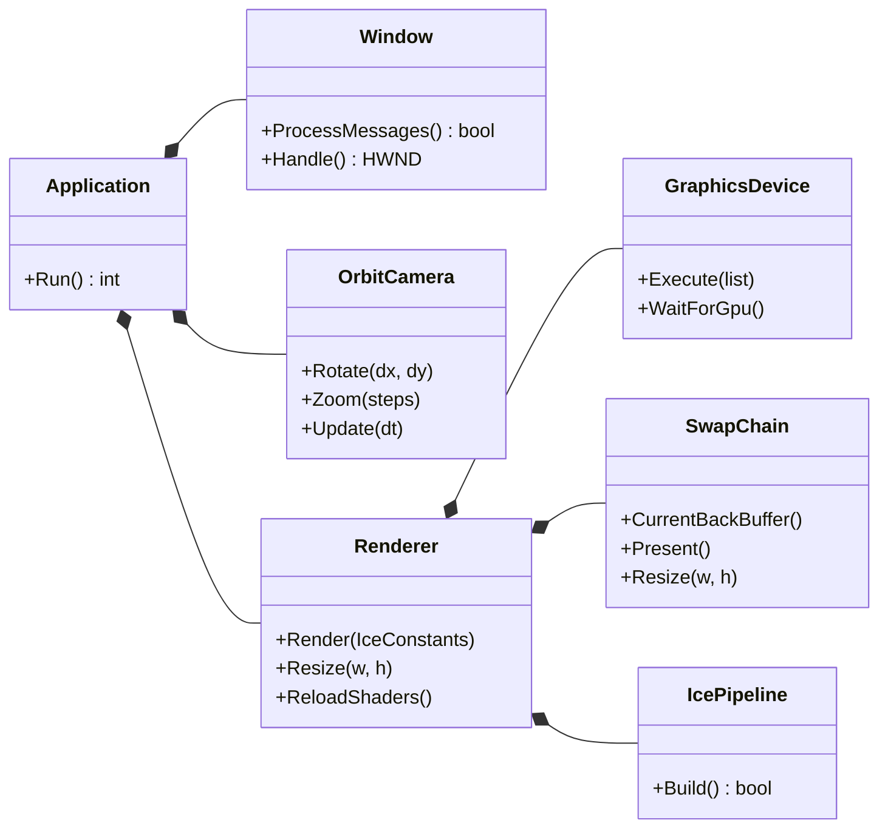
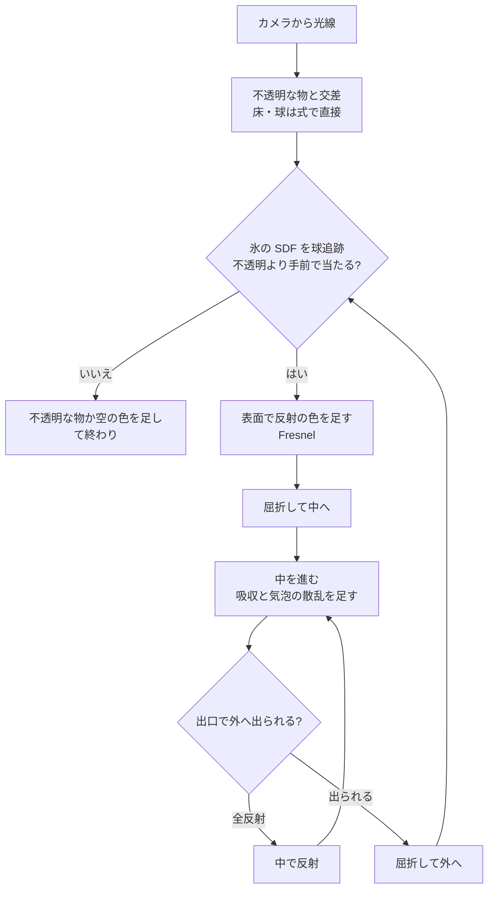

# 設計: SDF 氷 (DirectX 12)

## 目的

SDF (符号付き距離場) で形を表した透明な氷の塊を、 DirectX 12 で実時間に描く。
コードは最小限に保ち、 氷らしく見えるための要点だけを押さえる。

- 浅い角度ほど強く映り込む (Fresnel)
- 向こう側が屈折でずれて見える
- 厚い所ほど青い (吸収)
- 中から浅い角度で当たった光は外へ出られない (全反射)
- 芯が気泡で白く濁る
- 影が氷の色に色付く

## 範囲

| やる | やらない |
| --- | --- |
| 静止した氷の塊 3 個 (角の丸い箱) | 融解・破壊・浮力などの物理 |
| 床と球 2 つだけの簡単な場面 | メッシュ、 3D テクスチャの SDF 格子 |
| マウスでカメラを回す | 複数パスの描画、 TAA、 ポストエフェクト |
| シェーダーを実行中に読み直す | DXC (SM 6.x)、 外部ライブラリ |

## 全体の構成

```
Test/
├── CMakeLists.txt              … ビルド設定 (Windows / MSVC)
├── src/
│   ├── main.cpp                … 入口。 Application を作って回し、 例外を表示するだけ
│   ├── Application.h / .cpp    … 部品をつなぐ。 入力 → カメラ、 毎フレームの更新と描画
│   ├── Window.h / .cpp         … Win32 のウィンドウ、 メッセージ、 マウスとキーの受け取り
│   ├── OrbitCamera.h / .cpp    … 注視点の周りを回るカメラ (角度と距離)
│   ├── Renderer.h / .cpp       … 1 フレームの命令を記録して実行する
│   ├── GraphicsDevice.h / .cpp … デバイス・コマンドキュー・フェンス (GPU との同期)
│   ├── SwapChain.h / .cpp      … スワップチェーンとバックバッファの RTV
│   ├── IcePipeline.h / .cpp    … ルートシグネチャ・シェーダーのコンパイル・PSO
│   └── DxCheck.h               … HRESULT の失敗を例外にする
├── shaders/
│   ├── ice.hlsl                … 入口 (VSMain / PSMain) とカメラの光線
│   ├── Common.hlsli            … 定数 (cbuffer)・回転・表示用の変換
│   ├── Sky.hlsli               … 空と太陽
│   ├── IceShape.hlsli          … 氷の SDF・球追跡・法線
│   ├── IceMaterial.hlsli       … 氷の値 (屈折率・吸収・Fresnel・気泡)
│   ├── Scene.hlsli             … 床と球 (不透明な物) とその照明・影
│   └── IceOptics.hlsli         … 反射・屈折・吸収・全反射で光線を追う
└── docs/                       … この設計と、 要素ごとの解説
```

描画は **画面全体を覆う三角形を 1 枚描くだけ** で、 絵はすべてピクセルシェーダーが作る。
頂点バッファ・インデックスバッファ・テクスチャ・深度バッファは使わない。

### CPU 側 (`src/`)

1 クラス 1 ファイル (`.h` と `.cpp`)。 クラスの持ち方は次の通り。



| クラス | 責任 | 持たないもの |
| --- | --- | --- |
| `Application` | 部品を作ってつなぐ。 入力をカメラへ渡し、 毎フレーム定数を作って描かせる | DirectX 12 の詳細 |
| `Window` | ウィンドウを作り、 メッセージを処理し、 入力と大きさの変化を関数で知らせる | カメラや描画の知識 |
| `OrbitCamera` | 角度と距離を持ち、 ドラッグ・ホイール・自動回転で変える | 行列 (光線はシェーダーで作る) |
| `Renderer` | コマンドアロケーターとコマンドリストを持ち、 1 フレームを記録・実行する | デバイスやスワップチェーンの作り方 |
| `GraphicsDevice` | デバイス・コマンドキュー・フェンスを作り、 実行と待ちを受け持つ | 描く内容 |
| `SwapChain` | スワップチェーン・RTV ヒープ・バックバッファを作り、 大きさの変更と Present を受け持つ | 描く内容 |
| `IcePipeline` | ルートシグネチャとシェーダーと PSO を作る。 読み直しに失敗したら前の PSO を残す | 描く内容 |

| 部品 | 内容 |
| --- | --- |
| デバイス | 既定のアダプター、 機能レベル 11_0。 Debug ビルドではデバッグレイヤーを有効にする |
| スワップチェーン | 2 枚、 `R8G8B8A8_UNORM`、 `FLIP_DISCARD` |
| ルートシグネチャ | 32 bit 定数 8 個 (`b0`) だけ |
| パイプライン | VS + PS、 頂点入力なし、 深度なし |
| 同期 | 1 フレームごとにフェンスで GPU を待つ (簡単さ優先) |
| シェーダー | 実行時に `D3DCompileFromFile` (SM 5.0)。 `#include` は標準のハンドラーで解決。 R キーで読み直す |
| エラー | `DxCheck.h` の `ThrowIfFailed` が例外にし、 `main.cpp` がメッセージボックスで表示する |

毎フレームの流れ:

1. コマンドアロケーターとコマンドリストをリセット
2. バックバッファを `PRESENT` → `RENDER_TARGET`
3. ルート定数 (画面の大きさ・時間・カメラ) を積み、 `DrawInstanced(3, 1, 0, 0)`
4. バックバッファを `RENDER_TARGET` → `PRESENT`
5. 実行 → `Present` → フェンスで待つ

ルート定数の並び (HLSL の `cbuffer Constants` と一致させる):

| 位置 | 名前 | 内容 |
| --- | --- | --- |
| 0–1 | `Resolution` | 画面の大きさ (画素) |
| 2 | `Time` | 起動からの秒 |
| 3 | `CamYaw` | カメラの水平の角度 |
| 4 | `CamPitch` | カメラの見下ろす角度 |
| 5 | `CamDist` | 注視点からの距離 |
| 6–7 | `Pad` | 16 バイト境界へのそろえ |

操作:

| 入力 | 動作 |
| --- | --- |
| 左ドラッグ | カメラを回す |
| ホイール | 寄る・引く |
| Space | 自動回転の切り替え |
| R | シェーダーを読み直す |
| Esc | 終了 |

### GPU 側 (`shaders/`)

ファイルは依存の順に `ice.hlsl` から `#include` する。 後のファイルは前のファイルの関数だけを使う。

```
Common → Sky → IceShape → IceMaterial → Scene → IceOptics → ice.hlsl
```

| ファイル | 中身 | 作る要素 |
| --- | --- | --- |
| `Common.hlsli` | `cbuffer Constants`、 回転、 トーンマップとガンマ | `feature/dx12-base` |
| `Sky.hlsli` | 空のグラデーション、 太陽の向き・色・円盤 | `feature/dx12-base`, `feature/scene` |
| `Scene.hlsli` | 床・球の交差、 照明、 影 | `feature/scene`, `feature/ice-shadow` |
| `IceShape.hlsli` | 角の丸い箱の SDF、 境界球、 球追跡、 法線 | `feature/ice-sdf` |
| `IceMaterial.hlsli` | 屈折率、 F0、 吸収係数、 Fresnel、 気泡の密度 | `feature/ice-optics`, `feature/ice-bubbles` |
| `IceOptics.hlsli` | 中を進む、 1 本の光線を区間ごとに追うループ | `feature/ice-optics`, `feature/ice-bubbles` |
| `ice.hlsl` | 全画面三角形の VS、 カメラの光線、 PS | `feature/dx12-base` |

画素ごとに光線を 1 本出し、 次の順に追う。



- 区間 (外を進む・中を進む) は 1 本の光線で最大 8 回。 出られなかった光は捨てる。
- 外へ出た光線はもう一度氷を探すので、 **重なった氷も並べ替え無しで正しく屈折して見える**。
- 表面での反射の光線は不透明な物と空だけを見る (反射の中の氷は省く)。

#### 場面

| 物 | 表し方 |
| --- | --- |
| 空 | 地平線から天頂への色の補間 + 太陽の円盤 |
| 床 | `y = 0` の平面、 50 cm 角の市松模様 |
| 球 2 つ | 式で交差。 赤と黄 |
| 氷 3 個 | 角の丸い箱の SDF の和 + 表面の小さなゆらぎ |

単位はメートル、 `y` が上。

#### 氷の SDF

- 角の丸い箱 (`sdRoundBox`) を回して置き、 `min` でつなぐ。
- 表面に振幅 3 mm の正弦波のゆらぎを足し、 ガラスでなく氷らしいゆがみを出す。
- 3 個をまとめて包む球 (境界球) を先に調べ、 外れた光線は SDF を評価しない。

#### 光の追跡

| 段 | 方法 |
| --- | --- |
| 表面を探す | 球追跡。 SDF の値 × 0.9 ずつ進む |
| 法線 | SDF の勾配 (4 点の四面体の差分) |
| 反射 | Schlick の Fresnel、 F0 = 0.018 |
| 入る | `refract(d, n, 1 / 1.31)` |
| 中を進む | `clamp(-φ, 1 cm, 5 cm)` ずつ。 φ > 0 になったら 2 分探索で出口を絞る |
| 吸収 | Beer–Lambert。 `T *= exp(-σa × 距離)` |
| 気泡 | 表面から 10 cm より深い所に密度を置き、 散乱した光を足す |
| 出る | `refract(d, -n, 1.31)`。 0 が返れば全反射 |
| 影 | 床・球から太陽へ SDF を進み、 氷の中を通った長さで吸収 |

#### 物理の値

| 値 | 数 | 意味 |
| --- | --- | --- |
| 屈折率 | 1.31 | 氷 (空気は 1.0) |
| F0 | 0.018 | 正面からの反射率 ((1.31 − 1) / (1.31 + 1))² |
| 全反射の角 | 49.8° | 氷の中から、 垂直からこれより浅いと出られない |
| 吸収 σa | −ln(C) / d | 厚さ d = 1 m で白が C = (0.45, 0.75, 0.90) になる |

吸収は本物の氷より強めにしてある (本物は数 m でようやく青い)。 小さな塊でも色が見えるようにするため。

## 確かめること

| 項目 | どうなればよいか |
| --- | --- |
| 反射 | 正面からはほとんど映らず、 浅い角度で強く映る |
| 屈折 | 氷越しの市松模様と球がずれて見える |
| 吸収 | 厚い所ほど青い |
| 全反射 | 側面を浅い角度でのぞくと、 向こうが見えない所がある |
| 重なり | 奥の氷が手前の氷越しにずれて見える |
| 気泡 | 大きい塊の芯が白く濁り、 小さい塊は澄んでいる |
| 影 | 氷の影が青く色付き、 球の影は黒い |
| 壊れない | NaN による黒や白の点が出ない |

## フェーズ

| フェーズ | 要素 (ブランチ) | 完了の条件 |
| --- | --- | --- |
| 0 設計 | `docs/design` | この文書 |
| 1 基盤 | `feature/dx12-base`, `feature/scene` | ウィンドウに空・床・球が出て、 カメラが回る |
| 2 SDF 氷 | `feature/ice-sdf`, `feature/ice-optics` | 透明な氷が反射・屈折・吸収・全反射して見える |
| 3 仕上げ | `feature/ice-bubbles`, `feature/ice-shadow`, `docs/readme` | 白く濁った芯、 色付きの影、 使い方の README |

各要素には `docs/` に解説を 1 つ付ける (必要なコードを載せ、 1 つずつ説明する)。

| 要素 | 解説 |
| --- | --- |
| `feature/dx12-base` | `docs/01-dx12-base.md` |
| `feature/scene` | `docs/02-scene.md` |
| `feature/ice-sdf` | `docs/03-ice-sdf.md` |
| `feature/ice-optics` | `docs/04-ice-optics.md` |
| `feature/ice-bubbles` | `docs/05-ice-bubbles.md` |
| `feature/ice-shadow` | `docs/06-ice-shadow.md` |

## ブランチの運用

```
master    o-------------------------o---------------o---------------o
           \                       /  Phase 1      /  Phase 2      /  Phase 3
develop     o---o-----o-----o-----o---------------o---------------o
                 \   / \   / \   /
feature/*         o-o   o-o   o-o
```

| ブランチ | 役割 |
| --- | --- |
| `master` | フェーズが完了した安定版。 `develop` からのマージだけを受ける |
| `develop` | 開発の統合先。 要素のブランチはここへマージする |
| `feature/*`, `docs/*` | 要素ごとの作業。 `develop` から切り、 完成したら PR で `develop` へ |

- マージは PR で行い、 マージコミットを残す (`--no-ff` 相当)。
- フェーズの最後に `develop` → `master` の PR を作る。

### Issue とマイルストーン

- フェーズごとにマイルストーンを作る (`Phase 0: 設計` 〜 `Phase 3: 仕上げ`)。
- 要素ごとに Issue を 1 つ作り、 マイルストーンに入れる。 本文は `.github/ISSUE_TEMPLATE/element.md` (目的・やること・完了の条件)。
- ラベルは機能が `enhancement`、 文書だけが `documentation`。
- PR の本文に `Closes #<Issue 番号>` を書く。 既定のブランチは `develop` なので、 `develop` へのマージで Issue が閉じる。
- フェーズの PR (`develop` → `master`) には、 そのフェーズで閉じた Issue を並べる。

### コミットメッセージ

[Conventional Commits](https://www.conventionalcommits.org/ja/v1.0.0/) に従う。

```
<type>(<scope>): <要約>

<本文: 何を・なぜ>
```

| type | 使う所 |
| --- | --- |
| `feat` | 機能の追加 |
| `fix` | 不具合の修正 |
| `docs` | 文書だけの変更 |
| `refactor` | 振る舞いを変えない整理 |
| `chore` | ビルド設定など |

scope は `renderer` (C++)、 `shader` (HLSL)、 `build` (CMake) など。

### PR

タイトルはコミットと同じ書き方。 本文は `.github/pull_request_template.md` に従う (概要・変更内容・確認方法・関連)。
