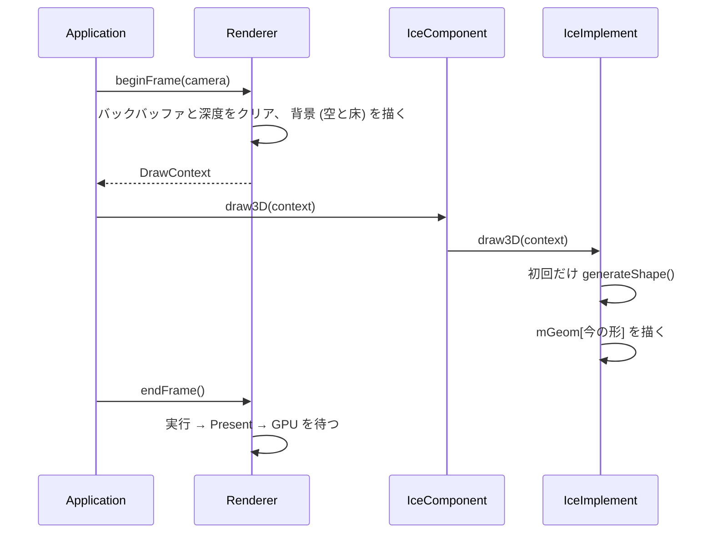
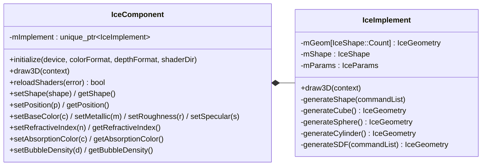
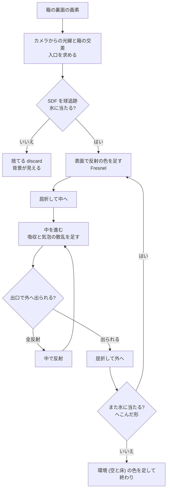

# 設計: SDF 氷 (DirectX 12)

## 目的

氷の部品 (`src/ice/`) に、 SDF (符号付き距離場) で形を表した氷を足す。
今あるプリミティブ (キューブ・球・円柱) と同じく `generateShape()` の中で作って `mGeom` に入れ、 切り替えて描けるようにする。

SDF の氷では、 氷らしく見えるための次の要点を押さえる。

- 浅い角度ほど強く映り込む (Fresnel)
- 向こう側が屈折でずれて見える
- 厚い所ほど青い (吸収)
- 中から浅い角度で当たった光は外へ出られない (全反射)
- 芯が気泡で白く濁る
- 影が氷の色に色付く

## 範囲

| やる | やらない |
| --- | --- |
| 氷の部品 (`IceComponent` / `IceImplement` / `IceGenerate`) | 融解・破壊・浮力などの物理 |
| プリミティブ (キューブ・球・円柱) と SDF の形の切り替え | 氷を複数並べる、 氷どうしの重なり |
| プリミティブの質感 (金属・粗さの PBR) をセッターで変える | 粗さに応じた映り込みのぼかし (プリフィルター) |
| カメラとライトを定数バッファでシェーダーへ渡す (ハードコードしない) | 複数のライト、 点光源 |
| SDF を CPU で 3D テクスチャに焼き、 箱の中をレイマーチで描く | メッシュからの SDF の生成 |
| 氷を動かすための最小のエンジンの代わり (`src/engine/`) | TAA、 ポストエフェクト |

## 全体の構成

```
Test/
├── CMakeLists.txt
├── src/
│   ├── main.cpp                   … 入口
│   ├── engine/                    … エンジンの代わり (氷を動かすための土台。 読まなくてよい)
│   │   ├── Application.h / .cpp   … 部品をつなぐ。 入力 → カメラ・氷の設定、 毎フレームの描画
│   │   ├── Window.h / .cpp        … Win32 のウィンドウと入力
│   │   ├── OrbitCamera.h / .cpp   … 注視点の周りを回るカメラ
│   │   ├── GraphicsDevice.h / .cpp… デバイス・コマンドキュー・フェンス
│   │   ├── SwapChain.h / .cpp     … スワップチェーンとバックバッファ
│   │   ├── DepthBuffer.h / .cpp   … 深度バッファ
│   │   ├── Renderer.h / .cpp      … フレームの始まりと終わり、 背景
│   │   ├── BackgroundPass.h / .cpp… 空と床を全画面に描く
│   │   ├── ShaderCompiler.h / .cpp… HLSL のファイルをコンパイルする
│   │   ├── DrawContext.h          … 描画に渡す物 (コマンドリスト・シーンの定数)
│   │   ├── DirectionalLight.h     … 平行光源 (太陽) の向き・色・強さ
│   │   ├── SceneConstants.h       … シーンの定数 (カメラとライト)。 全部のシェーダーが b0 で読む
│   │   ├── MathTypes.h            … 小さなベクトルと行列 (Float3 / Float4x4)
│   │   ├── DxCheck.h              … HRESULT の失敗を例外にする
│   │   └── shaders/
│   │       ├── SceneConstants.hlsli … シーンの定数の HLSL 側 (cbuffer SceneConstants : b0)
│   │       ├── Environment.hlsli  … 空・床・表示用の変換 (氷のシェーダーも使う)
│   │       └── Background.hlsl    … 背景の全画面シェーダー
│   └── ice/                       … 氷の部品 (ここだけ見ればよい)
│       ├── IceComponent.h / .cpp  … 外から使う窓口。 セッター・ゲッター。 IceImplement を private に持つ
│       ├── IceImplement.h / .cpp  … 実装。 draw3D、 パイプライン、 mGeom
│       ├── IceGenerate.cpp        … IceImplement の形づくり (generateShape と各形)
│       └── shaders/
│           ├── IceCommon.hlsli    … 氷ごとの定数 (b1)・氷の値・Fresnel
│           ├── IceMesh.hlsl       … プリミティブ (メッシュ) の面。 金属・粗さの PBR
│           └── IceSdf.hlsl        … SDF の氷 (箱の中をレイマーチ)
└── docs/
    ├── DESIGN.md                  … この設計
    ├── 01-…08-*.md                … 要素ごとの解説 (コードと計算・アルゴリズムの説明)
    ├── guide/                     … 自分のプロジェクトに氷を実装する手順と、 参考文献
    └── presentation/              … 成果発表のスライドのテンプレートと、 構成のメモ
```

`src/engine/` は自分のエンジンの代わりで、 氷の部品が使う物 (デバイス・コマンドリスト・カメラ) を用意するだけ。
自分のエンジンへ移すときは `src/ice/` を持っていき、 `DrawContext` と、 シーンの定数 (カメラとライト) の受け取り方をエンジンの物に置き換える (`docs/guide/`)。

### 1 フレームの流れ



## 氷の部品 (`src/ice/`)

### クラス



| ファイル | 中身 |
| --- | --- |
| `IceComponent.h / .cpp` | 外から使う窓口。 形と氷の値のセッター・ゲッター、 `draw3D` と `initialize` を `IceImplement` へ渡す。 実装は `mImplement` (private) に隠す |
| `IceImplement.h / .cpp` | ルートシグネチャと PSO (メッシュ用・SDF 用)、 SDF の SRV ヒープ、 `draw3D` |
| `IceGenerate.cpp` | `IceImplement` の形づくりだけを分けたファイル。 `generateShape` / `generateCube` / `generateSphere` / `generateCylinder` / `generateSDF` |

`IceShape` は形の種類 (`Cube`, `Sphere`, `Cylinder`, `Sdf`, `Count`)。 `mGeom` は `IceShape` を添え字にした配列。

### 形づくり (`generateShape`)

`draw3D` の最初の呼び出しで 1 回だけ、 全部の形を作って `mGeom` に入れる。

```cpp
void IceImplement::generateShape(ID3D12GraphicsCommandList* commandList)
{
    for (int i = 0; i < static_cast<int>(IceShape::Count); ++i) {
        switch (static_cast<IceShape>(i)) {
        case IceShape::Cube:     mGeom[i] = generateCube(); break;
        case IceShape::Sphere:   mGeom[i] = generateSphere(); break;
        case IceShape::Cylinder: mGeom[i] = generateCylinder(); break;
        case IceShape::Sdf:      mGeom[i] = generateSDF(commandList); break;
        default: break;
        }
    }
}
```

`IceGeometry` (1 つの形):

| メンバー | 内容 |
| --- | --- |
| 頂点バッファ・インデックスバッファとビュー | 頂点は位置・法線・UV。 アップロードヒープに置く (小さく、 作った後は変えないため) |
| `indexCount` | 描く頂点の数 |
| `isSdf` | SDF の形か。 描くときの PSO を選ぶ |
| `sdfTexture` と `sdfUpload` | SDF の 3D テクスチャと、 送るための一時バッファ (SDF のときだけ) |
| `boundsMin`, `boundsMax` | SDF の格子が覆う箱 (物体の空間) |

### generateSDF

1. **CPU で SDF を焼く**: 64 × 64 × 64 の格子の各点で、 氷の形の符号付き距離を計算する (`R32_FLOAT`)。
   形は 「角の丸い箱 + 表面のゆらぎ + 角の欠け」。 式で書けば何でも焼ける (重い式でも 1 回だけ)。
2. **3D テクスチャへ送る**: 既定ヒープに 3D テクスチャを作り、 アップロードバッファから `CopyTextureRegion` で写す。
   写す命令は `draw3D` に渡されたコマンドリストに記録するので、 そのフレームの描画より先に GPU で実行される。
3. **SRV を作る**: シェーダーから読めるよう、 ヒープに SRV を 1 つ作る。
4. **箱のメッシュを作る**: 格子が覆う箱 (`boundsMin` 〜 `boundsMax`) のメッシュ。 描くとこの箱の画素でだけピクセルシェーダーが動く。

### 描き方

| 形 | PSO | 中身 |
| --- | --- | --- |
| キューブ・球・円柱 | メッシュ用 (`IceMesh.hlsl`) | 金属・粗さの PBR (GGX・Smith・Schlick の Fresnel と Lambert)。 マテリアルはセッターで変える |
| SDF | SDF 用 (`IceSdf.hlsl`) | 箱の裏面を描き、 その画素を通る光線で箱の中をレイマーチする。 氷に当たらなければ捨てる (`discard`) |

SDF の箱は **裏面だけ** を描く (表面をカリング)。 カメラが箱の中に入っても描けるようにするため。
光線の入口は、 ピクセルシェーダーで光線と箱の交差を計算して求める。

### ルートシグネチャ (氷の部品)

| 番号 | 種類 | 中身 |
| --- | --- | --- |
| 0 | 定数バッファビュー (`b0`) | エンジンのシーンの定数 (`SceneConstants`: カメラとライト)。 エンジンが毎フレーム書いたものを、 そのまま読む |
| 1 | 32 bit 定数 (`b1`) | 氷ごとの値: `Position`、 マテリアル (`BaseColor`, `Metallic`, `Roughness`, `Specular`)、 SDF の値 (`RefractiveIndex`, `AbsorptionColor`, `BubbleDensity`, `BoundsMin`, `BoundsMax`) |
| 2 | デスクリプターテーブル (`t0`) | SDF の 3D テクスチャ |
| 静的サンプラー (`s0`) | 線形、 端で止める | |

行列は行ベクトル (p × M) の流儀で作り (`src/engine/MathTypes.h`)、 CPU で転置して渡す。 HLSL では `mul(float4(p, 1), ViewProj)` と、 CPU と同じ順で書く。

### 光の追跡 (`IceSdf.hlsl`)



| 段 | 方法 |
| --- | --- |
| SDF を読む | 3D テクスチャを線形補間で読む。 箱の外は大きい値 |
| 表面を探す | 球追跡。 SDF の値 × 0.9 ずつ進む |
| 法線 | SDF の勾配 (格子 1 つ分の中心差分) |
| 反射 | Schlick の Fresnel。 F0 は屈折率から求める (1.31 なら 0.018) |
| 入る | `refract(d, n, 1 / 屈折率)` |
| 中を進む | `clamp(-φ, 格子 1 つ分, 5 cm)` ずつ。 φ > 0 になったら 2 分探索で出口を絞る |
| 吸収 | Beer–Lambert。 `T *= exp(-σa × 距離)` |
| 気泡 | 表面から 10 cm より深い所に密度を置き、 散乱した光を足す |
| 出る | `refract(d, -n, 屈折率)`。 0 が返れば全反射 |
| 環境 | 外へ出た光線の先の空と床 (エンジンの `Environment.hlsli`) |
| 影 | 氷の部品が床に影の四角形を描き、 太陽への光線が SDF の中を通った長さで色付ける |

### 氷の値 (セッター・ゲッター)

| 値 | 既定 | 意味 |
| --- | --- | --- |
| 形 | `Cube` | `Cube` / `Sphere` / `Cylinder` / `Sdf` |
| 下地の色 | (0.70, 0.85, 0.95) | プリミティブの色 |
| 金属 | 0 | 0 = 金属でない、 1 = 金属 |
| 粗さ | 0.3 | 0.04〜1 |
| 鏡面反射の強さ | 0.5 | 金属でない面の F0 = 0.08 × 値 (0.5 で 4%) |
| 位置 | (0, 0, 0) | 物体の原点 (底の中心) の位置 |
| 屈折率 | 1.31 | 氷 (空気は 1.0)。 F0 = ((n − 1) / (n + 1))² |
| 吸収の色 | (0.45, 0.75, 0.90) | 厚さ 1 m を通った白がこの色になる。 σa = −ln(色) |
| 気泡の密度 | 5.0 | 芯の濁りの強さ (1/m)。 0 で澄んだ氷 |

吸収は本物の氷より強めにしてある (本物は数 m でようやく青い)。 小さな塊でも色が見えるようにするため。

## エンジンの代わり (`src/engine/`)

氷の部品を動かすための最小の土台。 自分のエンジンでは不要。

| クラス | 責任 |
| --- | --- |
| `Application` | 部品を作ってつなぐ。 入力をカメラと氷の設定へ渡し、 毎フレーム描かせる |
| `Window` | ウィンドウとメッセージ。 入力を関数で知らせる |
| `OrbitCamera` | 角度と距離。 ビュー・射影の行列を作る |
| `GraphicsDevice` | デバイス・コマンドキュー・フェンス |
| `SwapChain` / `DepthBuffer` | バックバッファと深度バッファ |
| `Renderer` | `beginFrame` (クリア・背景) と `endFrame` (実行・表示・待つ) |
| `BackgroundPass` | 空と床を全画面の三角形で描く |
| `ShaderCompiler` | HLSL のファイルをコンパイルする (`D3DCompileFromFile`, SM 5.0) |
| `MathTypes.h` | `Float3` / `Float4x4` と、 ビュー・射影・逆行列。 外部の数学ライブラリ (DirectXMath など) は使わない |
| `DirectionalLight.h` | 平行光源 (太陽) の向き・色・強さ。 `Application` が持つ |
| `SceneConstants.h` | カメラとライトをまとめた定数。 `Renderer` が毎フレーム定数バッファに書き、 背景も氷も `b0` で読む |

`DrawContext` (氷の部品へ渡す物):

| メンバー | 内容 |
| --- | --- |
| `commandList` | 記録中のコマンドリスト |
| `sceneConstants` | シーンの定数バッファの GPU のアドレス。 ルート引数 0 (`b0`) に渡す |
| `scene` | 同じ値の CPU 側の写し (C++ でカメラの位置などを使うとき用) |

### シーンの定数 (カメラとライト)

カメラとライトの値は、 シェーダーに **ハードコードしない**。 エンジンが毎フレーム 1 つの定数バッファに書き、 どのシェーダーも同じ番号 (`b0`) で読む (多くのエンジンと同じ形)。

| 名前 | 中身 |
| --- | --- |
| `ViewProj` / `InvViewProj` | ビュー × 射影とその逆 (転置済み) |
| `CameraPos`, `Time` | カメラの位置、 起動からの秒 |
| `LightDirection` | 面から太陽へ向かう向き (長さ 1) |
| `LightColor` | 太陽の色 × 強さ |

自分のエンジンで同じ物を探す手順は `docs/04-camera-light.md` と `docs/guide/` にまとめる。

座標: 単位はメートル、 y が上の右手系。 床は `y = 0`。 三角形は外から見て反時計回りを表にする。

操作:

| 入力 | 動作 |
| --- | --- |
| 左ドラッグ | カメラを回す |
| ホイール | 寄る・引く |
| 1 / 2 / 3 / 4, Tab | 形を切り替える (キューブ / 球 / 円柱 / SDF、 Tab は順に) |
| M | 金属と金属でないを切り替える |
| `[` `]` | 粗さを下げる・上げる |
| `,` `.` | 鏡面反射の強さを下げる・上げる |
| Space | 自動回転の切り替え |
| R | シェーダーを読み直す |
| Esc | 終了 |

## 確かめること

| 項目 | どうなればよいか |
| --- | --- |
| 切り替え | 1〜4 と Tab で形が変わる |
| マテリアル | M・`[` `]`・`,` `.` で質感が変わる |
| ライト | `DirectionalLight` の向きを変えると、 背景・プリミティブ・氷の照らされ方がそろって変わる |
| 反射 | 正面からはほとんど映らず、 浅い角度で強く映る |
| 屈折 | 氷越しの床の市松模様がずれて見える |
| 吸収 | 厚い所ほど青い |
| 全反射 | 側面を浅い角度でのぞくと、 向こうが見えない所がある |
| 気泡 | 芯が白く濁る。 気泡の密度 0 で澄む |
| 影 | 氷の影が青く色付く |
| 壊れない | NaN による黒や白の点が出ない。 カメラが箱の中でも描ける |

## フェーズ

| フェーズ | 要素 (ブランチ) | 完了の条件 |
| --- | --- | --- |
| 0 設計 | `docs/design`, `docs/ice-module-design` | この文書 |
| 1 基盤 | `feature/dx12-base`, `feature/environment`, `feature/ice-component`, `feature/camera-light` | 空と床の上に、 キューブ・球・円柱を切り替えて描ける。 カメラとライトは定数バッファから読む |
| 2 SDF 氷 | `feature/generate-sdf`, `feature/ice-optics` | SDF の氷が反射・屈折・吸収・全反射して見える |
| 3 仕上げ | `feature/ice-bubbles`, `feature/ice-shadow`, `docs/guide`, `docs/presentation`, `docs/readme` | 白く濁った芯、 色付きの影、 実装の手順と参考文献、 発表のテンプレート、 README |

各要素には `docs/` に解説を 1 つ付ける (必要なコードを載せ、 1 つずつ説明する)。
エンジンの代わりの要素の解説は短く、 氷の部品の要素の解説を詳しくする。

| 要素 | 解説 |
| --- | --- |
| `feature/dx12-base` | `docs/01-dx12-base.md` |
| `feature/environment` | `docs/02-environment.md` |
| `feature/ice-component` | `docs/03-ice-component.md` |
| `feature/camera-light` | `docs/04-camera-light.md` |
| `feature/generate-sdf` | `docs/05-generate-sdf.md` |
| `feature/ice-optics` | `docs/06-ice-optics.md` |
| `feature/ice-bubbles` | `docs/07-ice-bubbles.md` |
| `feature/ice-shadow` | `docs/08-ice-shadow.md` |
| `docs/guide` | `docs/guide/` (自分のプロジェクトに実装する手順・参考文献とその利用条件) |
| `docs/presentation` | `docs/presentation/` (スライドのテンプレート `.pptx` と構成のメモ `.txt`) |

解説には、 コードの説明だけでなく、 使っている計算とアルゴリズム (式の意味・なぜそうするか) を書く。
参考文献は、 正規の入手先であることと、 利用条件 (引用・実装・コードの流用・商用利用) を確かめて書く。

## 書き方

- 名前: クラスは `IceComponent` のように大文字始まり。 関数は `draw3D` / `generateShape` のように小文字始まり。 メンバー変数は `mGeom` のように `m` を付ける。 定数は `kGridSize` のように `k` を付ける。
- 1 クラス 1 ファイル (`.h` と `.cpp`)。 ただし `IceImplement` の形づくりは長いので `IceGenerate.cpp` に分ける。
- コードとシェーダーには、 何をしているか・なぜそうするかを詳しくコメントで書く。
- 失敗は `ThrowIfFailed` で例外にし、 `main.cpp` で表示する。 ただしシェーダーの読み直しの失敗は前の PSO で描き続ける。

## ブランチの運用

```
master    o-------------------------o---------------o---------------o
           \                       /  Phase 1      /  Phase 2      /  Phase 3
develop     o---o-----o-----o-----o---------------o---------------o
                 \   / \   / \   /
feature/*         o-o   o-o   o-o
```

| ブランチ | 役割 |
| --- | --- |
| `master` | フェーズが完了した安定版。 `develop` からのマージだけを受ける |
| `develop` | 開発の統合先 (既定のブランチ)。 要素のブランチはここへマージする |
| `feature/*`, `docs/*` | 要素ごとの作業。 `develop` から切り、 完成したら PR で `develop` へ |

- マージは PR で行い、 マージコミットを残す。
- フェーズの最後に `develop` → `master` の PR を作る。

### Issue とマイルストーン

- フェーズごとにマイルストーンを作る (`Phase 0: 設計` 〜 `Phase 3: 仕上げ`)。
- 要素ごとに Issue を 1 つ作り、 マイルストーンに入れる。 本文は `.github/ISSUE_TEMPLATE/element.md` (目的・やること・完了の条件)。
- ラベルは機能が `enhancement`、 文書だけが `documentation`。
- PR の本文に `Closes #<Issue 番号>` を書く。 既定のブランチは `develop` なので、 `develop` へのマージで Issue が閉じる。
- フェーズの PR (`develop` → `master`) には、 そのフェーズで閉じた Issue を並べる。

### コミットメッセージ

[Conventional Commits](https://www.conventionalcommits.org/ja/v1.0.0/) に従う。

```
<type>(<scope>): <要約>

<本文: 何を・なぜ>
```

| type | 使う所 |
| --- | --- |
| `feat` | 機能の追加 |
| `fix` | 不具合の修正 |
| `docs` | 文書だけの変更 |
| `refactor` | 振る舞いを変えない整理 |
| `chore` | ビルド設定など |

scope は `ice` (氷の部品)、 `engine` (エンジンの代わり)、 `shader`、 `build` など。

### PR

タイトルはコミットと同じ書き方。 本文は `.github/pull_request_template.md` に従う (概要・変更内容・確認方法・関連)。
