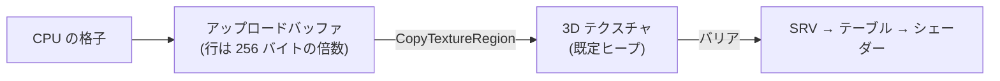

# step3. 3D テクスチャを作って GPU へ送る

**ゴール**: step2 で焼いた格子を、 シェーダーから読める 3D テクスチャにする。 この段の終わりで、 RenderDoc でテクスチャの中身が見える。

計算の解説: [`docs/05-generate-sdf.md`](../05-generate-sdf.md) §4。 見本: `src/ice/IceGenerate.cpp` (`generateSDF` の 3〜6)、 `src/ice/IceImplement.cpp` (`initialize`, `createRootSignature`, `draw3D`)。

---

## 全体の流れ



## 1. テクスチャを作る

| 項目 | 値 |
| --- | --- |
| `Dimension` | `D3D12_RESOURCE_DIMENSION_TEXTURE3D` |
| `Width` / `Height` / `DepthOrArraySize` | 64 / 64 / 64 |
| `Format` | `DXGI_FORMAT_R32_FLOAT` |
| `MipLevels` | 1 |
| ヒープ | 既定ヒープ (`D3D12_HEAP_TYPE_DEFAULT`) |
| 最初の状態 | `D3D12_RESOURCE_STATE_COPY_DEST` |

> エンジンにテクスチャを作る関数 (リソースの管理) があれば、 それを使う。 3D テクスチャに対応しているかを確かめる。

## 2. アップロードバッファに並べる

1. `GetCopyableFootprints` に 1. の記述を渡し、 並び (`footprint`, 行の数, 1 行の中身の大きさ, 全体の大きさ) を受け取る。
2. 全体の大きさのアップロードバッファを作る。
3. **1 行ずつ** 写す。 バッファ側の行の間隔は `footprint.Footprint.RowPitch` (256 の倍数)、 1 枚 (z) の間隔は `RowPitch × 行の数`。

```cpp
uint8_t* dst = staging + footprint.Offset + z * slicePitch + y * rowPitch;
memcpy(dst, &grid[(z * n + y) * n], rowBytes);
```

> 64 × 4 バイト = 256 なので、 たまたま隙間は無い。 でも格子の大きさを変えると隙間ができるので、 最初から 1 行ずつ写す書き方にしておく。

## 3. 写す命令とバリアを記録する

```cpp
commandList->CopyTextureRegion(&dst, 0, 0, 0, &src, nullptr);   // dst: テクスチャ (SUBRESOURCE_INDEX 0)、 src: バッファ (PLACED_FOOTPRINT)
// COPY_DEST → PIXEL_SHADER_RESOURCE
commandList->ResourceBarrier(1, &barrier);
```

- 命令を記録するコマンドリストは、 **描く命令より前に GPU で実行される物** を使う。 `draw3D` の中で `generateShape` を呼んでいるなら、 そのコマンドリストでよい (写す命令が描く命令の前に並ぶ)。
- **アップロードバッファは、 GPU が写し終えるまで壊さない**。 形の構造体 (`IceGeometry`) に持たせておくのが簡単。

## 4. シェーダーから読めるようにする

### 4.1 SRV

| 項目 | 値 |
| --- | --- |
| `Format` | `DXGI_FORMAT_R32_FLOAT` |
| `ViewDimension` | `D3D12_SRV_DIMENSION_TEXTURE3D` |
| `Shader4ComponentMapping` | `D3D12_DEFAULT_SHADER_4_COMPONENT_MAPPING` |
| `Texture3D.MipLevels` | 1 |

置き場所は **シェーダーから見えるデスクリプターヒープ** (`D3D12_DESCRIPTOR_HEAP_FLAG_SHADER_VISIBLE`)。
エンジンにデスクリプターの割り当ての仕組みがあれば、 それで 1 つもらう (自分でヒープを作ると、 エンジンのヒープと切り替えが必要になる)。

### 4.2 ルートシグネチャ

`IceImplement` のルートシグネチャに 2 つ足す (見本: `createRootSignature`)。

| 足す物 | 中身 |
| --- | --- |
| デスクリプターテーブル | SRV 1 つ、 `t0`、 ピクセルシェーダーから見える |
| 静的サンプラー | `s0`、 `MIN_MAG_MIP_LINEAR`、 U / V / W とも `CLAMP` |

### 4.3 描くとき

```cpp
ID3D12DescriptorHeap* heaps[] = { srvHeap };
commandList->SetDescriptorHeaps(1, heaps);   // エンジンのヒープを使うなら、 エンジンが設定済みのことが多い
commandList->SetGraphicsRootDescriptorTable(kRootSdf, gpuHandleOfSrv);
```

## 確かめ方

- [ ] デバッグレイヤーにエラーや警告が出ない (状態の食い違い、 ヒープの設定忘れ)
- [ ] RenderDoc の Texture Viewer で 3D テクスチャを開き、 z の断面を動かすと、 角の丸い四角が負 (中) の値で見える
- [ ] 外周が正、 中心が約 −0.37

## つまずきやすい所

| 症状 | 原因 |
| --- | --- |
| `CopyTextureRegion` でデバッグレイヤーのエラー | `RowPitch` が 256 の倍数でない / テクスチャの状態が COPY_DEST でない |
| 中身が縞々・斜めにずれる | 1 行ずつでなく、 まとめて写した (行の間隔と中身の大きさが違う) |
| 中身が 0 のまま | 写す命令を記録したコマンドリストが実行されていない / アップロードバッファを先に解放した |
| 描くときにエラー | SRV のヒープを設定していない / テーブルが別のヒープを指している |
