# 06. 氷 (コップは一旦外してある)

氷 3 つを、 **部品 1 つ = 氷 1 つ** で描くサンプル。 氷を増やすなら部品を置くだけで、 シェーダーは氷 1 つ分しか知らない。
シェーダーは、 作る順に 1 段ずつ機能が増えていく **[`IceShader0.hlsl`](shaders/IceShader0.hlsl) 〜 [`IceShader13.hlsl`](shaders/IceShader13.hlsl)** に分けてある。 段階 13 が完成形 (気泡・亀裂・体積の散乱・周りの景色入り)。
コップは一旦外した (内部散乱を先に入れるため)。

| 完成形 (段階 13) | 気泡と亀裂 (寄って見た所) |
| --- | --- |
|  | 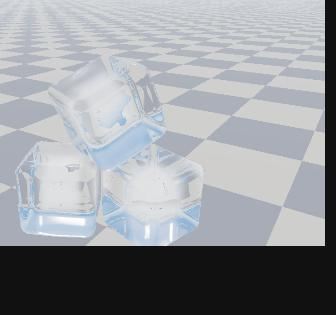 |

(同じシェーダーを WebGL2 で動かした絵。 共通のカメラに収まるよう、 場面は本物の 8 倍くらいの大きさにしてある)

## 段階のファイル (IceShader0〜13)

自分のエンジンに実装するときは、 **0 から順に 1 段ずつ** 足していく。 各ファイルのヘッダーに 「前の段から引き継ぐ物」 「今回足す物」 「仕組み」 「確かめること」 が書いてあり、 前の段から足した行には `★ 段階 N` の印がある。 前の段のファイルと見比べると、 足した所だけが分かる。
サンプルを動かすと、 **0〜9 と ← → で段階を切り替えられる** (10〜13 は →。 タイトルバーに段階の名前が出る)。 C++ 側は全部の段階で同じ。

| 段階 | 足す物 | 確かめること | 絵 |
| --- | --- | --- | --- |
| [0](shaders/IceShader0.hlsl) | 箱を描く (頂点シェーダーで 1 回だけ変換、 部品の空間の位置を色に) | 色の付いた箱が見える。 中に入っても消えない (裏面を描いている) | 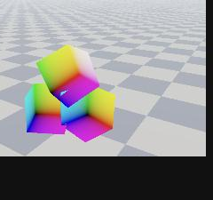 |
| [1](shaders/IceShader1.hlsl) | 形の式 (SDF)、 球追跡、 discard、 深度 | 角の丸い白い立方体。 重なりの前後が正しい | 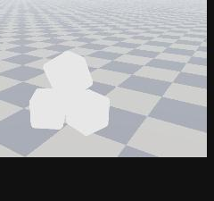 |
| [2](shaders/IceShader2.hlsl) | 法線 (中心差分)、 ランバートの光 | 太陽の側が明るい。 J / L で明るい面が回る | 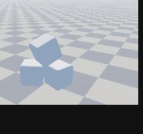 |
| [3](shaders/IceShader3.hlsl) | フレネルの映り込み、 まっすぐ透かす (屈折なし)。 col と thr で光を運ぶ形 | うっすらとしか見えない (正面は透明、 縁だけ映る)。 これが 「屈折の無い透明」 | 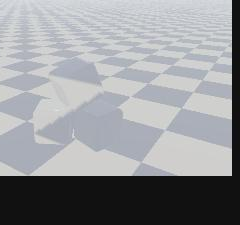 |
| [4](shaders/IceShader4.hlsl) | 屈折 (入口と出口)、 中を出口まで進む (外へ出てから 2 分探索で詰める) | 床の模様が曲がる。 **ここで急に氷らしくなる**。 斜めから見ても中の面が重ならない | 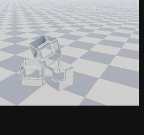 |
| [5](shaders/IceShader5.hlsl) | 全反射 (8 回まで)、 後ろの面の映り込み | 面ごとのまだら、 縁が銀色に光る | 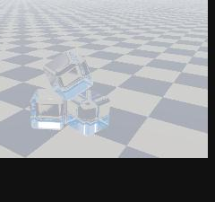 |
| [6](shaders/IceShader6.hlsl) | ノイズ、 溶けかけのでこぼこ、 吸収 (ランベルト・ベール) | 屈折した模様がゆるく波打つ | 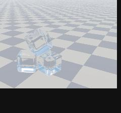 |
| [7](shaders/IceShader7.hlsl) | 白い芯 (内部散乱の簡単版) | 真ん中が白く濁り、 縁は透明 |  |
| [8](shaders/IceShader8.hlsl) | 気泡 (マスごとに 0 か 1 個) | 縁の光る小さな粒。 芯の近くほど多い |  |
| [9](shaders/IceShader9.hlsl) | 亀裂 (ぎざぎざの円盤の割れ目) | 斜めから見ると銀色に光る面 | 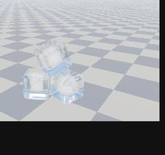 |
| [10](shaders/IceShader10.hlsl) | **体積の散乱**: 入口〜出口を一定の歩幅で 32 歩、 濃さは SDF の層 × 3D ノイズ、 画素ごとのずらし (段階 7 の簡単版と置き換わる) | 芯がむらのある雲のように濁る。 縁の 4 cm は透明。 層の縞が出ない | 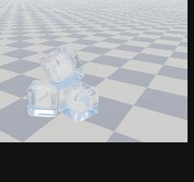 |
| [11](shaders/IceShader11.hlsl) | 散乱の影: 太陽の方へ 4 歩進み、 芯で減った分を掛ける | 芯の太陽の側が明るく、 反対側が暗い | 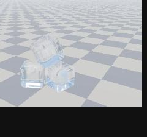 |
| [12](shaders/IceShader12.hlsl) | 前方散乱 (Henyey-Greenstein の位相関数) | 逆光 (太陽の方を向いて見る) で芯がぼんやり光る | 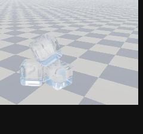 |
| [13](shaders/IceShader13.hlsl) | **周りの景色**: 屈折した先・映り込みを、 画面のコピーから読む (環境マップの行はコメントアウトで残す)。 **完成形**: 参考文献と全部の解説がヘッダーにある | 氷を通した床が、 後ろの本当の床とつながる | 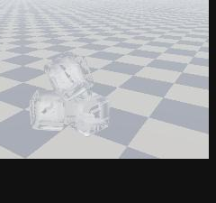 |

## 目次

1. [ファイルと描く流れ](#1-ファイルと描く流れ)
2. [氷に見えるために要る物](#2-氷に見えるために要る物)
3. [ノイズ (hash / noise)](#3-ノイズ-hash--noise)
4. [形 (SDF)](#4-形-sdf)
5. [法線 (calcNormal)](#5-法線-calcnormal)
6. [外から表面を探す (rayMarch)](#6-外から表面を探す-raymarch)
7. [表面: フレネルと反射](#7-表面-フレネルと反射)
8. [屈折: スネルの法則](#8-屈折-スネルの法則)
9. [中を進む (rayMarchInside): ランベルト・ベールの法則と白い芯](#9-中を進む-raymarchinside-ランベルトベールの法則と白い芯) (出口の探し方・体積の散乱・気泡・亀裂もここ)
10. [出口: 全反射と後ろの面](#10-出口-全反射と後ろの面)
11. [景色: 画面のコピーと環境マップ](#11-景色-画面のコピーと環境マップ)
12. [部品の箱・空間・深度](#12-部品の箱空間深度)
13. [参考文献](#13-参考文献)
14. [全部の部品の出典と、 自分で決めた所](#14-全部の部品の出典と自分で決めた所)

---

## 1. ファイルと描く流れ

| ファイル | 中身 |
| --- | --- |
| [`shaders/IceShader0〜13.hlsl`](shaders/IceShader13.hlsl) | 氷 1 つを描くシェーダー (段階ごと)。 関数はノイズ・SDF・法線・フレネル・気泡・亀裂・体積の散乱・周りの景色・レイマーチング。 描く流れは `PSMain` |
| [`SdfObject.h`](SdfObject.h) / [`.cpp`](SdfObject.cpp) | 部品 (RenderEntity)。 氷を囲む箱を描く。 位置・回転・屈折率・吸収・白い芯をセッターで決める |
| [`GlassIceSample.h`](GlassIceSample.h) / [`.cpp`](GlassIceSample.cpp) | 氷 3 つを置く (自分は描かない)。 キーで段階 (シェーダーのファイル) を切り替える。 毎フレーム最初に環境マップと画面のコピーの SRV を用意する |
| [`EnvironmentImage.h`](EnvironmentImage.h) / [`.cpp`](EnvironmentImage.cpp) | 環境マップ (キューブマップ) の 6 面を CPU で作る (背景と同じ式) |
| [`EnvironmentMap.h`](EnvironmentMap.h) / [`.cpp`](EnvironmentMap.cpp) | 6 面をキューブマップのテクスチャにして送る (t0)。 同じヒープの t1 に、 画面のコピーの SRV も置く |

ピクセルシェーダーの引数は `v` で、 `v.Pos` (画面の位置)・`v.LPos` (部品の空間の位置)・`v.WPos` (ワールドの位置)・`v.UV` が取れる。 カメラの位置は `cameraPos`。

`PSMain` の流れ (段階 13):

```
PSMain(v)
├─ 光線を部品の空間で作る (cameraPos → v.LPos、 最初に 1 回だけ invWorld)
├─ 1. rayMarch: 外から表面を探す。 当たらなければ discard。 当たった点の深度を出す
├─ 2. 表面: 映り込み (フレネル) を足し、 屈折 (スネル) して中へ
├─ for 出口 (8 回まで: 全反射で跳ね返る)
│   ├─ 3. rayMarchInside: 中を出口まで (吸収・気泡・亀裂)。 外へ出てから 2 分探索で出口を詰める
│   │     scatterInside : 入口〜出口を一定の歩幅で、 体積の散乱 (層 × ノイズ・散乱の影・前方散乱)
│   └─ 4. 出口: 屈折して外へ / 全反射して 3 へ。 後ろの面の映り込み
└─ 5. 景色: 屈折して出た先を、 画面のコピーから読む
```

描く順は **背景 → (画面のコピー) → 氷 3 つ**。

## 2. 氷に見えるために要る物

効く順:

1. **屈折** (入るときと出るときの 2 回)。 背景がずれて見える。 無いと 「何も無い」 か 「色の付いた透明な箱」 に見える。
2. **全反射**。 中から浅い角度で出ようとした光は外へ出られず、 中で跳ね返る。 面ごとのまだらや、 縁が銀色に光るのはこれ。
3. **色を付けすぎない**。 氷が青く見えるのは厚さが数 m あるとき。 コップの氷は光の通る長さが数 cm なので、 ほぼ無色。 吸収が強いと氷塊に見える。
4. **映り込み (フレネル)**。 縁ほど白く映り込む。 景色の太陽が映ると、 鋭いハイライトになる (ハイライトの計算は別に要らない)。
5. **形**: 小さく、 角が丸く (溶けかけ)、 いくつか傾けて重ねる。 でこぼこはゆるく小さく (細かいと霜に見える)。
6. **中身**: 冷凍庫の氷なら白い芯と、 粒の気泡。 割れ目 (亀裂) は角度で銀色に光る。 お店の氷なら芯も気泡も無く、 ほぼ透明。
7. **影と周り**: 背景の模様 (透けて歪む物が無いと、 屈折しても分からない)、 周りの物が屈折して映ること (段階 13)、 影 (このサンプルでは入れていない。 [§11](#11-景色-画面のコピーと環境マップ))。

### まだ足せる物 (このサンプルに無い物)

| 足す物 | 見た目 | 作り方の考え方 |
| --- | --- | --- |
| 芯から外へ伸びる白いすじ | 冷凍庫の氷の、 放射状の白い筋 | 体積の散乱のノイズを、 中心から外への向きに引き伸ばして読む |
| 霜 (表面の白いくもり) | 冷凍庫から出した直後のざらっとした白さ | 表面の映り込みに、 細かいノイズで白を混ぜる。 法線を細かく揺らす |
| 溶けた水の膜・しずく | 濡れた鋭いハイライト、 角の丸み | 角の丸みを大きく、 表面のでこぼこをなめらかに、 映り込みを少し強く |
| 影とコースティクス | 床に薄い影と、 影の中の光の集まり | 影はシャドウマップ (薄く)。 光の集まりは、 太陽からの光を氷で屈折させた点を床に置く (重い) |
| ほかの物が映り込む反射 | 隣の物が面に映る | 画面空間の反射 (SSR) か、 周りを撮ったキューブマップ |
| 色のにじみ (分散) | 縁の虹色 | 赤・緑・青で屈折率を少し変えて 3 回読む (氷ではごく弱い) |


## 3. ノイズ (hash / noise)

氷の表面を、 溶けかけのようにゆるく波打たせるのに使う。

### hash: 点 → でたらめな値

```hlsl
float hash(float3 p)
{
    return frac(sin(dot(p, float3(127.1, 311.7, 74.7))) * 43758.5453);
}
```

1. `dot(p, (127.1, 311.7, 74.7))`: 3 つの成分を、 ばらばらの重みで 1 つの数にまとめる。
2. `sin(…)`: −1〜1 の値にする。 となりの点 (整数で 1 違う点) でも、 sin の中身が大きく違うので、 値は関係なくばらばらになる。
3. `× 43758.5453` して `frac` (小数の部分だけ取る): 大きく引き伸ばして小数の部分だけを見ると、 少しの違いが 0〜1 の中の大きな違いになる。

これは 「本当の乱数」 ではなく、 **同じ点からはいつも同じ値が出る、 でたらめに見える関数** (ハッシュ)。 シェーダーでは前の結果を覚えておけないので、 位置から直接値を作る。 The Book of Shaders 第 10 章 (日本語) に、 同じ考え方の 2D 版がコードつきで説明されている。

> 注意: sin の精度は GPU によって少し違うので、 同じ点でも GPU が違うと値が変わることがある。 見た目のゆらぎに使う分には問題ない。

### noise: 値ノイズ

```hlsl
float3 i = floor(p);                 // マスの角 (整数の点)
float3 f = p - i;                    // マスの中の位置 (0〜1)
float3 u = f * f * (3.0 - 2.0 * f);  // エルミート補間
// 三線形補間: 角 8 つの hash を x → y → z の順に混ぜる
```

空間を 1 辺 1 の立方体のマスに分け、 **マスの角 8 つに hash で値を置き、 その間をなめらかに混ぜる**。 hash だけだとざらざら (隣の点と関係ない) だが、 混ぜるとゆっくり変わる値になる。

- **エルミート補間** $u = 3f^2 - 2f^3$: $f$ をそのまま使う (直線で混ぜる) と、 マスの境目で傾きが急に変わって筋が見える。 この曲線は $f = 0$ と $f = 1$ で傾きが 0 なので、 境目がなめらかにつながる。 `smoothstep(0, 1, f)` と同じ曲線。
- **三線形補間**: x の向きに 2 つずつ混ぜて 4 つ → y の向きに混ぜて 2 つ → z の向きに混ぜて 1 つ。 3D テクスチャを線形補間で読むのと同じ混ぜ方。
- 最後に `× 2 − 1` で −1〜1 にする。

使い方: `ICE_BUMP * noise(p * 8.0)`。 `p * 8` はマスの大きさを 1/8 にする (= でこぼこの間隔が 12.5 cm)。 `ICE_BUMP` (5 mm) がでこぼこの大きさ。 間隔を細かく・大きさを大きくすると、 霜や雪のように見える。

## 4. 形 (SDF)

SDF は 「点 p から形の表面までの、 符号付きの距離」。 外が正、 表面が 0、 中が負。 `sdf(p)` が氷の形を返す。

### 角の丸い箱 (氷)

```hlsl
float3 q = abs(p) - (b - r);
return length(max(q, 0.0)) + min(max(q.x, max(q.y, q.z)), 0.0) - r;
```

1. `abs(p)`: 箱は x・y・z について対称なので、 +x+y+z の 1/8 だけ考えればよい。
2. `q = abs(p) − (b − r)`: 丸みの分 (r) だけ小さくした箱の、 各軸の面からどれだけ外へ出ているか (負なら中)。
3. 外: 出ている成分だけの長さ `length(max(q, 0))`。 1 つの軸だけ出ていれば面まで、 2 つなら辺まで、 3 つなら角までの距離。
4. 中: いちばん近い面までの距離 = `q` のいちばん大きい成分 (負)。 外では 0 にするため `min(…, 0)`。
5. `− r`: 表面を r だけ外へふくらませる。 小さくした箱の角から r の距離の所が表面になるので、 角が半径 r で丸くなる。

## 5. 法線 (calcNormal)

$$\mathbf{n} = \frac{\nabla \phi}{\lVert \nabla \phi \rVert}, \qquad \frac{\partial \phi}{\partial x} \approx \frac{\phi(\mathbf{p} + h\mathbf{e}_x) - \phi(\mathbf{p} - h\mathbf{e}_x)}{2h}$$

```hlsl
const float2 e = float2(0.0005, 0.0);
return normalize(float3(sdf(p + e.xyy) - sdf(p - e.xyy),
                        sdf(p + e.yxy) - sdf(p - e.yxy),
                        sdf(p + e.yyx) - sdf(p - e.yyx)));
```

SDF は表面から離れる向きにいちばん速く増える。 その向き (**勾配**) が外向きの法線。 各軸で少し前と少し後ろの値の差を取る (**中心差分**)。 `2h` で割るのは、 `normalize` で長さをそろえるので省いている。 `e.xyy` は `(h, 0, 0)`、 `e.yxy` は `(0, h, 0)` (スウィズルで書いている)。

h は形の細かさよりずっと小さくする (0.5 mm)。 大きいと、 角の丸みやでこぼこがぼやけて法線がずれる。

## 6. 外から表面を探す (rayMarch)

**球追跡** (sphere tracing)。 SDF の値 $\phi$ は 「いちばん近い表面までの距離」 なので、 点 p を中心に半径 $\phi$ の球の中には表面が無い。 だから光線の向きがどちらでも、 $\phi$ だけ進むのは安全。

```hlsl
for (int i = 0; i < 128; ++i) {
    float d = sdf(ro + rd * t);
    if (d < 0.0002) return true;  // 表面まで 0.2 mm 未満なら当たり
    t += d * 0.9;                 // 0.9 倍で控えめに進む
    if (t > tMax) break;          // 箱の裏面まで来た = 当たらない
}
```

- 何も無い所は大股、 表面の近くは小股で、 歩幅が勝手に決まる。
- **0.9 倍**: ノイズを足した SDF は本当の距離より少し大きいことがあり、 そのまま進むと表面を越えることがある。 控えめに進んで越えないようにする。
- `tMax` は、 カメラから箱の裏面の点 (`v.LPos`) までの距離。 そこまで進んで当たらなければ、 この画素に形は無い (`discard`)。
- `[loop]` は、 コンパイラにループを展開せずループのまま残させる指定 (回数が多く途中で抜けるため)。

## 7. 表面: フレネルと反射

### フレネル (Schlick の近似)

$$F(\theta) = F_0 + (1 - F_0)(1 - \cos\theta)^5, \qquad F_0 = \left(\frac{n - 1}{n + 1}\right)^2$$

```hlsl
float f0 = pow((ior - 1.0) / (ior + 1.0), 2.0);
return f0 + (1.0 - f0) * pow(1.0 - saturate(cosTheta), 5.0);
```

光が表面に当たると、 一部は反射 (映り込み) し、 残りが中へ入る。 反射する割合 F は角度で変わり、 **正面ではわずか、 浅い角度 (縁) ほど 1 に近づく**。 窓ガラスを斜めから見ると景色が映るのと同じ。

- 正確な式 (フレネルの式) は少し長いので、 Schlick の近似を使う。 $\cos\theta$ は光線と法線のなす角の cos (`dot(-rd, n)`)。
- $F_0$ は正面の反射率。 氷 (n = 1.31): $(0.31 / 2.31)^2 \approx 0.018$ (1.8%)。 ガラス (n = 1.5): $0.04$ (4%)。
- 使い方: 映り込みの色 × F を足し (`col += thr * F * 景色`)、 残りの割合 (1 − F) を中へ持っていく (`thr *= 1 − F`)。

### 反射の向き

$$\mathbf{r} = \mathbf{d} - 2(\mathbf{d}\cdot\mathbf{n})\,\mathbf{n}$$

HLSL の `reflect(d, n)`。 入ってきた向き d の、 法線方向の成分だけを反対にする (鏡で跳ね返る)。 その向きの景色が映り込みの色。

## 8. 屈折: スネルの法則

$$n_1 \sin\theta_1 = n_2 \sin\theta_2$$

光は屈折率の違う物の境目で曲がる。 屈折率は空気 1.0、 氷 1.31、 ガラス 1.5。

```hlsl
rd = refract(rd, n, 1.0 / ior);        // 空気 → 中 (比 n1 / n2 = 1 / 1.31)
float3 outDir = refract(rd, -n, ior);  // 中 → 空気 (比 1.31 / 1)。 法線は光線と向かい合うよう −n
```

- HLSL の `refract(入る向き, 法線, 屈折率の比 n1 / n2)` が曲がった向きを返す。 法線は、 光線が来た側を向いている必要がある。 出口では光線は中から外へ進むので、 外向きの法線 n を反転して `-n` を渡す。
- **入るとき** (空気 → 氷) は法線に近づく向きに曲がり、 **出るとき** は法線から離れる向きに曲がる。 この 2 回の曲がりで、 向こうの景色がずれて見える (歪み)。
- 曲がった向きで景色を読むのが大事。 カメラの向きのまま読むと、 屈折していない (正面が透明なだけ) に見える。

### 歪みの仕組み

「歪み」 は、 屈折で曲がった向きの景色が見えること。 このシェーダーでは、 どこにも 「ずらす量」 は書いていない。 次の 3 つが重なって、 歪みが勝手に出る。

1. **入口の面の向き**: 面が傾いているほど大きく曲がる。 平らな面の真ん中はほぼ平行にずれるだけ、 丸い角では曲がり方が場所ごとに変わるので、 景色が大きく引き伸ばされる。
2. **中を通る長さ**: 曲がったまま進むので、 厚い所ほど出口の位置が大きくずれる。
3. **出口の面の向き**: もう一度曲がる。 入口と出口の面が平行なら、 向きは元に戻って位置だけずれる (窓ガラスと同じ)。 平行でない (氷の角・傾いた面) と向きも変わり、 景色が大きく動く (プリズムと同じ)。

表面のでこぼこ (ノイズ) は面の向きを場所ごとに少しずつ変えるので、 景色がゆらゆら波打って見える。 でこぼこを強くすると、 景色が細かくちぎれて、 霜や曇りガラスのように見える。

## 9. 中を進む (rayMarchInside): ランベルト・ベールの法則と白い芯

```hlsl
float depth = -sdf(ro + rd * t);                          // 表面からの深さ
if (depth < 0.0) break;                                    // 外へ出た (出口を越えた)
tIn = t;                                                   // ここはまだ中
float s = clamp(depth, 0.002, 0.02);                       // 1 歩 (2 mm〜2 cm)
float core = coreDensity * smoothstep(0.05, 0.11, depth);  // 白い芯の濃さ
float a = 1.0 - exp(-core * s);                            // この 1 歩で気泡に当たる割合
col += thr * a * float3(0.85, 0.9, 0.95);                  // 当たった光は白く散らばる
thr *= (1.0 - a) * exp(-absorption * s);                   // 透過率
t += s;
```

### 出口の探し方 (外へ出てから 2 分探索)

中では SDF が負で、 **−SDF が 「いちばん近い表面までの距離」**。 その分だけ進めば表面を越えない (球追跡と同じ理屈)。 ただし、 「表面に近づいたら出口」 にすると、 **斜めの光線で失敗する**:

- 光線が面とほぼ平行に、 表面のすぐ近くを進むと、 −SDF が小さいままなので歩幅も小さく、 **歩数を使い切って出口に着かない**。
- 表面に 0.2 mm 近づいただけで 「出口」 と判断するので、 **本当は出ていないのに出口にしてしまう** (かすめただけの所)。

どちらも、 中の途中の点で屈折・全反射をさせてしまい、 **斜めから見ると中の面が重なって見える**。 そこで:

1. 1 歩を **2 mm〜2 cm** に収めて進む (小さくなりすぎない。 大きすぎて中の濃さを読み飛ばさない)。
2. SDF が **正 (外) になるまで** 進む。 「中だった最後の距離」 を `tIn` に覚えておく。
3. `tIn` (中) と `t` (外) の間を **2 分探索** で 6 回詰める (真ん中が外なら `t` を、 中なら `tIn` を縮める)。 幅は 1/64 (2 cm なら 0.3 mm)。

```hlsl
for (int j = 0; j < 6; ++j) {
    float m = 0.5 * (tIn + t);
    if (sdf(ro + rd * m) > 0.0) t = m;   // 真ん中が外 → 出口は手前
    else tIn = m;                        // 真ん中が中 → 出口は奥
}
```

本体の氷 ([`IceSdf.hlsl`](../../src/ice/shaders/IceSdf.hlsl) の `MarchInside`) も同じ形。 自分のエンジンで 「斜めから見ると中が二重に見える」 ときは、 まずここを確かめるとよい。

### ランベルト・ベールの法則 (透過率)

$$T = e^{-\sigma L}$$

光が物の中を長さ $L$ 進むと、 吸収されずに残る割合 $T$ は $e^{-\sigma L}$ になる ($\sigma$ は 1 m あたりの吸収の強さ)。 1 歩ずつ `exp(−σ × s)` を掛けていけば、 全部で $e^{-\sigma L}$ になる。

- $\sigma$ を赤・緑・青で変えると色が付く。 赤を多く吸うと、 残る光は青っぽくなる (氷や水が青いのはこれ)。
- このサンプルの氷は $\sigma = (0.10, 0.04, 0.02)$ /m。 通る長さが数十 cm でも、 赤が 2〜3% 減るだけでほぼ無色。 **小さな氷を青くすると氷塊に見える** ので、 ここは弱くする。

### 白い芯 (冷凍庫の氷)

冷凍庫の氷は外側から凍り、 溶けていた空気が最後に凍る真ん中に細かい気泡として集まる。 だから表面から 5 cm より深い所 (`smoothstep(0.05, 0.11, depth)`) にだけ気泡を置く。

- 気泡に当たる割合も同じ法則: 1 歩で当たる割合 $a = 1 - e^{-\text{core} \times s}$。
- 当たった光は散らばり、 一部が目に届く。 本当は散らばる向きや、 その点に届く光を計算するが、 ここでは 「白い光が散らばる」 として足すだけにしている (一回散乱の簡単版)。
- 当たった分 $(1 - a)$ だけ、 奥からの光は減る。

散乱を全体に入れると、 霧のように白っぽくなる。 芯 (深い所) だけにするのが大事。

### 内部散乱の仕組み (本当の式と、 このサンプルの省略)

光が物の中 (気泡のある氷、 霧、 煙など) を進むとき、 起きることは 3 つある (PBR Book 「Volume Scattering Processes」)。

| 起きること | 意味 | 強さ (1 m あたり) | このサンプル |
| --- | --- | --- | --- |
| 吸収 | 光が熱になって消える | $\sigma_a$ | `absorption` |
| 外への散乱 | 気泡に当たって、 進む向きから外れる (目に届かなくなる) | $\sigma_s$ | `core` の `(1 − a)` |
| 中への散乱 | ほかの向きから来た光が気泡に当たって、 目の向きに曲がってくる | $\sigma_s$ × 届く光 × 散らばる向きの偏り | `col += thr * a * 白` |

光線に沿った明るさ $L$ の変化を書くと (放射伝達の式):

$$\frac{dL}{dt} = -(\sigma_a + \sigma_s)\,L + \sigma_s \int p(\omega, \omega')\,L_i(\omega')\,d\omega'$$

- 1 つ目の項が 「減る」 分 (吸収 + 外への散乱)。 これだけなら解は $L = L_0 e^{-(\sigma_a + \sigma_s) t}$ で、 ランベルト・ベールの法則そのもの。
- 2 つ目の項が 「増える」 分 (中への散乱)。 $p$ は散らばる向きの偏り (位相関数)、 $L_i$ はその点にいろいろな向きから届く光。

このサンプルは、 2 つ目の項を次のように省略している:

1. **散らばる向きの偏り $p$ を考えない** (どの向きにも同じだけ散らばる、 とする)。
2. **その点に届く光 $L_i$ を、 決まった白 (0.85, 0.9, 0.95) にする**。 本当は、 太陽からその点までの間の氷で減った光や、 周りの景色の光を集める。
3. **1 回だけ散らばる** (一回散乱)。 散らばった光がまた別の気泡に当たる分 (多重散乱) は入れない。

1 歩 $s$ の間に足す量は $T \times (1 - e^{-\sigma_s s}) \times L_i$ ($T$ はそこまでに残った割合 `thr`)。 $\sigma_s s$ が小さいときは $T \, \sigma_s \, s \, L_i$ とほぼ同じで、 上の式の 2 つ目の項を 1 歩分足したことになる。 $1 - e^{-x}$ の形にしているのは、 歩幅が大きくても 1 を超えないため。

もっと本物に近づけるなら、 2 の 「届く光」 を、 その点から太陽へもう一度レイマーチして減った分にする (サンプル 03 の影と同じ考え方)。 そのかわり重くなる。

### なぜ芯が白く濁るか

水には空気が溶けている。 凍るとき、 溶けていた空気は氷に入れず、 細かい泡になって出てくる。 外側に氷の層ができると、 泡は中に閉じ込められる (Wikipedia 「Ice cube」 の 「Clear and cloudy」)。 冷凍庫の氷は外側から凍るので、 泡は最後に凍る内側に集まり、 真ん中が白く濁る。 お店の透明な氷は、 水を流しながら下から凍らせて、 泡を逃がしている。

### 体積の散乱 (段階 10〜12)

段階 7 の白い芯は 「中を進む歩幅のまま、 決まった白を足す」 簡単版だった。 段階 10〜12 で、 次の形に置き換える (`scatterInside`)。

```hlsl
float3 pIn = p;
p += rd * rayMarchInside(p, rd, col, thr);       // 出口を探す (吸収・気泡・亀裂)
col += scatterInside(pIn, p, jitter, thr);       // 入口〜出口を一定の歩幅で、 体積の散乱
```

中では光はまっすぐ進むので、 入口と出口の間を **一定の歩幅で 32 歩** 歩けばよい (出口は `rayMarchInside` が見つける)。

**濃さの形 (SDF の層 × ノイズ)** — `scatterDensity`

```hlsl
float depth = -sdf(p);                         // 表面からの深さ (SDF の層)
float core = smoothstep(0.04, 0.10, depth);    // 外側 4 cm は透明、 10 cm より深いと最大
float n = noise(p * 12.0) * 0.5 + 0.5;         // 3D ノイズ (0〜1)
return coreDensity * core * (0.4 + 0.6 * n);   // むらのある芯
```

| 方法 | 濃さの決め方 | 良い所 | 困る所 |
| --- | --- | --- | --- |
| 体積テクスチャ | 3D テクスチャに濃さを入れる | 形は自由 | 作る手間とメモリ。 氷の形と合わせるのが大変 |
| SDF の層だけ | 表面からの深さ | 簡単、 氷の形にぴったり | 均一で、 「ガラスの中に霧の玉」 に見える |
| **層 × ノイズ (このサンプル)** | 深さで芯の形、 ノイズでむら | 冷凍庫の氷の 「芯が濁って、 むらがある」 感じ | ノイズの分だけ少し重い |

**1 歩の計算** (段階 10): 散乱する割合 $a = 1 - e^{-\sigma_s\,dt}$。 散った光のうち目の方へ来る分を足し (`col += thr × a × 届く光`)、 外れた分だけ奥からの光を減らす (`thr *= 1 − a`)。 届く光は 太陽 (`LightColor × SUN_SCATTER`) + 空 (`SKY_SCATTER`)。 吸収は `rayMarchInside` が掛けているので、 ここでは掛けない。

**画素ごとのずらし (jitter)**: 32 歩だと、 全部の画素が同じ深さの所を読むので、 層の縞が出る。 画素ごとに歩の位置を 0〜1 歩ずらす (`hash(v.Pos.xy)`) と、 縞が細かいざらつきに変わって見えなくなる。

**散乱の影** (段階 11): 芯の奥の点には、 太陽の光が芯を通ってから届く。 太陽の方へ 4 歩 (2 cm ずつ) 進んで濃さを足し、 光学的な厚さ $\tau = \sum \sigma_s\,\Delta$ から、 届く割合 $e^{-\tau}$ を掛ける。 太陽の向きは `invWorld` で部品の空間へ直す (向きなので w = 0)。

**前方散乱** (段階 12): 泡に当たった光は、 進んでいた向きのまま前へ散りやすい。 Henyey-Greenstein の位相関数

$$p(\theta) = \frac{1 - g^2}{4\pi\,(1 + g^2 - 2g\cos\theta)^{3/2}}$$

($g$ = 0.5、 θ は 「太陽 → 点 → 目」 で曲がる角度) を、 太陽の光に掛ける。 4π を掛けて、 偏りが無い (g = 0) とき 1 になるようにしてある。 逆光で芯がぼんやり光る。

### 気泡 (段階 8)

```hlsl
float3 cell = floor(p / BUBBLE_CELL);                         // マスの番号
float3 r = hash3(cell + seed * 13.0);                         // このマスのでたらめな値 3 つ
center = (cell + 0.5 + (r - 0.5) * 0.4) * BUBBLE_CELL;        // 中心: マスの真ん中 ± 20%
radius = lerp(BUBBLE_R_MIN, BUBBLE_R_MAX, frac(r.x * 7.31));  // 半径: 1.5〜4 mm
if (frac(r.y * 3.17 + r.z * 5.11) > rate || …) return 1e3;    // このマスに気泡は無い
return length(p - center) - radius;                           // 球の距離関数
```

**置き方**: 空間を 3.5 cm のマスに分け、 マスの番号から `hash3` で 「気泡があるか・位置・大きさ」 を決める。 同じマスからはいつも同じ値が出るので、 気泡の場所を覚えておく配列は要らない (The Book of Shaders 第 12 章の 「マスごとに点を置く」 と同じ考え方)。

- `seed` は部品の位置 (`mul(float4(0, 0, 0, 1), world)`)。 これを混ぜて、 氷ごとに気泡の並びを変える。
- 気泡がある確率は、 マスの中心が深い (芯に近い) ほど高い (5〜30%)。 冷凍庫の氷は、 泡が中に閉じ込められるため。
- 中心をマスの真ん中 ± 20% にして、 面から 30% 離す。 半径 (最大 4 mm) はその余白より小さいので、 気泡はマスからはみ出さない。 だから **自分のマスの気泡だけを調べればよい**。

**歩幅**: 自分のマスの気泡しか調べないので、 1 歩でマスを越えると、 となりのマスの気泡を調べずに通り過ぎてしまう。 そこで 1 歩を 「光線がこのマスを出るまで」 に抑える:

$$t_{	ext{面}} = rac{	ext{面} - p}{d} \quad (	ext{各軸で、 光線が進む向きにある面})、 \qquad 	ext{cellStep} = \min(t_x, t_y, t_z) + 0.5\,	ext{mm}$$

これは光線で格子をたどる方法で、 光線と箱の交差 (スラブ法) と同じ考え方。 さらに、 気泡の表面までの距離 (球の SDF) でも歩幅を抑える (球追跡)。

> 最初は 「いちばん近い面までの距離」 (向きを見ない) にしていたが、 面を越えた直後は距離がほぼ 0 なので歩幅が小さくなりすぎ、 歩数を使い切って出口まで着かなかった (芯が消えた)。 光線の向きで測るのが正しい。

**見え方**: 気泡の中は空気なので、 気泡の表面は 氷 → 空気 の境目。 出口と同じく、 浅い角度 (気泡の縁) では全反射する (密な物 → 疎な物でだけ全反射が起きる)。 だから気泡は **縁が銀色に光り、 真ん中が透ける粒** に見える。

```hlsl
float3 nb = normalize(p - bubbleC);                         // 気泡の法線 (氷の側)
float3 into = refract(rd, nb, ior);                         // 氷 → 空気
float Fb = dot(into, into) < 1e-6 ? 1.0 : fresnelSchlick(dot(-rd, nb));  // 全反射なら 1
col += thr * Fb * 景色(reflect(rd, nb));                     // 映り込み
thr *= 1.0 - Fb;                                            // 残りは通り抜ける
```

**抜け方**: 光線と球の交点の公式で、 気泡の出口まで一気に飛ぶ。 光線 $p + t\,d$ と球 $|x - c| = r$ の交点は、 $oc = p - c$、 $b = oc \cdot d$、 $c' = |oc|^2 - r^2$ とおいて

$$t = -b \pm \sqrt{b^2 - c'}$$

遠い方 (+) が出口。 本当は気泡の中で光が広がる (空気の球は凹レンズとして働く) が、 小さいので曲がりは無視する (このサンプルの近似)。 当たりと数えるのは、 気泡に **近づいている** とき (`dot(rd, p − 中心) < 0`) だけ。 抜けた直後の裏側をまた当たりと数えると、 法線が逆向きになって光が全部消えてしまう。

### 亀裂 (段階 9)

亀裂は、 氷の中の 1 枚の割れ目。 中は薄い空気の層なので、 光は 氷 → 空気 → 氷 と通る。 気泡と同じく、 **浅い角度では全反射して鏡のように光り**、 正面からはほとんど透ける。

```hlsl
float3 crackN = crackPlane(crackC);                                    // 面の向きと円盤の中心 (部品の位置から hash3 で決める)
float dn = dot(rd, crackN);
float tc = dot(crackC - p, crackN) / dn;                               // 光線と平面の交点までの距離
if (tc > 0.0 && tc < s && insideCrack(p + rd * tc - crackC)) {         // この 1 歩の間に、 円盤の中を通る
    float3 nc = dn < 0.0 ? crackN : -crackN;                           // 光線と向かい合う法線
    float3 through = refract(rd, nc, ior);
    float Fc = dot(through, through) < 1e-6 ? 1.0 : min(2.0 * fresnelSchlick(dot(-rd, nc)), 1.0);
    …
}
```

- **形**: 平面の上の円盤 (半径 8 cm)。 ふちの半径を `noise` で場所ごとにゆらして、 ぎざぎざにする (`insideCrack`)。
- **通ったかの判定**: 光線 $p + t\,d$ と平面 $(x - c)\cdot n = 0$ の交点は $t = \dfrac{(c - p)\cdot n}{d \cdot n}$。 その $t$ が今の 1 歩 (0〜s) の中にあり、 交点が円盤の中なら通った。
- **映り込み**: 全反射なら 1。 そうでなければ、 割れ目の 2 つの面 (入る・出る) の映り込み 2F。 薄いので、 通り抜けた光の曲がりは無視する。
- **白い散らばり**: 本物の割れ目には細かいひびがあり、 光を白く散らす。 通る光の 8% (`CRACK_WHITE`) を白として足す (このサンプルで決めた値)。

## 10. 出口: 全反射と後ろの面

### 全反射

出るときは $n_1 = 1.31 > n_2 = 1$ なので、 $\sin\theta_2 = 1.31 \sin\theta_1$ が 1 を超えると、 スネルの法則を満たす向きが無い。 このとき光は外へ出られず、 表面で全部跳ね返る (**全反射**)。

$$\theta_c = \arcsin\frac{1}{n} \qquad (\text{氷 } 49.8°、 \text{ ガラス } 41.8°)$$

```hlsl
float3 outDir = refract(rd, -n, ior);
if (dot(outDir, outDir) < 1e-6) {  // refract は全反射のとき (0, 0, 0) を返す
    rd = reflect(rd, n);           // 中で跳ね返って
    p -= n * EPS;
    continue;                      // また出口を探す
}
```

HLSL の `refract` は、 全反射の角度では (0, 0, 0) を返す (Microsoft の説明に書いてある)。 長さが 0 なら全反射と判断する。
臨界角が 49.8° と小さいので、 中から出ようとする光のかなりの部分が出られない。 これが氷やガラスがきらきら見える理由。 4 回跳ね返っても出られない光は、 今の向きの景色で近似して終わる。

### 後ろの面が見える理由

透明なので、 表の面の向こうに後ろの面 (出口) が見える。 3 で着く出口が、 その後ろの面そのもの。 後ろの面は色を塗らなくても、 次の 3 つで見える。

1. 後ろの面の向きで、 出口での曲がり方が変わる (面の境目で景色がずれて、 線に見える)
2. 全反射で、 後ろの面が鏡のように光る
3. 外へ出る光のうち F の割合は、 中へ跳ね返る。 それを跳ね返った向きの景色で近似して足す:

```hlsl
F = fresnelSchlick(dot(outDir, n));
col += thr * F * envMap.SampleLevel(envSampler, mul(float4(reflect(rd, n), 0.0), world).xyz, 0).rgb;
thr *= 1.0 - F;
```

本当は跳ね返った光が中をもう一度進んで、 表の面から出ていく。 光を 2 本に分けると重くなるので、 近似にしている。 全反射の角度に近いほど F が 1 に近づくので、 斜めの後ろの面ほど強く光る。

## 11. 景色: 画面のコピーと環境マップ

### 周りの景色は画面のコピーから読む (段階 13)

```hlsl
Texture2D<float4> sceneCopy : register(t1);  // 背景を描いた直後の画面のコピー

float3 sceneBehind(float3 pw, float3 dw)
{
    float4 clip = mul(float4(pw + dw * REFRACT_DEPTH, 1.0), ViewProj);  // 0.4 m 奥の点 → 画面
    float2 uv = clip.xy / clip.w * float2(0.5, -0.5) + 0.5;             // −1〜1 → 0〜1 (y は下向き)
    if (画面の外) return skyColor(dw);                                   // コピーに無い → 空のグラデーション
    return sceneCopy.SampleLevel(envSampler, uv, 0).rgb;
}

col += thr * sceneBehind(mul(float4(p, 1.0), world).xyz, mul(float4(rd, 0.0), world).xyz);
```

環境マップは 「遠くの景色」 なので、 近くの物 (床・机・ほかの物) は正しい位置に映らない。 **画面のコピー** なら、 実際に描いた周りの物が映る。

- エンジンが毎フレーム、 背景を描いた直後に画面をコピーする (`Renderer` の `beginFrame`、 `DrawContext::sceneCopy`)。 自分のエンジンでは、 **不透明な物を全部描いた後にコピーして、 その後に氷を描く**。
- **画面空間の屈折**: 出口から屈折した向きに `REFRACT_DEPTH` (0.4 m) 進んだ点を、 `ViewProj` で画面に写し、 その位置の色を読む。 先の物までの本当の距離は分からないので、 決まった距離で近似する (深度のコピーも読めば、 もっと正しくできる)。
- 映り込み (反射) も同じ関数で読む。 ただし反射の向きはたいてい画面の外を向くので、 多くは空のグラデーション (`skyColor`) になる。 床の方へ向く反射だけ、 画面のコピーの床が映る。 正しい反射には、 環境マップか画面空間の反射 (SSR) が要る。
- コピーより後に描いた物 (氷自身・ほかの氷) は、 コピーに入っていないので映らない。

### 環境マップ (段階 3〜12。 段階 13 ではコメントアウトで残してある)

段階 13 では、 環境マップを読む行は消さずに **コメントアウトで残してある** (`// col += thr * F * envMap.SampleLevel(...)`)。 キューブマップが用意できたら、 宣言 (`TextureCube<float4> envMap`) とその行のコメントを戻せば、 映り込みを環境マップで読める。

```hlsl
TextureCube<float4> envMap : register(t0);  // 周りの景色のキューブマップ
SamplerState envSampler : register(s0);     // 線形補間

col += thr * envMap.SampleLevel(envSampler, mul(float4(rd, 0.0), world).xyz, 0).rgb;  // 出た向きの景色
return float4(col, 1.0);  // 色 (光の強さのまま) と α
```

最後に出た向きの景色に、 残った割合 `thr` を掛けて足し、 **`float4(色, α)` を返すだけ**。 映り込み・後ろの面・気泡・亀裂の映り込みも、 全部同じく向きで環境マップを読む。

**環境マップ (キューブマップ)** は、 周りの景色を、 立方体の 6 つの面 (+X, −X, +Y, −Y, +Z, −Z) の画像にしておく物。 向きを渡すと、 その向きの延長が当たる面の画素の色 (となりと線形補間) が返る。 「遠くの景色は、 向きだけで決まる」 とみなす方法で、 ゲームの映り込みや屈折の多くはこれ。

- 向きはワールドの向きなので、 部品の空間の向きを `mul(float4(向き, 0), world)` でワールドへ直してから読む。
- 氷のシェーダーは、 **エンジンの関数を 1 つも使わない**。 使うのは定数バッファ (`ViewProj`・`LightDirection`・`LightColor` と、 部品の定数) と、 この環境マップだけ。 自分のエンジンでは、 スカイボックスのキューブマップを t0 に渡せばよい。
- サンプルでは、 背景と同じ式 (空・太陽・床・霧) で C++ が 6 面を作る ([`EnvironmentImage.cpp`](EnvironmentImage.cpp))。 氷のあたり (0, 0.4, 0) から見た景色で、 1 面 128 × 128。 太陽を J / L で回したら作り直す ([`EnvironmentMap.cpp`](EnvironmentMap.cpp))。
- 近似: 床は本当は近くにあるので、 見る場所で模様の見え方が変わる。 環境マップは氷のあたりから見た 1 枚なので、 氷の場所ごとの違いは無視している。 氷どうしが近いので、 差は小さい。

**面の向きの決まり** (D3D のキューブマップ): 面の画素 (x, y) は、 $u = 2\frac{x + 0.5}{n} - 1$、 $v = 2\frac{y + 0.5}{n} - 1$ (y は上から下) として

| 面 | 向き | 面 | 向き | 面 | 向き |
| --- | --- | --- | --- | --- | --- |
| +X | $(1, -v, -u)$ | +Y | $(u, 1, v)$ | +Z | $(u, -v, 1)$ |
| −X | $(-1, -v, u)$ | −Y | $(u, -1, -v)$ | −Z | $(-u, -v, -1)$ |

の向きの景色を入れる。 C++ の値は、 エンジンの背景の HLSL と同じ向きで小数第 5 位まで一致することを確かめた。

返す色は **光の強さのまま** (1 を超えてもよい)。 表示用の色への変換 (`ToDisplay`: トーンマップとガンマ) は、 エンジンがシーンを全部描き終えた後に 1 回だけする ([`Display.hlsl`](../../src/engine/shaders/Display.hlsl)、 [docs/01-dx12-base.md](../../docs/01-dx12-base.md))。 自分のエンジンでも、 後処理でこの変換をしているなら、 シェーダーは色をそのまま返せばよい。

部品 1 つは自分の形しか知らないので、 氷を通して隣の氷は見えない (景色だけが見える)。 数個が触れ合っているくらいなら、 見た目の差は小さい。

### 影

部品 1 つのシェーダーは、 自分の画素 (箱が映る所) にしか描けないので、 床に影を落とせない。 影はエンジンの影 (シャドウマップなど) に任せる。 氷の影は不透明な物より薄く、 本物は真ん中が明るく (光が集まる) 縁が暗い。

## 12. 部品の箱・空間・深度

### 形を囲む箱を描く

部品は形を囲む箱 (`SdfObject.cpp` の `makeBox`) を描き、 箱が映る画素でだけピクセルシェーダーが動く。 箱は **裏面** を描く (`D3D12_CULL_MODE_FRONT`)。 表面を描くと、 カメラが箱の中に入ったとき箱が消えてしまう。 箱の大きさ (`kBoundsHalf`) は氷より少し大きくする (小さいと形の端が切れる)。

### 部品の空間

光線は部品の空間 (形の真ん中が原点、 回っていない) で追う。 そうすると SDF は位置も回転も持たない、 ただの形の式で済む。

変換は 2 つの行列だけで、 関数は作らない:

| 行列 | 向き | 使う所 |
| --- | --- | --- |
| `world` | 部品の空間 → ワールド | 頂点シェーダー (`v.WPos`)、 景色を読む所、 深度 |
| `invWorld` (`world` の逆行列) | ワールド → 部品の空間 | ピクセルシェーダーの **最初に 1 回だけ** (カメラの位置) |

```hlsl
// 最初に 1 回だけ、 カメラを部品の空間へ。 ここから先は全部、 部品の空間で計算する
float3 ro = mul(float4(cameraPos, 1.0), invWorld).xyz;  // 点なので w = 1
float3 rd = normalize(v.LPos - ro);                     // カメラ → この画素の箱の点 (v.LPos はもう部品の空間)
```

`rd` は `v.LPos` (頂点シェーダーが変換する前の位置) から作るので、 向きの変換は要らない。

ワールドへ戻すのは、 景色を読む所と深度だけ。 点は `mul(float4(p, 1.0), world)`、 向きは `mul(float4(d, 0.0), world)` と書く。 4 つ目の値 w が 1 なら行列の移動の部分が効き、 0 なら回転だけがかかる (向きは位置を持たないので、 移動させない)。
`world` は C++ で 「傾き (z 軸まわり) → 向き (y 軸まわり) → 位置」 の順に掛けた行列 (`SdfObject::worldMatrix`)。 行ベクトルの流儀 (`p × M`) なので、 左から順にかかる。 HLSL は行列を列優先で読むので、 転置して渡す (`ViewProj` と同じ)。

### 深度

```hlsl
float4 clip = mul(mul(float4(p, 1.0), world), ViewProj);  // 部品の空間 → ワールド → 画面
depth = clip.z / clip.w;  // SV_Depth
```

箱の面の深度のままだと、 重なった部品の前後が箱の大きさで決まってしまう。 **当たった点の深度** を出すと、 氷どうしの前後が正しくなる (深度は 0〜1 の、 透視の割り算の後の z)。

## 13. 参考文献

シェーダーの先頭にも書いてある。 どれも式と考え方を確かめるために読んだもので、 **コードは写していない** (自分で書いた)。 読むなら、 コードつきで説明しているものから。

| 内容 | 文献 | 読みやすさ | 利用条件 (2026-10-19 確認) |
| --- | --- | --- | --- |
| ランダム・値ノイズ | The Book of Shaders [第 10 章 ランダム](https://thebookofshaders.com/10/?lan=jp)・[第 11 章 ノイズ](https://thebookofshaders.com/11/?lan=jp) | 日本語。 コードを書き換えながら試せる | 著作権表示のみ (All rights reserved)。 読む・考え方を使うのは可、 文章やコードを写すのは不可 |
| SDF の形・onion・共通部分 | Inigo Quilez [distance functions](https://iquilezles.org/articles/distfunctions) | 英語。 形ごとにコードと図 | 記事のコード片は MIT (記事の一覧のページに記載)。 写すなら著作権表示と許諾文を同梱 |
| 法線 (中心差分) | Inigo Quilez [normals for an SDF](https://iquilezles.org/articles/normalsSDF) | 英語。 コードつき | 同上 |
| 球追跡 | Inigo Quilez [raymarching SDFs](https://iquilezles.org/articles/raymarchingdf)。 原典 J. C. Hart 1996 ([DOI](https://doi.org/10.1007/s003710050084)) | 記事は英語・コードつき。 原典は論文 | 記事は同上。 論文は出版社の著作権 |
| 反射と屈折の向き | LearnOpenGL [Cubemaps](https://learnopengl.com/Advanced-OpenGL/Cubemaps) の Reflection / Refraction | 英語。 `reflect` / `refract` を使うコードつき | コードは CC BY-NC 4.0 (About のページに記載)。 商用で写すのは不可、 読むのは可 |
| refract の決まり | Microsoft [refract](https://learn.microsoft.com/en-us/windows/win32/direct3dhlsl/dx-graphics-hlsl-refract) | 英語。 全反射で (0, 0, 0) を返すと書いてある | Microsoft の文書 |
| フレネル (Schlick) | LearnOpenGL [PBR Theory](https://learnopengl.com/PBR/Theory) の Fresnel equation。 原典 Schlick 1994 ([DOI](https://doi.org/10.1111/1467-8659.1330233)) | 英語。 式とコード | LearnOpenGL は同上。 論文は出版社の著作権 |
| スネル・全反射・透過率 | PBR Book 第 4 版 [Specular Reflection and Transmission](https://pbr-book.org/4ed/Reflection_Models/Specular_Reflection_and_Transmission)・[Transmittance](https://pbr-book.org/4ed/Volume_Scattering/Transmittance) | 英語。 式の導きが丁寧 | 本文 CC BY-NC-ND 4.0 ([docs/guide/references.md](../../docs/guide/references.md))。 本文中のコードは写さない |
| マスごとに点を置く (気泡) | The Book of Shaders [第 12 章 セルラーノイズ](https://thebookofshaders.com/12/?lan=jp) | 日本語。 マスの番号から点を決める考え方 | 第 10・11 章と同じ (All rights reserved) |
| 光線と球・平面の交点 (気泡・亀裂) | Inigo Quilez [intersectors](https://iquilezles.org/articles/intersectors) | 英語。 `sphIntersect` / `plaIntersect` のコード | 記事のコード片は MIT |
| 全反射 (密な物 → 疎な物) | Wikipedia [Total internal reflection](https://en.wikipedia.org/wiki/Total_internal_reflection) | 英語。 図が多い | 本文 CC BY-SA 4.0 |
| 位相関数 (前方散乱) | PBR Book 第 4 版 [Phase Functions](https://pbr-book.org/4ed/Volume_Scattering/Phase_Functions) | 英語。 Henyey-Greenstein の式と導き | 同上 |
| 内部散乱 (放射伝達の式) | PBR Book 第 4 版 [Volume Scattering Processes](https://pbr-book.org/4ed/Volume_Scattering/Volume_Scattering_Processes) | 英語。 吸収・外への散乱・中への散乱を順に説明 | 同上 |
| 冷凍庫の氷が濁る理由 | Wikipedia [Ice cube](https://en.wikipedia.org/wiki/Ice_cube) の Clear and cloudy | 英語。 短い | 本文 CC BY-SA 4.0 (Wikipedia の通常の条件)。 写すなら表示と同じ条件での公開が要る |
| 氷の屈折率 1.31 | Warren & Brandt 2008 ([DOI](https://doi.org/10.1029/2007JD009744)) | 論文 (値の出典) | 値は事実として使える |

ほかの文献と利用条件の詳しい確かめ方: [docs/guide/references.md](../../docs/guide/references.md)

## 14. 全部の部品の出典と、 自分で決めた所

シェーダーと C++ の部品を 1 つずつ、 「何をしているか」 と 「どこから来たか」 で並べた。 **出典がある物** は文献の考え方を自分で書いた物、 **このサンプルで決めた物** は文献に無い近似や、 見た目で選んだ値。 説明するときは、 この区別をそのまま言えばよい。

### シェーダー (IceShader13.hlsl。 途中の段も同じ部品)

| 部品 | 何をしているか | 出典 / 決めた理由 |
| --- | --- | --- |
| `hash` (sin のハッシュ) | 点 → 0〜1 のでたらめな値 | The Book of Shaders 第 10 章 (2D 版 `fract(sin(dot(st, vec2(12.9898, 78.233))) * 43758.5453)`)。 3D にするため重みを 3 つにした。 重みの値 (127.1, 311.7, 74.7) に意味は無く、 大きくて互いにそろわない数なら何でもよい |
| `noise` (値ノイズ) | 格子の角の値をなめらかに混ぜる | The Book of Shaders 第 11 章 (値ノイズ・エルミート補間)。 3D の三線形補間は、 2D の混ぜ方を z にもう 1 回した物 |
| `noise(p * 8) * 0.005` | 溶けかけのでこぼこ | **このサンプルで決めた値** (見た目で選んだ。 間隔 12.5 cm、 大きさ 5 mm。 場面は本物の約 8 倍) |
| `sdRoundBox` | 角の丸い箱の距離 | Inigo Quilez "distance functions" の Round Box |
| `calcNormal` (中心差分、 h = 0.5 mm) | 法線 | Inigo Quilez "normals for an SDF"。 h は **このサンプルで決めた値** (角の丸みやでこぼこより十分小さく) |
| `fresnelSchlick` | 映り込む割合 | Schlick 1994 / LearnOpenGL "PBR Theory"。 $F_0 = ((n-1)/(n+1))^2$ は垂直に当たるときのフレネルの式 (PBR Book "Specular Reflection and Transmission") |
| `reflect` | 反射の向き | HLSL の組み込み関数。 式 $\mathbf{r} = \mathbf{d} - 2(\mathbf{d}\cdot\mathbf{n})\mathbf{n}$ (LearnOpenGL "Cubemaps") |
| `refract` と、 長さ 0 で全反射 | 屈折の向き / 全反射の判定 | HLSL の組み込み関数 (Microsoft の説明: 全反射で (0, 0, 0))。 スネルの法則 (PBR Book) |
| `rayMarch` (球追跡) | 外から表面を探す | Hart 1996 / Inigo Quilez "raymarching SDFs" |
| `× 0.9` (控えめに進む) | ノイズで距離が不正確な分の安全 | **このサンプルで決めた値**。 SDF にノイズを足すと 「本当の距離より大きい」 所ができるので、 歩幅を小さめにするのはよく使われるやり方 |
| `0.0002` (当たりの距離)、 `128` (歩数) | 止める条件 | **このサンプルで決めた値** (形が欠けない細かさと歩数) |
| `rayMarchInside` (−SDF で進み、 外へ出たら 2 分探索) | 中から出口を探す | 球追跡を中に当てはめた物 (「中では −SDF が表面までの距離」 は SDF の定義から言える)。 歩幅を 2 mm〜2 cm に収め、 外へ出てから 2 分探索で詰めるのは、 本体の `MarchInside` と同じ作り (斜めの光線で失敗しないため。 §9) |
| 1 歩を 2 cm まで (`clamp(…, 0.02)`) | 芯の濃さを読み飛ばさない | **このサンプルで決めた値** |
| `exp(−absorption × s)` | 吸収 (ランベルト・ベールの法則) | PBR Book "Transmittance" |
| `absorption = (0.10, 0.04, 0.02)` | 氷の吸収の強さ | **このサンプルで決めた値** (小さな氷がほぼ無色になる弱さ)。 本物の氷の吸収は Warren & Brandt 2008 に波長ごとの値がある。 赤が強く吸われる (だから厚い氷は青い) という向きは本物と同じ |
| `1 − exp(−core × s)` と `col += thr * a * 白` | 白い芯の散乱 | 放射伝達の式 (PBR Book "Volume Scattering Processes") を、 一回散乱・向きの偏り無し・届く光は決まった白、 と省略した物。 **省略の仕方はこのサンプルで決めた物** (§9) |
| 芯の位置 `smoothstep(0.05, 0.11, depth)`、 濃さ 15、 白 (0.85, 0.9, 0.95) | 芯の形と色 | 「冷凍庫の氷は泡が中に閉じ込められて濁る」 は Wikipedia "Ice cube" (Clear and cloudy)。 **深さ・濃さ・色の値は見た目で決めた** |
| `hash3` | でたらめな値を 3 つ | `hash` を、 点をずらして 3 回呼んだ物。 ずらす量に意味は無い |
| 気泡をマスごとに置く (`nearestBubble`) | マスの番号から有無・位置・大きさを決める | The Book of Shaders 第 12 章 (マスごとに点を置く)。 マス 3.5 cm・半径 1.5〜4 mm・確率 5〜30% は **このサンプルで決めた値** |
| 気泡の歩幅 (光線がマスを出るまで) | となりのマスの気泡を通り過ぎない | 光線で格子をたどる考え方 (光線と箱の交差と同じ式)。 **このサンプルの作り** |
| 気泡の映り込み (全反射なら 1) | 縁が光り真ん中が透ける粒 | 全反射 (Wikipedia "Total internal reflection"、 PBR Book)。 中を通る光の曲がりを無視するのは **このサンプルの近似** |
| 気泡を抜ける (`t = −b + √(b² − c)`) | 光線と球の交点の遠い方 | Inigo Quilez "intersectors" (`sphIntersect`) |
| 近づいているときだけ当たりにする | 抜けた直後の裏側で光が消えるのを防ぐ | **このサンプルで決めた条件** |
| 亀裂の円盤 (`crackPlane` / `insideCrack`) | 向きと中心を hash3 で、 ふちをノイズでゆらす | **このサンプルで決めた形** (半径 8 cm) |
| 亀裂を通ったか (`t = (c − p)·n / (d·n)`) | 光線と平面の交点 | Inigo Quilez "intersectors" (`plaIntersect`) |
| 亀裂の映り込み (全反射なら 1、 そうでなければ 2F) | 薄い空気の層の 2 つの面 | フレネル・全反射。 2 面を 2F とするのと、 曲がりの無視は **このサンプルの近似** |
| `CRACK_WHITE = 0.08` | 細かいひびの白い散らばり | **このサンプルで決めた値** |
| 出口で中へ跳ね返る分を景色で足す | 後ろの面の映り込み | **このサンプルの近似**。 本当は跳ね返った光をもう一度追う (§10) |
| 全反射 8 回で打ち切り、 残りを景色で近似 | 重さを決めて止める | **このサンプルの近似** (打ち切るのは角や辺に沿った細い帯だけ) |
| `EPS = 0.001` (表面から少し離す) | 曲がった直後に、 同じ表面にまた当たらないように | レイトレーシングでよく使う決まった手 (自分自身に当たる誤差を避ける)。 値は **このサンプルで決めた** (中を進む最小の歩幅 2 mm より小さく) |
| `discard` | 形に当たらない画素を描かない | HLSL の命令 ([Microsoft](https://learn.microsoft.com/en-us/windows/win32/direct3dhlsl/discard--sm4---asm-)) |
| `SV_Depth` | 当たった点の深度を書く | HLSL のセマンティクス ([Microsoft](https://learn.microsoft.com/en-us/windows/win32/direct3dhlsl/dx-graphics-hlsl-semantics)) |
| `scatterDensity` (SDF の層 × ノイズ) | 体積の散乱の濃さ | 放射伝達の式 (PBR Book "Volume Scattering Processes") の散乱の係数を、 SDF の深さとノイズで決めた。 芯の範囲 (4〜10 cm)・ノイズの細かさは **このサンプルで決めた値** |
| `scatterInside` (一定の歩幅 32 歩、 一回散乱) | 入口〜出口の散乱を足す | 体積レンダリングの一回散乱 (PBR Book)。 届く光を 太陽 × `SUN_SCATTER` + 空 `SKY_SCATTER` とする近似は **このサンプルで決めた物** |
| 画素ごとのずらし (`jitter = hash(v.Pos.xy)`) | 一定の歩幅の縞を消す | よく使われるやり方 (歩の位置をでたらめにずらす)。 hash は The Book of Shaders 第 10 章と同じ考え方 |
| 散乱の影 (太陽の方へ 4 歩、 exp(−τ)) | 芯の奥を暗く | ランベルト・ベールの法則。 4 歩・2 cm は **このサンプルで決めた値** |
| `phaseHG` (Henyey-Greenstein、 g = 0.5) | 前方散乱 | PBR Book "Phase Functions"。 4π を掛けて g = 0 で 1 にするのと、 g の値は **このサンプルで決めた物** |
| `sceneCopy` (t1) / `sceneBehind` | 屈折した先と映り込みを、 画面のコピーから読む | 画面空間の屈折 (よく使われる近似)。 先の物まで `REFRACT_DEPTH` = 0.4 m とみなすのは **このサンプルで決めた値** |
| `skyColor` | 画面の外を読むときの代わりの空 | 背景の空のグラデーションと同じ色 (エンジンの代わりの `Environment.hlsli` の Sky の色) |
| `envMap` / `envSampler` (t0 / s0) | 景色 (環境マップ) を向きで読む (段階 3〜12。 段階 13 ではコメントアウトで残す。 `envSampler` は画面のコピーにも使う) | キューブマップ (LearnOpenGL "Cubemaps" の Environment mapping)。 中身は **このサンプルで作った物** (背景と同じ式、 コップの真ん中から見た景色) |
| `EnvironmentImage` / `EnvironmentMap` (C++) | 6 面を CPU で作り、 キューブマップとして送る | 面の向きの表は D3D (と OpenGL) のキューブマップの決まり。 6 枚の 2D 配列を `D3D12_SRV_DIMENSION_TEXTURECUBE` で見る。 太陽が変わったら作り直すのは **このサンプルの作り** |
| `LightDirection` / `LightColor` | 太陽への向き / 色 × 強さ (段階 2 のランバート) | エンジンのシーンの定数バッファ (b0) を直接読む ([docs/04-camera-light.md](../../docs/04-camera-light.md)) |
| `Environment` / `ToDisplay` (エンジン) | 背景 (空・床) を描く / 表示用の色にする (エンジンが最後に 1 回だけ) | 氷のシェーダーは使わない (背景と環境マップを作る C++ だけが同じ式)。 このリポジトリのエンジンの代わり | このリポジトリのエンジンの代わり ([docs/02-environment.md](../../docs/02-environment.md))。 `ToDisplay` のトーンマップは Narkowicz 2016 の ACES の近似 ([記事](https://knarkowicz.wordpress.com/2016/01/06/aces-filmic-tone-mapping-curve/)、 記事のコードは CC0 または MIT) |

### C++ (SdfObject.cpp)

| 部品 | 何をしているか | 出典 / 決めた理由 |
| --- | --- | --- |
| `makeBox` (箱の 6 面) | 形を囲む箱。 外から見て反時計回り | このリポジトリの本体の `appendBox` ([`src/ice/IceGenerate.cpp`](../../src/ice/IceGenerate.cpp)) と同じ決まり (外から見て反時計回りが表) |
| `D3D12_CULL_MODE_FRONT` | 箱の裏面を描く (カメラが中に入っても消えない) | 本体の SDF の氷と同じ ([docs/05-generate-sdf.md](../../docs/05-generate-sdf.md) §5.1) |
| `setShaderFile` | 段階の切り替え (次に描くときにコンパイルし直す) | **このサンプルの作り**。 前のフレームは Renderer が待ち終えているので、 描く前に PSO を作り直してよい |
| `rotationY` / `rotationZ` / `translation`、 掛ける順 | 部品の空間 → ワールド | 行ベクトル (`p × M`) の回転行列。 このリポジトリの `MathTypes.h` と同じ流儀 ([docs/04-camera-light.md](../../docs/04-camera-light.md)) |
| `transpose` して渡す | HLSL が列優先で読むため | `ViewProj` と同じ ([docs/04-camera-light.md](../../docs/04-camera-light.md)) |
| `inverse(world)` | ワールド → 部品の空間 (カメラの位置を直す) | 逆行列 (`MathTypes.h` の `inverse`) |
| ルート定数 40 個 | 部品ごとの値を b1 へ | ルートシグネチャは合わせて 64 DWORD まで (ルート定数 1 個 = 1、 定数バッファビュー = 2、 デスクリプターテーブル = 1)。 40 + 2 + 1 = 43 で収まる ([Microsoft: Root Signature Limits](https://learn.microsoft.com/en-us/windows/win32/direct3d12/root-signature-limits)) |
| 形の大きさ・位置・屈折率 | 氷 3 つの置き方 | **このサンプルで決めた値**。 屈折率 1.31 は Warren & Brandt 2008 |
