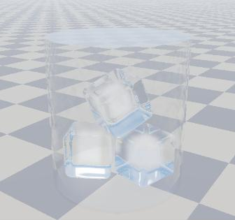
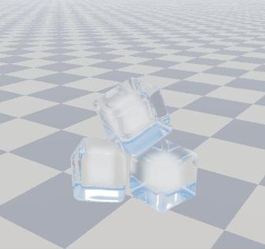

# 06. コップの氷

氷 3 つとコップ 1 つを、 **部品 1 つ = 形 1 つ** で描くサンプル。 氷を 3 つ出すなら部品を 3 つ置くだけで、 シェーダー ([`shaders/GlassIce.hlsl`](shaders/GlassIce.hlsl)) は形 1 つ分しか知らない。
コップも同じシェーダーの形の 1 つ (円柱を殻にした SDF) で、 同じ部品で描く。

| 氷 3 つ + コップ | 氷だけ |
| --- | --- |
|  |  |

(同じシェーダーを WebGL2 で動かした絵。 共通のカメラに収まるよう、 場面は本物の 8 倍くらいの大きさにしてある)

## 目次

1. [ファイルと描く流れ](#1-ファイルと描く流れ)
2. [氷に見えるために要る物](#2-氷に見えるために要る物)
3. [ノイズ (hash / noise)](#3-ノイズ-hash--noise)
4. [形 (SDF)](#4-形-sdf)
5. [法線 (calcNormal)](#5-法線-calcnormal)
6. [外から表面を探す (rayMarch)](#6-外から表面を探す-raymarch)
7. [表面: フレネルと反射](#7-表面-フレネルと反射)
8. [屈折: スネルの法則](#8-屈折-スネルの法則)
9. [中を進む (rayMarchInside): ランベルト・ベールの法則と白い芯](#9-中を進む-raymarchinside-ランベルトベールの法則と白い芯)
10. [出口: 全反射と後ろの面](#10-出口-全反射と後ろの面)
11. [景色と、 コップの重ね方](#11-景色とコップの重ね方)
12. [部品の箱・空間・深度](#12-部品の箱空間深度)
13. [参考文献](#13-参考文献)
14. [全部の部品の出典と、 自分で決めた所](#14-全部の部品の出典と自分で決めた所)

---

## 1. ファイルと描く流れ

| ファイル | 中身 |
| --- | --- |
| [`shaders/GlassIce.hlsl`](shaders/GlassIce.hlsl) | 形 1 つを描くシェーダー。 関数はノイズ・SDF・法線・フレネル・レイマーチング。 描く流れは `PSMain` |
| [`SdfObject.h`](SdfObject.h) / [`.cpp`](SdfObject.cpp) | 部品 (RenderEntity)。 形を囲む箱を描く。 位置・回転・屈折率・吸収・白い芯をセッターで決める |
| [`GlassIceSample.h`](GlassIceSample.h) / [`.cpp`](GlassIceSample.cpp) | 氷 3 つとコップ 1 つを置くだけ (自分は描かない) |

ピクセルシェーダーの引数は `v` で、 `v.Pos` (画面の位置)・`v.LPos` (部品の空間の位置)・`v.WPos` (ワールドの位置)・`v.UV` が取れる。 カメラの位置は `cameraPos`。

`PSMain` の流れ:

```
PSMain(v)
├─ 光線を部品の空間で作る (cameraPos → v.LPos)
├─ 1. rayMarch: 外から表面を探す。 当たらなければ discard。 当たった点の深度を出す
└─ for 同じ形に入る (2 回まで: コップの手前の壁 → 奥の壁)
    ├─ 2. 表面: 映り込み (フレネル) を足し、 屈折 (スネル) して中へ
    ├─ for 出口 (4 回まで: 全反射で跳ね返る)
    │   ├─ 3. rayMarchInside: 中を出口まで (吸収・白い芯)
    │   └─ 4. 出口: 屈折して外へ / 全反射して 3 へ。 後ろの面の映り込み
    └─ 5. 外へ出た光が、 同じ形にまた当たるか (rayMarch)
6. 景色: 氷は出た向きの空と床。 コップは後ろに描いた物に重ねる
```

描く順は **背景 → 氷 3 つ → コップ**。 コップは後ろに描いてある物 (氷・床) に半透明で重ねるので最後。

## 2. 氷に見えるために要る物

効く順:

1. **屈折** (入るときと出るときの 2 回)。 背景がずれて見える。 無いと 「何も無い」 か 「色の付いた透明な箱」 に見える。
2. **全反射**。 中から浅い角度で出ようとした光は外へ出られず、 中で跳ね返る。 面ごとのまだらや、 縁が銀色に光るのはこれ。
3. **色を付けすぎない**。 氷が青く見えるのは厚さが数 m あるとき。 コップの氷は光の通る長さが数 cm なので、 ほぼ無色。 吸収が強いと氷塊に見える。
4. **映り込み (フレネル)**。 縁ほど白く映り込む。 景色の太陽が映ると、 鋭いハイライトになる (ハイライトの計算は別に要らない)。
5. **形**: 小さく、 角が丸く (溶けかけ)、 いくつか傾けて重ねる。 でこぼこはゆるく小さく (細かいと霜に見える)。
6. **中身**: 冷凍庫の氷なら白い芯。 お店の氷なら芯は無く、 ほぼ透明。
7. **影と周り**: コップ、 背景の模様 (透けて歪む物が無いと、 屈折しても分からない)、 影 (このサンプルでは入れていない。 [§11](#11-景色とコップの重ね方))。

## 3. ノイズ (hash / noise)

氷の表面を、 溶けかけのようにゆるく波打たせるのに使う。

### hash: 点 → でたらめな値

```hlsl
float hash(float3 p)
{
    return frac(sin(dot(p, float3(127.1, 311.7, 74.7))) * 43758.5453);
}
```

1. `dot(p, (127.1, 311.7, 74.7))`: 3 つの成分を、 ばらばらの重みで 1 つの数にまとめる。
2. `sin(…)`: −1〜1 の値にする。 となりの点 (整数で 1 違う点) でも、 sin の中身が大きく違うので、 値は関係なくばらばらになる。
3. `× 43758.5453` して `frac` (小数の部分だけ取る): 大きく引き伸ばして小数の部分だけを見ると、 少しの違いが 0〜1 の中の大きな違いになる。

これは 「本当の乱数」 ではなく、 **同じ点からはいつも同じ値が出る、 でたらめに見える関数** (ハッシュ)。 シェーダーでは前の結果を覚えておけないので、 位置から直接値を作る。 The Book of Shaders 第 10 章 (日本語) に、 同じ考え方の 2D 版がコードつきで説明されている。

> 注意: sin の精度は GPU によって少し違うので、 同じ点でも GPU が違うと値が変わることがある。 見た目のゆらぎに使う分には問題ない。

### noise: 値ノイズ

```hlsl
float3 i = floor(p);                 // マスの角 (整数の点)
float3 f = p - i;                    // マスの中の位置 (0〜1)
float3 u = f * f * (3.0 - 2.0 * f);  // エルミート補間
// 三線形補間: 角 8 つの hash を x → y → z の順に混ぜる
```

空間を 1 辺 1 の立方体のマスに分け、 **マスの角 8 つに hash で値を置き、 その間をなめらかに混ぜる**。 hash だけだとざらざら (隣の点と関係ない) だが、 混ぜるとゆっくり変わる値になる。

- **エルミート補間** $u = 3f^2 - 2f^3$: $f$ をそのまま使う (直線で混ぜる) と、 マスの境目で傾きが急に変わって筋が見える。 この曲線は $f = 0$ と $f = 1$ で傾きが 0 なので、 境目がなめらかにつながる。 `smoothstep(0, 1, f)` と同じ曲線。
- **三線形補間**: x の向きに 2 つずつ混ぜて 4 つ → y の向きに混ぜて 2 つ → z の向きに混ぜて 1 つ。 3D テクスチャを線形補間で読むのと同じ混ぜ方。
- 最後に `× 2 − 1` で −1〜1 にする。

使い方: `ICE_BUMP * noise(p * 8.0)`。 `p * 8` はマスの大きさを 1/8 にする (= でこぼこの間隔が 12.5 cm)。 `ICE_BUMP` (5 mm) がでこぼこの大きさ。 間隔を細かく・大きさを大きくすると、 霜や雪のように見える。

## 4. 形 (SDF)

SDF は 「点 p から形の表面までの、 符号付きの距離」。 外が正、 表面が 0、 中が負。 `sdf(p)` が部品の形を返す (`shape` で氷とコップを選ぶ)。

### 角の丸い箱 (氷)

```hlsl
float3 q = abs(p) - (b - r);
return length(max(q, 0.0)) + min(max(q.x, max(q.y, q.z)), 0.0) - r;
```

1. `abs(p)`: 箱は x・y・z について対称なので、 +x+y+z の 1/8 だけ考えればよい。
2. `q = abs(p) − (b − r)`: 丸みの分 (r) だけ小さくした箱の、 各軸の面からどれだけ外へ出ているか (負なら中)。
3. 外: 出ている成分だけの長さ `length(max(q, 0))`。 1 つの軸だけ出ていれば面まで、 2 つなら辺まで、 3 つなら角までの距離。
4. 中: いちばん近い面までの距離 = `q` のいちばん大きい成分 (負)。 外では 0 にするため `min(…, 0)`。
5. `− r`: 表面を r だけ外へふくらませる。 小さくした箱の角から r の距離の所が表面になるので、 角が半径 r で丸くなる。

### 円柱と、 殻 (onion) と、 共通部分 (コップ)

```hlsl
float2 d = abs(float2(length(p.xz), p.y)) - float2(r, h);   // 円柱
return min(max(d.x, d.y), 0.0) + length(max(d, 0.0));

float shell = abs(sdCappedCylinder(p, CUP_R, CUP_H)) - CUP_T;  // 殻 (onion)
return max(shell, p.y - (CUP_H - CUP_T));                        // 上を切る (共通部分)
```

- **円柱**: 中心軸からの横の距離 `length(p.xz)` と縦の位置 `p.y` を 2 次元の点と見て、 「2 次元の箱」 の距離を測る (箱の式の 2 次元版)。
- **殻 (onion)**: `|d| − t`。 距離の絶対値を取ると、 中も外も 「表面からの距離」 になる。 そこから厚さの半分 t を引くと、 表面を中心に厚さ 2t の殻になる。 円柱が中身の詰まった物から、 壁と底だけの物になる。
- **共通部分**: `max(a, b)` は 「a の中 かつ b の中」 (どちらの距離も負の所だけが負)。 `p.y − (CUP_H − CUP_T)` は 「その高さより下」 を表す SDF なので、 殻の上のふたを切り落として口を開ける。

壁の厚さは 1.2 cm (2 × `CUP_T`)、 底の厚さも 1.2 cm。

## 5. 法線 (calcNormal)

$$\mathbf{n} = \frac{\nabla \phi}{\lVert \nabla \phi \rVert}, \qquad \frac{\partial \phi}{\partial x} \approx \frac{\phi(\mathbf{p} + h\mathbf{e}_x) - \phi(\mathbf{p} - h\mathbf{e}_x)}{2h}$$

```hlsl
const float2 e = float2(0.0005, 0.0);
return normalize(float3(sdf(p + e.xyy) - sdf(p - e.xyy),
                        sdf(p + e.yxy) - sdf(p - e.yxy),
                        sdf(p + e.yyx) - sdf(p - e.yyx)));
```

SDF は表面から離れる向きにいちばん速く増える。 その向き (**勾配**) が外向きの法線。 各軸で少し前と少し後ろの値の差を取る (**中心差分**)。 `2h` で割るのは、 `normalize` で長さをそろえるので省いている。 `e.xyy` は `(h, 0, 0)`、 `e.yxy` は `(0, h, 0)` (スウィズルで書いている)。

h はコップの壁 (1.2 cm) よりずっと小さくする (0.5 mm)。 大きいと、 壁の向こう側の面まで混ざって法線がずれる。

## 6. 外から表面を探す (rayMarch)

**球追跡** (sphere tracing)。 SDF の値 $\phi$ は 「いちばん近い表面までの距離」 なので、 点 p を中心に半径 $\phi$ の球の中には表面が無い。 だから光線の向きがどちらでも、 $\phi$ だけ進むのは安全。

```hlsl
for (int i = 0; i < 128; ++i) {
    float d = sdf(ro + rd * t);
    if (d < 0.0002) return true;  // 表面まで 0.2 mm 未満なら当たり
    t += d * 0.9;                 // 0.9 倍で控えめに進む
    if (t > tMax) break;          // 箱の裏面まで来た = 当たらない
}
```

- 何も無い所は大股、 表面の近くは小股で、 歩幅が勝手に決まる。
- **0.9 倍**: ノイズを足した SDF は本当の距離より少し大きいことがあり、 そのまま進むと表面を越えることがある。 控えめに進んで越えないようにする。
- `tMax` は、 カメラから箱の裏面の点 (`v.LPos`) までの距離。 そこまで進んで当たらなければ、 この画素に形は無い (`discard`)。
- `[loop]` は、 コンパイラにループを展開せずループのまま残させる指定 (回数が多く途中で抜けるため)。

## 7. 表面: フレネルと反射

### フレネル (Schlick の近似)

$$F(\theta) = F_0 + (1 - F_0)(1 - \cos\theta)^5, \qquad F_0 = \left(\frac{n - 1}{n + 1}\right)^2$$

```hlsl
float f0 = pow((ior - 1.0) / (ior + 1.0), 2.0);
return f0 + (1.0 - f0) * pow(1.0 - saturate(cosTheta), 5.0);
```

光が表面に当たると、 一部は反射 (映り込み) し、 残りが中へ入る。 反射する割合 F は角度で変わり、 **正面ではわずか、 浅い角度 (縁) ほど 1 に近づく**。 窓ガラスを斜めから見ると景色が映るのと同じ。

- 正確な式 (フレネルの式) は少し長いので、 Schlick の近似を使う。 $\cos\theta$ は光線と法線のなす角の cos (`dot(-rd, n)`)。
- $F_0$ は正面の反射率。 氷 (n = 1.31): $(0.31 / 2.31)^2 \approx 0.018$ (1.8%)。 ガラス (n = 1.5): $0.04$ (4%)。
- 使い方: 映り込みの色 × F を足し (`col += thr * F * 景色`)、 残りの割合 (1 − F) を中へ持っていく (`thr *= 1 − F`)。

### 反射の向き

$$\mathbf{r} = \mathbf{d} - 2(\mathbf{d}\cdot\mathbf{n})\,\mathbf{n}$$

HLSL の `reflect(d, n)`。 入ってきた向き d の、 法線方向の成分だけを反対にする (鏡で跳ね返る)。 その向きの景色が映り込みの色。

## 8. 屈折: スネルの法則

$$n_1 \sin\theta_1 = n_2 \sin\theta_2$$

光は屈折率の違う物の境目で曲がる。 屈折率は空気 1.0、 氷 1.31、 ガラス 1.5。

```hlsl
rd = refract(rd, n, 1.0 / ior);        // 空気 → 中 (比 n1 / n2 = 1 / 1.31)
float3 outDir = refract(rd, -n, ior);  // 中 → 空気 (比 1.31 / 1)。 法線は光線と向かい合うよう −n
```

- HLSL の `refract(入る向き, 法線, 屈折率の比 n1 / n2)` が曲がった向きを返す。 法線は、 光線が来た側を向いている必要がある。 出口では光線は中から外へ進むので、 外向きの法線 n を反転して `-n` を渡す。
- **入るとき** (空気 → 氷) は法線に近づく向きに曲がり、 **出るとき** は法線から離れる向きに曲がる。 この 2 回の曲がりで、 向こうの景色がずれて見える (歪み)。
- 曲がった向きで景色を読むのが大事。 カメラの向きのまま読むと、 屈折していない (正面が透明なだけ) に見える。

### 歪みの仕組み

「歪み」 は、 屈折で曲がった向きの景色が見えること。 このシェーダーでは、 どこにも 「ずらす量」 は書いていない。 次の 3 つが重なって、 歪みが勝手に出る。

1. **入口の面の向き**: 面が傾いているほど大きく曲がる。 平らな面の真ん中はほぼ平行にずれるだけ、 丸い角では曲がり方が場所ごとに変わるので、 景色が大きく引き伸ばされる。
2. **中を通る長さ**: 曲がったまま進むので、 厚い所ほど出口の位置が大きくずれる。
3. **出口の面の向き**: もう一度曲がる。 入口と出口の面が平行なら、 向きは元に戻って位置だけずれる (窓ガラスと同じ)。 平行でない (氷の角・傾いた面) と向きも変わり、 景色が大きく動く (プリズムと同じ)。

表面のでこぼこ (ノイズ) は面の向きを場所ごとに少しずつ変えるので、 景色がゆらゆら波打って見える。 でこぼこを強くすると、 景色が細かくちぎれて、 霜や曇りガラスのように見える。

## 9. 中を進む (rayMarchInside): ランベルト・ベールの法則と白い芯

```hlsl
float depth = -sdf(ro + rd * t);                          // 表面からの深さ
if (depth < 0.0002) break;                                 // 出口
float s = clamp(depth, 0.0002, 0.02);                      // 1 歩
float core = coreDensity * smoothstep(0.05, 0.11, depth);  // 白い芯の濃さ
float a = 1.0 - exp(-core * s);                            // この 1 歩で気泡に当たる割合
col += thr * a * float3(0.85, 0.9, 0.95);                  // 当たった光は白く散らばる
thr *= (1.0 - a) * exp(-absorption * s);                   // 透過率
t += s;
```

### 中での球追跡

中では SDF が負で、 **−SDF が 「いちばん近い表面までの距離」**。 外と同じ理屈で、 その分だけ進めば表面を越えない。 表面 (出口) に近づくと歩幅が小さくなり、 0.2 mm 未満で止まる。 1 歩を 2 cm までにするのは、 芯の濃さの変わり方を読み飛ばさないため。

### ランベルト・ベールの法則 (透過率)

$$T = e^{-\sigma L}$$

光が物の中を長さ $L$ 進むと、 吸収されずに残る割合 $T$ は $e^{-\sigma L}$ になる ($\sigma$ は 1 m あたりの吸収の強さ)。 1 歩ずつ `exp(−σ × s)` を掛けていけば、 全部で $e^{-\sigma L}$ になる。

- $\sigma$ を赤・緑・青で変えると色が付く。 赤を多く吸うと、 残る光は青っぽくなる (氷や水が青いのはこれ)。
- このサンプルの氷は $\sigma = (0.10, 0.04, 0.02)$ /m。 通る長さが数十 cm でも、 赤が 2〜3% 減るだけでほぼ無色。 **小さな氷を青くすると氷塊に見える** ので、 ここは弱くする。

### 白い芯 (冷凍庫の氷)

冷凍庫の氷は外側から凍り、 溶けていた空気が最後に凍る真ん中に細かい気泡として集まる。 だから表面から 5 cm より深い所 (`smoothstep(0.05, 0.11, depth)`) にだけ気泡を置く。

- 気泡に当たる割合も同じ法則: 1 歩で当たる割合 $a = 1 - e^{-\text{core} \times s}$。
- 当たった光は散らばり、 一部が目に届く。 本当は散らばる向きや、 その点に届く光を計算するが、 ここでは 「白い光が散らばる」 として足すだけにしている (一回散乱の簡単版)。
- 当たった分 $(1 - a)$ だけ、 奥からの光は減る。

散乱を全体に入れると、 霧のように白っぽくなる。 芯 (深い所) だけにするのが大事。

### 内部散乱の仕組み (本当の式と、 このサンプルの省略)

光が物の中 (気泡のある氷、 霧、 煙など) を進むとき、 起きることは 3 つある (PBR Book 「Volume Scattering Processes」)。

| 起きること | 意味 | 強さ (1 m あたり) | このサンプル |
| --- | --- | --- | --- |
| 吸収 | 光が熱になって消える | $\sigma_a$ | `absorption` |
| 外への散乱 | 気泡に当たって、 進む向きから外れる (目に届かなくなる) | $\sigma_s$ | `core` の `(1 − a)` |
| 中への散乱 | ほかの向きから来た光が気泡に当たって、 目の向きに曲がってくる | $\sigma_s$ × 届く光 × 散らばる向きの偏り | `col += thr * a * 白` |

光線に沿った明るさ $L$ の変化を書くと (放射伝達の式):

$$\frac{dL}{dt} = -(\sigma_a + \sigma_s)\,L + \sigma_s \int p(\omega, \omega')\,L_i(\omega')\,d\omega'$$

- 1 つ目の項が 「減る」 分 (吸収 + 外への散乱)。 これだけなら解は $L = L_0 e^{-(\sigma_a + \sigma_s) t}$ で、 ランベルト・ベールの法則そのもの。
- 2 つ目の項が 「増える」 分 (中への散乱)。 $p$ は散らばる向きの偏り (位相関数)、 $L_i$ はその点にいろいろな向きから届く光。

このサンプルは、 2 つ目の項を次のように省略している:

1. **散らばる向きの偏り $p$ を考えない** (どの向きにも同じだけ散らばる、 とする)。
2. **その点に届く光 $L_i$ を、 決まった白 (0.85, 0.9, 0.95) にする**。 本当は、 太陽からその点までの間の氷で減った光や、 周りの景色の光を集める。
3. **1 回だけ散らばる** (一回散乱)。 散らばった光がまた別の気泡に当たる分 (多重散乱) は入れない。

1 歩 $s$ の間に足す量は $T \times (1 - e^{-\sigma_s s}) \times L_i$ ($T$ はそこまでに残った割合 `thr`)。 $\sigma_s s$ が小さいときは $T \, \sigma_s \, s \, L_i$ とほぼ同じで、 上の式の 2 つ目の項を 1 歩分足したことになる。 $1 - e^{-x}$ の形にしているのは、 歩幅が大きくても 1 を超えないため。

もっと本物に近づけるなら、 2 の 「届く光」 を、 その点から太陽へもう一度レイマーチして減った分にする (サンプル 03 の影と同じ考え方)。 そのかわり重くなる。

### なぜ芯が白く濁るか

水には空気が溶けている。 凍るとき、 溶けていた空気は氷に入れず、 細かい泡になって出てくる。 外側に氷の層ができると、 泡は中に閉じ込められる (Wikipedia 「Ice cube」 の 「Clear and cloudy」)。 冷凍庫の氷は外側から凍るので、 泡は最後に凍る内側に集まり、 真ん中が白く濁る。 お店の透明な氷は、 水を流しながら下から凍らせて、 泡を逃がしている。

## 10. 出口: 全反射と後ろの面

### 全反射

出るときは $n_1 = 1.31 > n_2 = 1$ なので、 $\sin\theta_2 = 1.31 \sin\theta_1$ が 1 を超えると、 スネルの法則を満たす向きが無い。 このとき光は外へ出られず、 表面で全部跳ね返る (**全反射**)。

$$\theta_c = \arcsin\frac{1}{n} \qquad (\text{氷 } 49.8°、 \text{ ガラス } 41.8°)$$

```hlsl
float3 outDir = refract(rd, -n, ior);
if (dot(outDir, outDir) < 1e-6) {  // refract は全反射のとき (0, 0, 0) を返す
    rd = reflect(rd, n);           // 中で跳ね返って
    p -= n * EPS;
    continue;                      // また出口を探す
}
```

HLSL の `refract` は、 全反射の角度では (0, 0, 0) を返す (Microsoft の説明に書いてある)。 長さが 0 なら全反射と判断する。
臨界角が 49.8° と小さいので、 中から出ようとする光のかなりの部分が出られない。 これが氷やガラスがきらきら見える理由。 4 回跳ね返っても出られない光は、 今の向きの景色で近似して終わる。

### 後ろの面が見える理由

透明なので、 表の面の向こうに後ろの面 (出口) が見える。 3 で着く出口が、 その後ろの面そのもの。 後ろの面は色を塗らなくても、 次の 3 つで見える。

1. 後ろの面の向きで、 出口での曲がり方が変わる (面の境目で景色がずれて、 線に見える)
2. 全反射で、 後ろの面が鏡のように光る
3. 外へ出る光のうち F の割合は、 中へ跳ね返る。 それを跳ね返った向きの景色で近似して足す:

```hlsl
F = fresnelSchlick(dot(outDir, n));
col += thr * F * Environment(toWorld(p), toWorldDir(reflect(rd, n)));
thr *= 1.0 - F;
```

本当は跳ね返った光が中をもう一度進んで、 表の面から出ていく。 光を 2 本に分けると重くなるので、 近似にしている。 全反射の角度に近いほど F が 1 に近づくので、 斜めの後ろの面ほど強く光る。

### 同じ形にまた入る

外へ出た光が同じ形にまた当たることがある (コップの手前の壁を抜けて、 奥の壁に当たる)。 `rayMarch` をもう一度して、 当たれば 2 (表面) からくり返す (2 回まで)。 氷は凸 (へこみが無い) ので、 ほとんど 1 回で終わる。

## 11. 景色と、 コップの重ね方

### 氷: 出た向きの景色

```hlsl
col += thr * Environment(toWorld(p), toWorldDir(rd));
return float4(ToDisplay(col), 1.0);
```

最後に出た向きの景色 (空と床) に、 残った割合 `thr` を掛けて足す。 `Environment` と `ToDisplay` はエンジンの代わりの部分 ([`src/engine/shaders/Environment.hlsli`](../../src/engine/shaders/Environment.hlsli))。 自分のエンジンでは、 キューブマップか、 不透明な物を描いた画面のコピーを、 この向きで読む所になる。

部品 1 つは自分の形しか知らないので、 氷を通して隣の氷は見えない (景色だけが見える)。 数個が触れ合っているくらいなら、 見た目の差は小さい。

### コップ: 後ろに描いた物に重ねる

```hlsl
float a = 1.0 - (thr.r + thr.g + thr.b) / 3.0;  // 通らなかった割合
float3 reflection = col / max(a, 1e-4);         // 映り込みの平均の色
return float4(ToDisplay(reflection) * a, a);
```

コップの壁は薄いので、 通り抜けた光はほとんど曲がらない。 そこで、 通った光の景色は自分で計算せず、 **先に描いてある物 (氷・床) をそのまま使う**。 ブレンドは 「出した色 + 後ろの色 × (1 − α)」 (`SdfObject.cpp` の `options.blend`) なので、 出力は

$$\text{結果} = \text{映り込み} \times a + \text{後ろの色} \times (1 - a)$$

になる。 画面の色は表示用 (`ToDisplay` の後) なので、 映り込みを足すのではなく、 割合 $a$ で混ぜている (足すと明るくなりすぎる)。 だからコップは最後に描く。 氷は α = 1 なので、 同じブレンドでも上書きになる。

### 影

部品 1 つのシェーダーは、 自分の画素 (箱が映る所) にしか描けないので、 床に影を落とせない。 影はエンジンの影 (シャドウマップなど) に任せる。 氷の影は不透明な物より薄く、 本物は真ん中が明るく (光が集まる) 縁が暗い。

## 12. 部品の箱・空間・深度

### 形を囲む箱を描く

部品は形を囲む箱 (`SdfObject.cpp` の `makeBox`) を描き、 箱が映る画素でだけピクセルシェーダーが動く。 箱は **裏面** を描く (`D3D12_CULL_MODE_FRONT`)。 表面を描くと、 カメラが箱の中に入ったとき箱が消えてしまう。 箱の大きさ (`boundsHalf`) は形より少し大きくする (小さいと形の端が切れる)。

### 部品の空間

光線は部品の空間 (形の真ん中が原点、 回っていない) で追う。 そうすると SDF は位置も回転も持たない、 ただの形の式で済む。

```hlsl
float3 ro = mul(float4(cameraPos, 1.0), invWorld).xyz;  // カメラ → 部品の空間 (点: w = 1)
float3 rd = normalize(v.LPos - ro);                     // カメラ → この画素の箱の点
```

景色を読むときはワールドに戻す (`toWorld` は点 w = 1、 `toWorldDir` は向き w = 0。 向きは位置を動かさない)。
`world` は C++ で 「傾き (z 軸まわり) → 向き (y 軸まわり) → 位置」 の順に掛けた行列 (`SdfObject::worldMatrix`)。 行ベクトルの流儀 (`p × M`) なので、 左から順にかかる。 HLSL は行列を列優先で読むので、 転置して渡す (`ViewProj` と同じ)。

### 深度

```hlsl
float4 clip = mul(float4(toWorld(p), 1.0), ViewProj);
depth = clip.z / clip.w;  // SV_Depth
```

箱の面の深度のままだと、 重なった部品の前後が箱の大きさで決まってしまう。 **当たった点の深度** を出すと、 氷どうし・氷とコップの前後が正しくなる (深度は 0〜1 の、 透視の割り算の後の z)。

## 13. 参考文献

シェーダーの先頭にも書いてある。 どれも式と考え方を確かめるために読んだもので、 **コードは写していない** (自分で書いた)。 読むなら、 コードつきで説明しているものから。

| 内容 | 文献 | 読みやすさ | 利用条件 (2026-10-19 確認) |
| --- | --- | --- | --- |
| ランダム・値ノイズ | The Book of Shaders [第 10 章 ランダム](https://thebookofshaders.com/10/?lan=jp)・[第 11 章 ノイズ](https://thebookofshaders.com/11/?lan=jp) | 日本語。 コードを書き換えながら試せる | 著作権表示のみ (All rights reserved)。 読む・考え方を使うのは可、 文章やコードを写すのは不可 |
| SDF の形・onion・共通部分 | Inigo Quilez [distance functions](https://iquilezles.org/articles/distfunctions) | 英語。 形ごとにコードと図 | 記事のコード片は MIT (記事の一覧のページに記載)。 写すなら著作権表示と許諾文を同梱 |
| 法線 (中心差分) | Inigo Quilez [normals for an SDF](https://iquilezles.org/articles/normalsSDF) | 英語。 コードつき | 同上 |
| 球追跡 | Inigo Quilez [raymarching SDFs](https://iquilezles.org/articles/raymarchingdf)。 原典 J. C. Hart 1996 ([DOI](https://doi.org/10.1007/s003710050084)) | 記事は英語・コードつき。 原典は論文 | 記事は同上。 論文は出版社の著作権 |
| 反射と屈折の向き | LearnOpenGL [Cubemaps](https://learnopengl.com/Advanced-OpenGL/Cubemaps) の Reflection / Refraction | 英語。 `reflect` / `refract` を使うコードつき | コードは CC BY-NC 4.0 (About のページに記載)。 商用で写すのは不可、 読むのは可 |
| refract の決まり | Microsoft [refract](https://learn.microsoft.com/en-us/windows/win32/direct3dhlsl/dx-graphics-hlsl-refract) | 英語。 全反射で (0, 0, 0) を返すと書いてある | Microsoft の文書 |
| フレネル (Schlick) | LearnOpenGL [PBR Theory](https://learnopengl.com/PBR/Theory) の Fresnel equation。 原典 Schlick 1994 ([DOI](https://doi.org/10.1111/1467-8659.1330233)) | 英語。 式とコード | LearnOpenGL は同上。 論文は出版社の著作権 |
| スネル・全反射・透過率 | PBR Book 第 4 版 [Specular Reflection and Transmission](https://pbr-book.org/4ed/Reflection_Models/Specular_Reflection_and_Transmission)・[Transmittance](https://pbr-book.org/4ed/Volume_Scattering/Transmittance) | 英語。 式の導きが丁寧 | 本文 CC BY-NC-ND 4.0 ([docs/guide/references.md](../../docs/guide/references.md))。 本文中のコードは写さない |
| 内部散乱 (放射伝達の式) | PBR Book 第 4 版 [Volume Scattering Processes](https://pbr-book.org/4ed/Volume_Scattering/Volume_Scattering_Processes) | 英語。 吸収・外への散乱・中への散乱を順に説明 | 同上 |
| 冷凍庫の氷が濁る理由 | Wikipedia [Ice cube](https://en.wikipedia.org/wiki/Ice_cube) の Clear and cloudy | 英語。 短い | 本文 CC BY-SA 4.0 (Wikipedia の通常の条件)。 写すなら表示と同じ条件での公開が要る |
| 氷の屈折率 1.31 | Warren & Brandt 2008 ([DOI](https://doi.org/10.1029/2007JD009744)) | 論文 (値の出典) | 値は事実として使える |

ほかの文献と利用条件の詳しい確かめ方: [docs/guide/references.md](../../docs/guide/references.md)

## 14. 全部の部品の出典と、 自分で決めた所

シェーダーと C++ の部品を 1 つずつ、 「何をしているか」 と 「どこから来たか」 で並べた。 **出典がある物** は文献の考え方を自分で書いた物、 **このサンプルで決めた物** は文献に無い近似や、 見た目で選んだ値。 説明するときは、 この区別をそのまま言えばよい。

### シェーダー (GlassIce.hlsl)

| 部品 | 何をしているか | 出典 / 決めた理由 |
| --- | --- | --- |
| `hash` (sin のハッシュ) | 点 → 0〜1 のでたらめな値 | The Book of Shaders 第 10 章 (2D 版 `fract(sin(dot(st, vec2(12.9898, 78.233))) * 43758.5453)`)。 3D にするため重みを 3 つにした。 重みの値 (127.1, 311.7, 74.7) に意味は無く、 大きくて互いにそろわない数なら何でもよい |
| `noise` (値ノイズ) | 格子の角の値をなめらかに混ぜる | The Book of Shaders 第 11 章 (値ノイズ・エルミート補間)。 3D の三線形補間は、 2D の混ぜ方を z にもう 1 回した物 |
| `noise(p * 8) * 0.005` | 溶けかけのでこぼこ | **このサンプルで決めた値** (見た目で選んだ。 間隔 12.5 cm、 大きさ 5 mm。 場面は本物の約 8 倍) |
| `sdRoundBox` | 角の丸い箱の距離 | Inigo Quilez "distance functions" の Round Box |
| `sdCappedCylinder` | 円柱の距離 | 同 Capped Cylinder |
| `abs(d) − t` (onion) | 殻にする | 同 Onion |
| `max(a, b)` | 共通部分 (上を切る) | 同 Intersection |
| `calcNormal` (中心差分、 h = 0.5 mm) | 法線 | Inigo Quilez "normals for an SDF"。 h は **このサンプルで決めた値** (コップの壁 1.2 cm より十分小さく) |
| `fresnelSchlick` | 映り込む割合 | Schlick 1994 / LearnOpenGL "PBR Theory"。 $F_0 = ((n-1)/(n+1))^2$ は垂直に当たるときのフレネルの式 (PBR Book "Specular Reflection and Transmission") |
| `reflect` | 反射の向き | HLSL の組み込み関数。 式 $\mathbf{r} = \mathbf{d} - 2(\mathbf{d}\cdot\mathbf{n})\mathbf{n}$ (LearnOpenGL "Cubemaps") |
| `refract` と、 長さ 0 で全反射 | 屈折の向き / 全反射の判定 | HLSL の組み込み関数 (Microsoft の説明: 全反射で (0, 0, 0))。 スネルの法則 (PBR Book) |
| `rayMarch` (球追跡) | 外から表面を探す | Hart 1996 / Inigo Quilez "raymarching SDFs" |
| `× 0.9` (控えめに進む) | ノイズで距離が不正確な分の安全 | **このサンプルで決めた値**。 SDF にノイズを足すと 「本当の距離より大きい」 所ができるので、 歩幅を小さめにするのはよく使われるやり方 |
| `0.0002` (当たりの距離)、 `128` / `64` (歩数) | 止める条件 | **このサンプルで決めた値** (コップの壁 1.2 cm を通り抜けない細かさ、 形が欠けない歩数) |
| `rayMarchInside` (−SDF で進む) | 中から出口を探す | 球追跡を中に当てはめた物。 「中では −SDF が表面までの距離」 は、 SDF の定義 (中は負で、 大きさは表面までの距離) から言える |
| 1 歩を 2 cm まで (`clamp(…, 0.02)`) | 芯の濃さを読み飛ばさない | **このサンプルで決めた値** |
| `exp(−absorption × s)` | 吸収 (ランベルト・ベールの法則) | PBR Book "Transmittance" |
| `absorption = (0.10, 0.04, 0.02)` | 氷の吸収の強さ | **このサンプルで決めた値** (小さな氷がほぼ無色になる弱さ)。 本物の氷の吸収は Warren & Brandt 2008 に波長ごとの値がある。 赤が強く吸われる (だから厚い氷は青い) という向きは本物と同じ |
| `1 − exp(−core × s)` と `col += thr * a * 白` | 白い芯の散乱 | 放射伝達の式 (PBR Book "Volume Scattering Processes") を、 一回散乱・向きの偏り無し・届く光は決まった白、 と省略した物。 **省略の仕方はこのサンプルで決めた物** (§9) |
| 芯の位置 `smoothstep(0.05, 0.11, depth)`、 濃さ 15、 白 (0.85, 0.9, 0.95) | 芯の形と色 | 「冷凍庫の氷は泡が中に閉じ込められて濁る」 は Wikipedia "Ice cube" (Clear and cloudy)。 **深さ・濃さ・色の値は見た目で決めた** |
| 出口で中へ跳ね返る分を景色で足す | 後ろの面の映り込み | **このサンプルの近似**。 本当は跳ね返った光をもう一度追う (§10) |
| 全反射 4 回で打ち切り、 残りを景色で近似 | 重さを決めて止める | **このサンプルの近似** |
| `EPS = 0.001` (表面から少し離す) | 曲がった直後に、 同じ表面にまた当たらないように | レイトレーシングでよく使う決まった手 (自分自身に当たる誤差を避ける)。 値は **このサンプルで決めた** (コップの壁の厚さの半分 6 mm より小さく) |
| 同じ形にまた入る (2 回まで) | コップの手前の壁 → 奥の壁 | **このサンプルで決めた作り** |
| コップ: `lerp(後ろの色, 映り込み, a)` | 薄い物を後ろの絵に重ねる | **このサンプルの近似** (壁が薄いので曲がりを無視する)。 ブレンドの式は D3D12 のブレンドの設定 (§11) |
| `discard` | 形に当たらない画素を描かない | HLSL の命令 ([Microsoft](https://learn.microsoft.com/en-us/windows/win32/direct3dhlsl/discard--sm4---asm-)) |
| `SV_Depth` | 当たった点の深度を書く | HLSL のセマンティクス ([Microsoft](https://learn.microsoft.com/en-us/windows/win32/direct3dhlsl/dx-graphics-hlsl-semantics)) |
| `Environment` / `ToDisplay` | 景色 (空・床) / 表示用の色にする | このリポジトリのエンジンの代わり ([docs/02-environment.md](../../docs/02-environment.md))。 `ToDisplay` のトーンマップは Narkowicz 2016 の ACES の近似 ([記事](https://knarkowicz.wordpress.com/2016/01/06/aces-filmic-tone-mapping-curve/)、 記事のコードは CC0 または MIT) |

### C++ (SdfObject.cpp)

| 部品 | 何をしているか | 出典 / 決めた理由 |
| --- | --- | --- |
| `makeBox` (箱の 6 面) | 形を囲む箱。 外から見て反時計回り | このリポジトリの本体の `appendBox` ([`src/ice/IceGenerate.cpp`](../../src/ice/IceGenerate.cpp)) と同じ決まり (外から見て反時計回りが表) |
| `D3D12_CULL_MODE_FRONT` | 箱の裏面を描く (カメラが中に入っても消えない) | 本体の SDF の氷と同じ ([docs/05-generate-sdf.md](../../docs/05-generate-sdf.md) §5.1) |
| `rotationY` / `rotationZ` / `translation`、 掛ける順 | 部品の空間 → ワールド | 行ベクトル (`p × M`) の回転行列。 このリポジトリの `MathTypes.h` と同じ流儀 ([docs/04-camera-light.md](../../docs/04-camera-light.md)) |
| `transpose` して渡す | HLSL が列優先で読むため | `ViewProj` と同じ ([docs/04-camera-light.md](../../docs/04-camera-light.md)) |
| `inverse(world)` | ワールド → 部品の空間 (カメラの位置を直す) | 逆行列 (`MathTypes.h` の `inverse`) |
| ルート定数 44 個 | 部品ごとの値を b1 へ | ルートシグネチャは合わせて 64 DWORD まで (ルート定数 1 個 = 1、 定数バッファビュー = 2)。 44 + 2 = 46 で収まる ([Microsoft: Root Signature Limits](https://learn.microsoft.com/en-us/windows/win32/direct3d12/root-signature-limits)) |
| `options.blend` (ONE と INV_SRC_ALPHA) | 出した色 + 後ろの色 × (1 − α) | D3D12 のブレンドの設定 ([Microsoft: D3D12_RENDER_TARGET_BLEND_DESC](https://learn.microsoft.com/en-us/windows/win32/api/d3d12/ns-d3d12-d3d12_render_target_blend_desc)) |
| 描く順 (氷 → コップ) | 半透明は後ろの物を先に描く | 半透明の一般的な決まり (後ろの絵に重ねるので) |
| 形の大きさ・位置・屈折率 | 氷 3 つの置き方、 コップの大きさ | **このサンプルで決めた値**。 屈折率 1.31 は Warren & Brandt 2008、 ガラスの 1.5 はよく使う代表値 |
