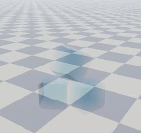
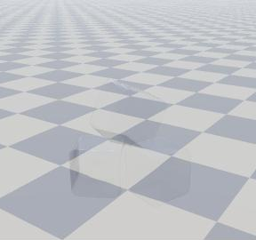
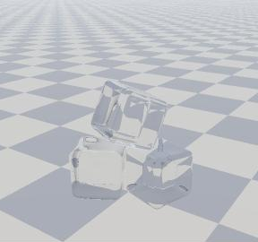
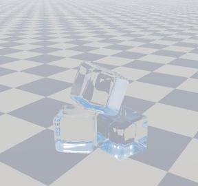
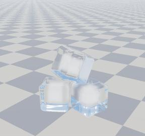
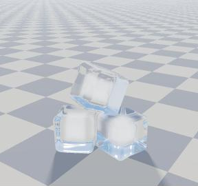
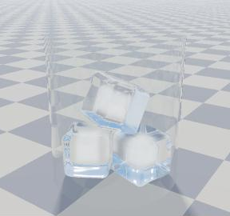

# 06. コップの氷 (短い版)

氷を 「氷塊」 ではなく **「コップに入れた氷」** に見せるには何が要るかを、 短いシェーダー 1 本 ([`shaders/GlassIce.hlsl`](shaders/GlassIce.hlsl)) で確かめるサンプル。 描き方はピクセルシェーダーの関数 1 つ (`PSMain`) に全部入っている。
1〜7 のキーで、 要素を 1 つずつ足して比べられる (前の段の物は全部入ったまま)。

| キー | 足す物 | 見た目 |
| --- | --- | --- |
| 1 | 強い吸収、 屈折なし | 青っぽい透明な箱。 **氷塊に近い見た目** |
| 2 | 吸収を弱く | ほぼ見えない (色が無くなり、 背景がそのまま透ける) |
| 3 | **屈折 (歪み)** | ここで急に氷に見える |
| 4 | **全反射と後ろの面の映り込み** | 面ごとに明るい所・暗い所ができ、 縁や後ろの面が銀色に光る |
| 5 | 白い芯 | 冷凍庫の氷 (真ん中が白く濁る) |
| 6 | 薄い影 | 床に置いてある感じ |
| 7 | コップ | 薄いガラスの映り込み |

| 1 強い吸収 | 2 吸収を弱く | 3 屈折 | 4 全反射と後ろの面 |
| --- | --- | --- | --- |
|  |  |  |  |

| 5 白い芯 | 6 薄い影 | 7 コップ |
| --- | --- | --- |
|  |  |  |

(同じシェーダーを WebGL2 で動かした絵。 共通のカメラに収まるよう、 場面は本物の 8 倍くらいの大きさにしてある)

## 影と歪み、 どちらが要るか

**歪み (屈折と全反射) が先**。 2 と 3 を比べると分かるとおり、 屈折が無いと何も無いように見え、 屈折を入れると影が無くても氷に見える。 影は最後の一押し (置いてある感じ) で、 無くても氷には見える。

効く順:

1. **屈折** (入るときと出るときの 2 回)。 背景がずれて、 角の所で大きく曲がる。
2. **全反射**。 中から浅い角度で出ようとした光は外へ出られず、 中で跳ね返る。 面ごとのまだらや、 縁が銀色に光るのはこれ。 氷らしさの大半は 1 と 2。
3. **色を付けすぎない**。 氷が青く見えるのは、 厚さが数 m あるとき。 コップの氷は光の通る長さが数 cm なので、 **ほぼ無色**。 青いと氷塊に見える。
4. **映り込み (Fresnel)**。 縁ほど白く映り込む。 背景の太陽が映ると、 鋭いハイライトになる (ハイライトの計算は別に要らない)。
5. **形**: 小さく、 角が丸く (溶けかけ)、 いくつか傾いて重なる。 表面のでこぼこはゆるく小さく (細かいと霜や雪に見える)。
6. **中身**: 冷凍庫の氷なら白い芯。 お店の氷なら芯は無く、 ほぼ透明。
7. **影と周り**: 薄い影、 コップ、 透けて歪む物 (背景に模様が無いと、 屈折しても分からない)。

## 今の見た目 (青い・正面が透明・端が白い) の理由

| 見た目 | 理由 | 直し方 |
| --- | --- | --- |
| 全体に青い | 吸収 (Beer–Lambert) の強さが、 大きな氷塊の値になっている | 吸収をずっと弱く (このサンプルでは 1/20 くらい)。 小さな氷はほぼ無色 |
| 正面は透明 | 屈折が無い (または弱い) と、 背景がずれずにそのまま見える | 入口と出口の両方で `refract` (屈折率 1.31) |
| 斜めだと中心が青く、 端が白い | 中心は光が通る長さが長いので吸収が強い。 端は Fresnel の映り込み | 端の白さは正しい。 中心の青さは吸収を弱くすれば消える |

中の散乱を全体に入れると、 霧のように白っぽくなる。 入れるなら芯 (表面から深い所) だけにする (段階 5)。

## シェーダーの形

関数に分けているのは **ノイズと SDF だけ** (`Hash` / `Noise` / `Cube` / `IceSdf` / `IceNormal`)。
描き方は全部 `PSMain` の中に、 上から順に書いてある。 `PSMain` を上から読めば、 流れが全部分かる。

```
PSMain
├─ for 氷 (3 回まで: 出た光が隣の氷にまた入る)
│   ├─ 1. 外から表面を探す (球追跡: SDF の値だけ進む)
│   ├─ 2. 表面: 映り込み (Fresnel) を足し、 残りは屈折して中へ
│   └─ for 出口 (4 回まで: 全反射で跳ね返る)
│       ├─ 3a. 中を進む (−SDF の値だけ進む。 吸収と白い芯)
│       └─ 3b. 出口 (後ろの面): 屈折して外へ / 全反射で中へ。 後ろの面の映り込み
├─ 4. 出た向きの景色 (床なら、 太陽へ氷をたどって薄い影)
└─ 5. コップ (薄いガラスの映り込み)
```

いちばん大事な所 (2〜3b。 段階の切り替えを除いた形):

```hlsl
// 2. 表面: 映り込みを足し、 残りは屈折して中へ
float F = F0 + (1.0 - F0) * pow(1.0 - saturate(dot(-rd, n)), 5.0);
col += thr * F * Environment(p, reflect(rd, n));
thr *= 1.0 - F;
rd = refract(rd, n, 1.0 / IOR);               // 空気 → 氷
p -= n * EPS;

for (int k = 0; k < 4; ++k) {
    // 3a. 中では −SDF が 「いちばん近い表面までの距離」。 その分進めば表面を越えない
    for (int j = 0; j < 64; ++j) {
        float depth = -IceSdf(p);
        if (depth < 0.0005) break;                // 出口 (後ろの面) に着いた
        float s = clamp(depth, 0.0005, 0.02);
        thr *= exp(-absorb * s);                  // 吸収 (白い芯もここで足す)
        p += rd * s;
    }
    // 3b. 出口: 氷 → 空気
    n = IceNormal(p);
    float3 outDir = refract(rd, -n, IOR);
    if (dot(outDir, outDir) < 1e-6) {             // 解が無い = 全反射
        rd = reflect(rd, n);
        p -= n * EPS;
        continue;                                 // 中で跳ね返って、 もう一度 3a
    }
    F = F0 + (1.0 - F0) * pow(1.0 - saturate(dot(outDir, n)), 5.0);
    col += thr * F * Environment(p, reflect(rd, n));  // 後ろの面の映り込み (中へ跳ね返る分の近似)
    thr *= 1.0 - F;
    rd = outDir;                                  // 残りは曲がって外へ
    p += n * EPS;
    break;
}
```

### 後ろの面が見える理由

透明なので、 表の面の向こうに後ろの面 (出口) が見える。 3a で着く出口が、 その後ろの面そのもの。 後ろの面は色を塗らなくても、 次の 3 つで見える。

1. 後ろの面の向きで、 出口での背景の曲がり方が変わる (面の境目で背景がずれて、 線に見える)
2. 全反射で、 後ろの面が鏡のように光る
3. 外へ出る光のうち F の割合は中へ跳ね返る。 これを跳ね返った向きの景色で足す (段階 4)。 全反射の角度に近いほど F が 1 に近づくので、 斜めの後ろの面ほど強く光る

## 式

| 何 | 式 | 値 |
| --- | --- | --- |
| 映り込み (Schlick) | $F = F_0 + (1 - F_0)(1 - \cos\theta)^5$ | $F_0 = \left(\frac{1.31 - 1}{1.31 + 1}\right)^2 \approx 0.018$ (正面で 2%) |
| 屈折 | `refract(rd, n, 1/1.31)` (入る)、 `refract(rd, -n, 1.31)` (出る) | 屈折率 1.31 |
| 全反射 | 出るときに $\sin\theta > 1/1.31$ なら解が無い | 臨界角 $\arcsin(1/1.31) \approx 49.8°$ |
| 吸収 | $T = e^{-\sigma L}$ ($L$ = 中を通った長さ) | 段階 1: $\sigma = (2.5, 0.9, 0.4)$、 段階 2〜: $(0.10, 0.04, 0.02)$ /m |

全反射の臨界角が 49.8° と小さいので、 中から出ようとする光のかなりの部分が出られない。 これが氷やガラスがきらきら見える理由。

## 水に入れたら

氷 (1.31) と水 (1.33) は屈折率がほぼ同じなので、 **水に沈んだ所はほとんど曲がらず、 見えにくくなる**。 飲み物の中の氷が見えるのは、 水面から出た所・白い芯・気泡やひびのおかげ。 水を入れるなら、 水の中の部分では屈折の式に入れる比を 1.33 / 1.31 (ほぼ 1) にし、 芯や気泡を目立たせる。

## 本体との違い

本体 ([`IceSdf.hlsl`](../../src/ice/shaders/IceSdf.hlsl)) は、 焼いた 3D テクスチャの SDF・箱のメッシュ・色付きの影など、 部品として使う物を全部入れている。
このサンプルは全画面のパス 1 つで、 形は式で書き、 影は 「薄い黒」 だけにして、 見た目に効く所だけを残した。 描き方は関数に分けず `PSMain` 1 つにまとめてある。

- 球追跡: [04_sdf_raymarch](../04_sdf_raymarch/README.md)
- 中を進んで足す: [03_raymarch](../03_raymarch/README.md)
- 反射・屈折・全反射の詳しい説明: [docs/06-ice-optics.md](../../docs/06-ice-optics.md)
